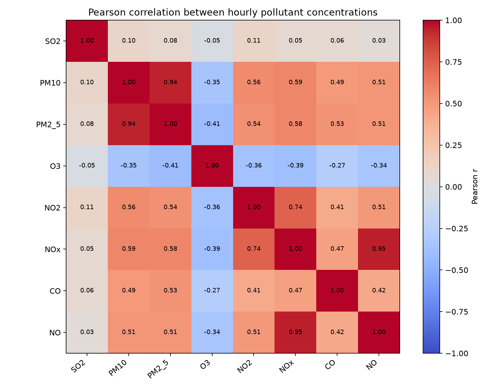
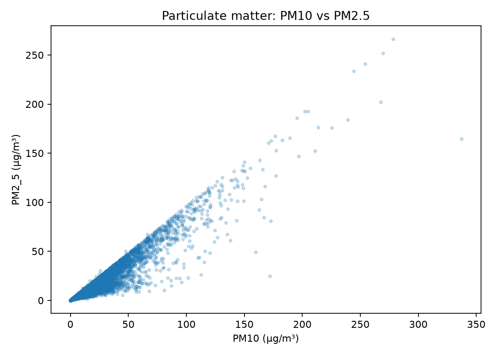
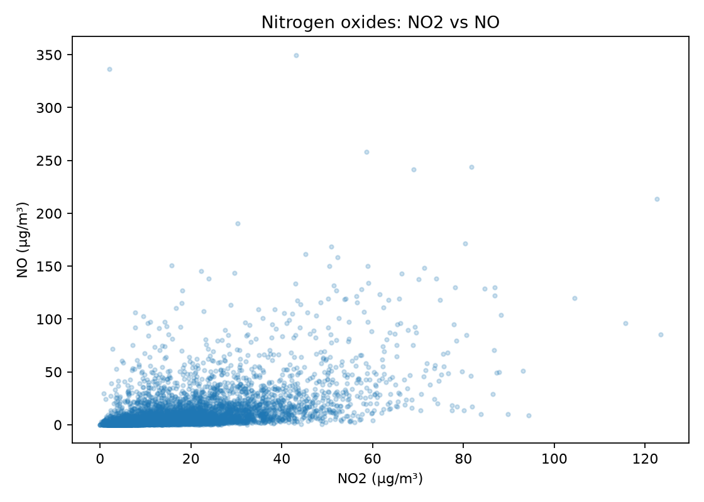

# Phase II: Exploratory data analysis

Input: `data\gold\sample_10pct.parquet`; 60,291 rows × 12 columns.

The input is the Phase I p4 stratified sample. Concentration summaries use measured/imputed pollutant columns as supplied by p4; station and season are categorical, while timestamp/key columns are not treated as measurements. The script does not alter the input.

## Summary statistics

`tables/summary_by_pollutant.csv` includes count, null count, mean, median, sample standard deviation and variance, min/max, quartiles and 5th/95th percentiles. CO is reported in mg/m³; other pollutants in µg/m³.

## Multivariate analysis

Pearson correlations are pairwise complete; the pair table records the available pair count. The plots show PM10 vs PM2.5 and NO2 vs NO; scatter points are capped deterministically at 8,000 for readability, while correlation calculations use all complete pairs.

### Strongest absolute correlations

| Pollutant A | Pollutant B | Complete pairs | Pearson r |
|---|---|---:|---:|
| NOx | NO | 46,110 | 0.951 |
| PM10 | PM2_5 | 56,063 | 0.942 |
| NO2 | NOx | 45,973 | 0.742 |
| PM10 | NOx | 45,779 | 0.589 |
| PM2_5 | NOx | 45,786 | 0.583 |

