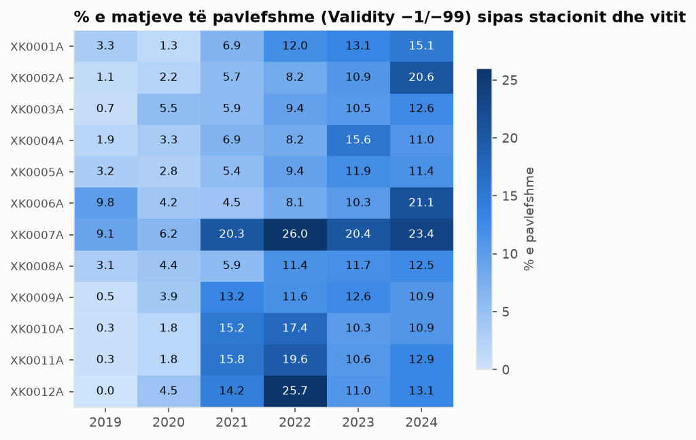
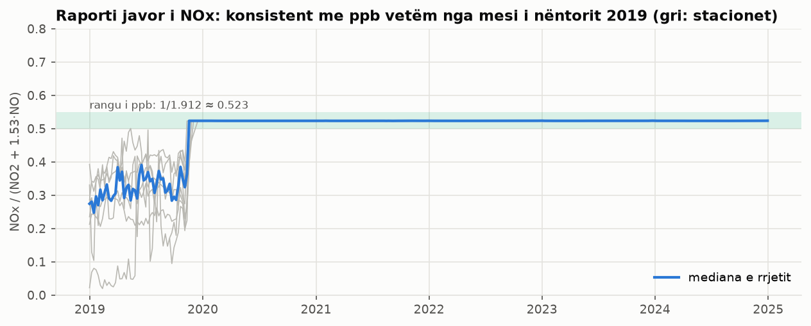
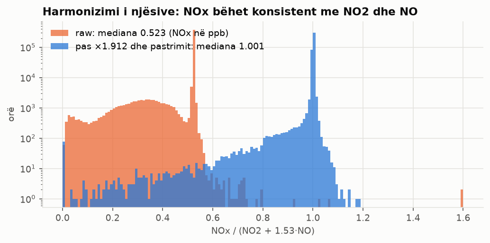
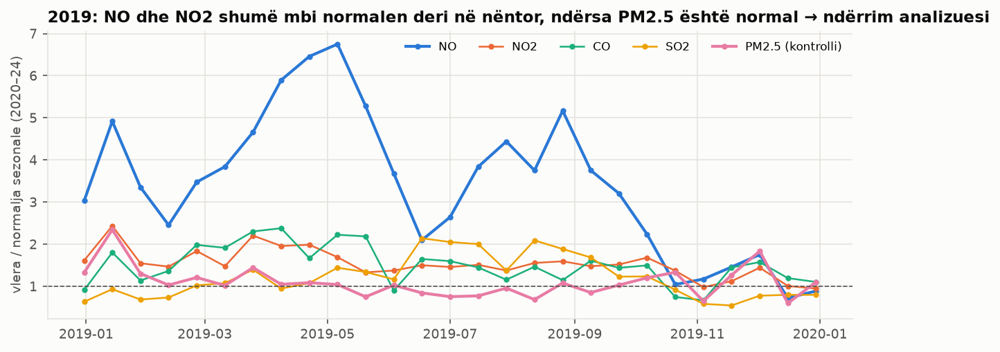
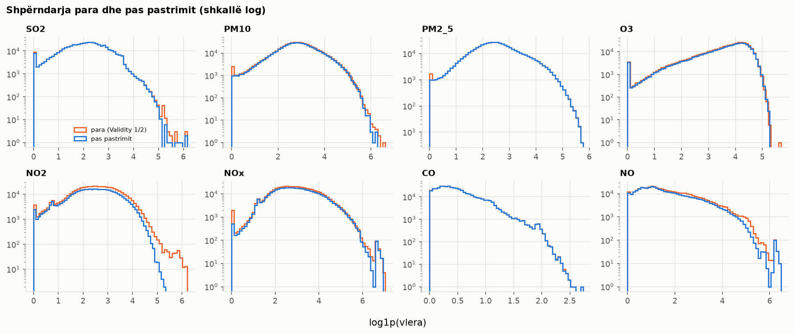

# Raporti i Fazës I: Para-procesimi i të dhënave të cilësisë së ajrit në Kosovë

**Dataseti:** EEA Air Quality, vendi XK, E1a (i verifikuar), matje orare, 2019-01-01 → 2024-12-30, 12 stacione,
8 ndotës, 4,261,594 rreshta. Licenca CC BY 4.0 (© European Environment Agency); matjet: rrjeti i IHMK-së.

## 1. Para-procesimi për përgatitjen e të dhënave për analizë
Të dhënat kalojnë nëpër katër shtresa: **raw** (origjinalet, read-only) → **bronze** (tipe të sakta, pa ndryshime)
→ **silver** (të integruara dhe të pastruara) → **gold** (rrjet orar me imputim, agregate, mostër, veti). Parimet:
asnjë rresht s'fshihet (vlera problematike bëhet null dhe arsyeja ruhet); mungesat strukturore ndahen nga ato reale;
"e vlefshme" sipas institucionit kontrollohet përsëri; outliers statistikë s'janë gabime; imputimi është transparent
(`value` dhe `value_imputed` + `impute_method`); gjithçka që mësohet nga të dhënat mësohet vetëm nga 2019–2023.
Çdo vendim, me arsyetim dhe evidencë, është te `decisions.md` (D01–D35, plus tabela e vlerave null me numrat realë).

**Lidhja e kërkesave të detyrës me skriptat, output-et dhe figurat:**

| Kërkesa | Skripta | Output / tabelat | Figurat |
|---|---|---|---|
| Para-procesimi për përgatitjen e të dhënave për analizë | të gjitha | data/bronze → silver → gold | lineage.csv, decisions.md |
| Mbledhja e të dhënave | p1 | data/bronze/ | – |
| Definimi i tipeve të dhënave | p1 | tables/p1_data_dictionary.csv | – |
| Kualiteti i të dhënave | p1 | tables/p1_kualiteti_*.csv | p1_pavlefshme_stacion_vit, p1_nox_raporti_javor |
| Integrimi | p2 | data/silver/stations.parquet, tables/p2_metadata_konfliktet.csv, p2_nox_* | p2_nox_raporti_para_pas, p2_nderrimi_analizuesve |
| Pastrimi | p2 | data/silver/measurements_clean/, tables/p2_clean_action_ndotes.csv | p2_histogramet_para_pas |
| Identifikimi dhe strategjia për vlerat e zbrazëta | p3 | data/gold/hourly_long/, tables/p3_* | p3_harta_mungesave, p3_mungesa_muaj_ore, p3_rmse_metodat, p3_metodat_imputimit |
| Agregimi | p4 | data/gold/daily, monthly, annual.parquet; tables/p4_* | p4_pm25_ditor_stacionet |
| Mostrimi | p4 | data/gold/sample_10pct.parquet, tables/p4_mostrimi_* | – |
| Zgjedhja e nënbashkësisë së vetive | p5 | tables/p5_kolonat_e_hequra.csv, p5_zgjedhja_vetive.csv | – |
| Krijimi i vetive | p5 | data/gold/features_hourly.parquet, tables/p5_vetite_e_reja.csv | – |
| Diskretizimi dhe binarizimi | p5 | tables/p5_kufijte_diskretizimit.csv, p5_eaqi_pm25, p5_tejkalimet | p5_diskretizimi_pm25 |
| Transformimi | p5 | tables/p5_anshmeria.csv | p5_transformimi |
| Reduktimi i dimensionit | p5 | tables/p5_pca_*.csv, p5_korrelacioni_spearman.csv | p5_korrelacioni, p5_pca_scree, p5_pca_biplot |

**Lineage** (nga 4,261,594 rreshta raw deri te tabelat gold):

| skripta | hapi | rreshta_para | rreshta_pas | null_para | null_pas |
|---|---|---|---|---|---|
| p1 | mbledhja: raw → bronze | 4261594 | 4261594 | 0 | 0 |
| p1 | metadata: Evropa → Kosova | 187994 | 222 | 0 | 0 |
| p2 | metadata: deduplikim | 222 | 12 | 0 | 0 |
| p2 | pastrimi: bronze → silver | 4261594 | 4261594 | 0 | 563695 |
| p3 | rrjeti orar + imputimi → gold | 4261594 | 4823304 | 940390 | 493799 |
| p4 | agregimi orar → ditor | 4638289 | 193292 | 940390 | 45488 |
| p4 | mostrimi i stratifikuar 10% | 602913 | 60291 | 0 | 0 |
| p5 | formati i gjerë + vetitë → gold | 602913 | 602913 | 0 | 0 |

**Koha e ekzekutimit:** 

| skripta | koha_s |
|---|---|
| p1_mbledhja_tipet_kualiteti | 13.9 |
| p2_pastrimi_integrimi | 19.6 |
| p3_mungesat_imputimi | 36.3 |
| p4_agregimi_mostrimi | 7.8 |
| p5_vetite_transformimi_reduktimi | 120.4 |

## 2. Mbledhja e të dhënave, definimi i tipeve, kualiteti i të dhënave

### 2.1 Mbledhja
93 skedarë Parquet (një për çdo stacion × ndotës) lexohen njëherësh me `pl.scan_parquet`. Verifikimet:
4,261,594 rreshta, 93 pika matjeje, 12
stacione; kodi i ndotësit në ID = kolona `Pollutant`; emri i skedarit = ID-ja e pikës. Metadata e EEA përmban
187,994 rreshta për gjithë Evropën; mbahen 222 rreshtat e Kosovës.
Madhësia: 74.3 MB raw → 65.1 MB bronze (Parquet zstd, i particionuar sipas ndotësit).
Koha e p1: 13.9 s.

### 2.2 Definimi i tipeve
`Value` vjen si Decimal(38,18) → Float64 (0 dështime). Nga `Samplingpoint` nxirren stacioni, ndotësi dhe
instrumenti. Koha raw është UTC+1 fikse pa orë verore → `ts_utc` (çelësi kohor) dhe `ts_local`
(Europe/Belgrade, me orë verore, për veçoritë ditore). Kolonat tekstuale → Categorical, ndotësi → Enum.
Tipi statistikor tregon çfarë veprimesh kanë kuptim (p.sh. mesatarja ka kuptim për `raport`, jo për `nominale`).

| kolona_raw | tipi_origjinal | kolona_e_re | tipi_i_ri | tipi_statistikor | pershkrimi | pct_bosh | shembull |
|---|---|---|---|---|---|---|---|
| Samplingpoint | String | station_id, pollutant, instrument | Categorical | nominale | ID-ja e pikës: stacioni_ndotësi_instrumenti | 0.0 | XK0001A |
| Pollutant | Int32 | pollutant_code | Int16 | nominale | kodi EEA i ndotësit | 0.0 | 1 |
| Start | Datetime(time_unit='ns', time_zone=None) | ts_utc, ts_local | Datetime(time_unit='ns', time_zone='UTC') | kohore | fillimi i orës (raw: UTC+1 fiks) | 0.0 | 2018-12-31 23:00:00+00:00 |
| End | Datetime(time_unit='ns', time_zone=None) | ts_end | Datetime(time_unit='ns', time_zone='UTC') | kohore | fundi i orës | 0.0 | 2019-01-01 00:00:00+00:00 |
| Value | Decimal(precision=38, scale=18) | value_raw | Float64 | raport | përqendrimi (zero e vërtetë, raportet kanë kuptim) — njësitë: SO2: µg/m³, PM10: µg/m³, PM2_5: µg/m³, O3: µg/m³, NO2: µg/m³, NOx: µg/m³, CO: mg/m³, NO: µg/m³ | 0.0 | 2.49122 |
| Unit | String | unit | Categorical | nominale | njësia e deklaruar | 0.0 | ug.m-3 |
| AggType | String | agg_type | Categorical | nominale | lloji i agregimit | 0.0 | hour |
| Validity | Int32 | validity | Int8 | nominale (kod) | 1 e vlefshme, 2 nën pragun e detektimit, -1 e pavlefshme, -99 mirëmbajtje | 0.0 | 1 |
| Verification | Int32 | verification | Int8 | nominale (kod) | statusi i verifikimit | 0.0 | 1 |
| ResultTime | Datetime(time_unit='ns', time_zone=None) | result_time | Datetime(time_unit='ns', time_zone=None) | kohore | koha e publikimit të rezultatit | 0.0 | 2020-10-14 10:31:54 |
| DataCapture | Decimal(precision=38, scale=18) | data_capture | Float64 | raport | përqindja e mbulimit | 100.0 | – |
| FkObservationLog | String | fk_observation_log | String | nominale (identifikues) | referencë administrative e EEA | 0.0 | 1383c4dc-cd6f-49cc-89ce-248fc95217d4 |

### 2.3 Kualiteti i të dhënave (asgjë s'është ndryshuar ende)
**Plotësia.** Null eksplicite në `Value`: 0. Por mungojnë
376,695 orë **pa rresht fare** brenda periudhës së serive
(mungesa implicite, nuk duken pa krijuar rrjetin orar te p3). `DataCapture` është 100% bosh.

| station_id | pollutant | rreshta | ore_te_pritura | ore_pa_rresht | pct_pa_rresht |
|---|---|---|---|---|---|
| XK0007A | SO2 | 36715 | 44732 | 8017 | 17.92 |
| XK0007A | NO2 | 36730 | 44732 | 8002 | 17.89 |
| XK0007A | CO | 36991 | 44732 | 7741 | 17.31 |
| XK0007A | PM2_5 | 37526 | 44006 | 6480 | 14.73 |
| XK0007A | PM10 | 37527 | 44006 | 6479 | 14.72 |
| XK0010A | O3 | 40425 | 45636 | 5211 | 11.42 |
| XK0009A | PM2_5 | 47007 | 52584 | 5577 | 10.61 |
| XK0009A | PM10 | 47015 | 52584 | 5569 | 10.59 |
| XK0012A | PM10 | 41002 | 45654 | 4652 | 10.19 |
| XK0012A | PM2_5 | 41075 | 45654 | 4579 | 10.03 |
| XK0012A | O3 | 41101 | 45654 | 4553 | 9.97 |
| XK0005A | O3 | 41037 | 45515 | 4478 | 9.84 |

*… 81 rreshta të tjerë te CSV.*

**Vlefshmëria** (% e rreshtave sipas Validity):

| pollutant | validity -1 | validity -99 | validity 1 | validity 2 |
|---|---|---|---|---|
| SO2 | 11.22 | 2.23 | 86.55 | 0.0 |
| PM10 | 3.81 | 0.0 | 96.03 | 0.16 |
| PM2_5 | 3.81 | 0.0 | 96.19 | 0.0 |
| O3 | 8.99 | 0.38 | 90.63 | 0.0 |
| NO2 | 10.41 | 0.89 | 88.7 | 0.0 |
| NOx | 9.65 | 0.44 | 89.91 | 0.0 |
| CO | 10.84 | 1.26 | 87.9 | 0.0 |
| NO | 10.85 | 1.64 | 87.51 | 0.0 |

Mesatarja e të pavlefshmeve sipas vitit: 2019: 2.8%, 2020: 3.5%, 2021: 10.0%, 2022: 13.9%, 2023: 12.4%, 2024: 14.6%. Trendi është rritës: nga 2.8% në 2019 në 14.6% në
2024 (viti më i keq: 2024). Stacioni më i keq (mesatarja e viteve):
XK0007A (17.6%).

**Saktësia.** Flamujt janë llogaritur, jo aplikuar (numri gjithsej):

| f_invalid | f_below_dl | f_sentinel | f_absurd | f_negative | f_stuck | f_stuck_zero | f_spike | f_pm25_gt_pm10 | f_pm_out_tol | f_outlier_stat |
|---|---|---|---|---|---|---|---|---|---|---|
| 404961 | 873 | 328829 | 5 | 13490 | 9187 | 8759 | 666 | 1848 | 274 | 61892 |

- **Sentinel −9900:** kod për "pa vlerë", jo matje; mesatarja raw e të gjitha vlerave është
  93,115, kurse mbi vlerat e përdorshme (raw) 17.40.
- **Negative me Validity 1/2** (në njësinë kanonike; pragu "e vogël → 0" është -2.0 µg/m³,
  -0.1 mg/m³ për CO):

| pollutant | n | min_kanonike | pragu_neg_zero | te_vogla_ne_0 | te_medha_null | pct_te_vogla |
|---|---|---|---|---|---|---|
| SO2 | 4421 | -20.23 | -2.0 | 3340 | 1081 | 75.5 |
| O3 | 560 | -11.24 | -2.0 | 423 | 137 | 75.5 |
| NO2 | 1529 | -28.81 | -2.0 | 1394 | 135 | 91.2 |
| NOx | 743 | -98.08 | -2.0 | 229 | 514 | 30.8 |
| CO | 1557 | -0.62 | -0.1 | 819 | 738 | 52.6 |
| NO | 4680 | -81.49 | -2.0 | 4173 | 507 | 89.2 |

  Te SO2, O3, NO2, CO, NO shumica janë negative të vogla afër zeros (zhurmë instrumenti → 0); te NOx shumica janë negative të mëdha (gabime → null). PM10 dhe PM2.5 s'kanë negative të vlefshme.
- **Sensor i ngecur** (≥ 6h e njëjta vlerë, vetëm mbi vlerat e vlefshme):

| pollutant | ore_te_ngecura | prej_tyre_zero |
|---|---|---|
| SO2 | 1477 | 1068 |
| PM10 | 1509 | 1509 |
| PM2_5 | 741 | 741 |
| O3 | 1463 | 1463 |
| NO2 | 456 | 456 |
| NOx | 442 | 442 |
| CO | 2700 | 2681 |
| NO | 399 | 399 |

  8,759 nga 9,187 orë të ngecura (95%) janë zero; më shumë te CO (2,700), PM10 (1,509), SO2 (1,477) → zerot e gjata vlerësohen sipas ndotësit te p2 (D13).
- **Maja të izoluara:** rritje > P99.9 e ndryshimeve orare dhe rënie menjëherë pas (`tables/p1_spike_thresholds.csv`).
- **Outliers statistikë** (IQR mbi log1p): 61,892. Janë informative, jo gabime.

**Konsistenca.**
- PM2.5 > PM10 në të njëjtën orë: 924 orë; jashtë tolerancës
  max(5.0 µg/m³, 10%): 137.
- Njësitë e deklaruara: 

| pollutant | njesia_e_deklaruar |
|---|---|
| SO2 | ug.m-3 |
| PM10 | ug.m-3 |
| PM2_5 | ug.m-3 |
| O3 | ug.m-3 |
| NO2 | ug.m-3 |
| NOx | ug.m-3 |
| CO | mg.m-3 |
| NO | ug.m-3 |

- **NOx.** Kimikisht NOx = NO2 + NO. Në µg/m³ si NO2: NOx ≈ NO2 + 1.53·NO, pra raporti duhet ≈ 1. Raporti
  del ≈ 0.5233 = 1/1.912 → **NOx është në ppb, edhe pse etiketohet µg/m³**.
  Por 8 stacion-vite (vitet: 2019) kanë mediana jashtë rangut të ppb:

| station_id | year | ore | mediana | pct_ne_rangun_ppb |
|---|---|---|---|---|
| XK0001A | 2019 | 6908 | 0.344 | 15.4 |
| XK0002A | 2019 | 5525 | 0.31 | 14.8 |
| XK0003A | 2019 | 8243 | 0.338 | 11.1 |
| XK0004A | 2019 | 7980 | 0.302 | 12.5 |
| XK0006A | 2019 | 4672 | 0.374 | 24.4 |
| XK0008A | 2019 | 7507 | 0.391 | 8.1 |
| XK0009A | 2019 | 7587 | 0.254 | 4.1 |
| XK0011A | 2019 | 2343 | 0.297 | 44.2 |

  Para mesit të nëntorit 2019 raporti s'është konstant (asnjë njësi e vetme s'i shpjegon vlerat). Trajtimi: D10 te p2.

**Unikaliteti.** 0 duplikate të çelësit (stacion, ndotës, orë).

**Kolonat pa informacion** (kandidate për heqje te p5):

| kolona | vlera_unike | pct_null | verdikti |
|---|---|---|---|
| data_capture | 1 | 100.0 | 100% bosh |
| agg_type | 1 | 0.0 | konstante |
| verification | 1 | 0.0 | konstante |
| fk_observation_log | 558 | 0.0 | identifikues administrativ, pa informacion për ndotjen |
| unit | 2 | 0.0 | e përcaktuar plotësisht nga ndotësi (CO mg/m³, të tjerët µg/m³): e tepërt |
| result_time | 6 | 0.0 | administrative: koha e publikimit, s'lidhet me matjen |
| ts_end |  | 0.0 | e tepërt: End = Start + 1h (përjashtime: 0) |

## 3. Integrimi dhe pastrimi

### 3.1 Integrimi i metadata-ve të stacioneve
Metadata e EEA ka 222 rreshta për 12 stacione, nga disa grupe regjistrimesh me vlera
kontradiktore:

| atributi | stacione_me_konflikt | shembull_XK0002A |
|---|---|---|
| station_name | 11 | ['AQMS Prishtine Rilindje', 'Prishtine-Build ex Rilindja', 'Prishtine2'] |
| national_code | 12 | ['KS0102', 'KS0102A'] |
| lat | 9 | [42.39347, 42.65964] |
| lon | 11 | [21.09264, 21.15732] |
| altitude_m | 5 | [583.0] |
| station_type | 7 | ['background', 'traffic'] |
| station_area | 1 | ['urban'] |

**Analiza e grupeve të regjistrimeve:**

| record_set | rreshta | stacione | tipet | komunat |
|---|---|---|---|---|
| 2017 | 1 | 1 | industrial |  |
| 2024 | 62 | 12 | background, industrial, traffic |  |
| 2024_komuna | 96 | 12 | background | AQMS Brezovica, AQMS Dardhishte, AQMS Obiliq, AQMS Peje, AQMS Prishtine - IHMK, AQMS Prishtine Rilindje, AQMS Prizren, Drenas-Municipality, Mitrovice, Podgorica |
| legacy | 63 | 12 | background, industrial, traffic |  |

Grupi `2024_komuna` (importi i 2025, me kolonën Municipality të plotësuar) u jep **"background" të gjitha stacioneve**,
edhe XK0002A (Prishtinë, Rilindja) që dy burimet e tjera e quajnë "traffic", dhe ka komunën **"Podgorica"** (kryeqyteti
i Malit të Zi) për tre stacione në Kosovë: janë shenja të një shablloni të paplotësuar. Megjithatë ky grup ka
koordinatat e sakta të Prishtinës, ndërsa grupet e tjera i vendosin dy stacionet e Prishtinës ~30 km në jug.
Pra **asnjë grup s'është i besueshëm për të gjitha atributet**, dhe rregulli "viti më i ri" s'funksionon (në 2024
ka dy grupe që kundërshtojnë njëri-tjetrin).

**Vendimi (D09), rregull i veçantë për çdo atribut:**
- **Koordinatat:** nga të gjithë kandidatët merret ai më afër qendrës së qytetit/fshatit të stacionit (gazeter në
  `config.yaml`, kontroll i pavarur gjeografik); largësia > 10 km ndalon pipeline-in.
- **Lartësia:** nga i njëjti rregjistrim si koordinatat (që të përshkruajnë të njëjtin vend); 0 m → null.
- **Tipi dhe zona:** shumica mes burimeve të besueshme (`legacy`, `2024`, `2017`), pa `2024_komuna`; në barazim
  fiton raportimi më i ri.
- **Emri dhe kodi kombëtar:** nga raportimi 2024; emrat pastrohen (thonjëza, hapësira, kode HTML:
  `Dardhisht&#235;` → Dardhishtë) dhe të gjitha variantet ruhen.

Kandidatët e koordinatave dhe largësia nga qyteti (`tables/p2_metadata_koordinatat_kandidate.csv`), p.sh. Prishtina:

| station_id | record_set | lat | lon | altitude_m | town | distance_km |
|---|---|---|---|---|---|---|
| XK0001A | 2024_komuna | 42.649 | 21.137 | 573.0 | Prishtinë | 2.8 |
| XK0001A | legacy | 42.386 | 21.081 | 573.0 | Prishtinë | 31.6 |
| XK0001A | 2024 | 42.386 | 21.081 |  | Prishtinë | 31.6 |
| XK0002A | 2024_komuna | 42.66 | 21.157 | 583.0 | Prishtinë | 0.8 |
| XK0002A | legacy | 42.393 | 21.093 | 583.0 | Prishtinë | 30.6 |
| XK0002A | 2024 | 42.393 | 21.093 |  | Prishtinë | 30.6 |

Rezultati, 12 stacione (çdo stacion brenda 2.8 km nga qyteti i vet):

| station_id | station_name | national_code | town | lat | lon | altitude_m | distance_km | coords_from | station_type | station_area |
|---|---|---|---|---|---|---|---|---|---|---|
| XK0001A | Prishtine1 | KS0101A | Prishtinë | 42.649 | 21.137 | 573.0 | 2.8 | 2024_komuna | background | suburban |
| XK0002A | Prishtine2 | KS0102A | Prishtinë | 42.66 | 21.157 | 583.0 | 0.8 | 2024_komuna | traffic | urban |
| XK0003A | Drenas | KS0103A | Drenas | 42.625 | 20.891 | 580.0 | 0.2 | 2024_komuna | industrial | urban |
| XK0004A | Mitrovice | KS0204 | Mitrovicë | 42.892 | 20.869 | 489.0 | 0.3 | 2024 | background | urban |
| XK0005A | Peje | KS0305 | Pejë | 42.666 | 20.305 | 509.0 | 1.5 | 2024 | background | urban |
| XK0006A | Prizren | KS0406 | Prizren | 42.22 | 20.728 | 479.0 | 1.2 | 2024 | background | urban |
| XK0007A | Brezovica | KS0507A | Brezovicë | 42.188 | 21.03 | 1803.0 | 1.6 | 2024_komuna | background | rural-remote |
| XK0008A | Hani i Elezit | KS0508 | Hani i Elezit | 42.154 | 21.296 | 399.0 | 0.6 | 2024 | industrial | suburban |
| XK0009A | Gjilan | KS0609 | Gjilan | 42.468 | 21.46 | 499.0 | 0.8 | 2024 | traffic | urban |
| XK0010A | Palaj | KS0110 | Palaj (Obiliq) | 42.678 | 21.053 | 509.0 | 0.3 | 2024 | industrial | suburban |
| XK0011A | Obiliq | KS0111 | Obiliq | 42.684 | 21.073 | 519.0 | 0.4 | 2024 | industrial | urban |
| XK0012A | Dardhishtë | KS0112 | Dardhishtë (Obiliq) | 42.66 | 21.083 | 529.0 | 0.3 | 2024 | industrial | suburban |

### 3.2 Harmonizimi i njësive (para pastrimit, që pragjet të aplikohen në njësinë e duhur)
Te p1 u vërtetua që NOx është në ppb (raporti ≈ 0.523 = 1/1.912). **Vendimi (D10):** NOx × 1.912 → µg/m³
(si NO2), kudo. CO mbetet në mg/m³ (praktikë standarde). Para mesit të nëntorit 2019 raporti s'përputhet me asnjë
njësi, prandaj NOx i asaj periudhe shënohet **jokonsistent** me dy burime evidence: (a) periudha: çdo orë para javës
nga e cila mediana javore e stacionit mbetet në rangun e ppb (`consistent_from`); (b) ora: pas konvertimit raporti
NOx/(NO2 + 1.53·NO) largohet nga 1 më shumë se 20%.

| station_id | consistent_from | last_bad |
|---|---|---|
| XK0001A | 2019-11-18 00:00:00+00:00 | 2019-11-11 00:00:00+00:00 |
| XK0002A | 2019-11-25 00:00:00+00:00 | 2019-11-11 00:00:00+00:00 |
| XK0003A | 2019-11-18 00:00:00+00:00 | 2019-11-11 00:00:00+00:00 |
| XK0004A | 2019-11-18 00:00:00+00:00 | 2019-11-11 00:00:00+00:00 |
| XK0005A | 2019-11-25 00:00:00+00:00 | 2019-11-11 00:00:00+00:00 |
| XK0006A | 2019-11-11 00:00:00+00:00 | 2019-11-04 00:00:00+00:00 |
| XK0008A | 2019-12-02 00:00:00+00:00 | 2019-11-11 00:00:00+00:00 |
| XK0009A | 2019-12-16 00:00:00+00:00 | 2019-11-11 00:00:00+00:00 |
| XK0010A | 2019-11-18 00:00:00+00:00 | 2019-11-11 00:00:00+00:00 |
| XK0011A | 2019-11-18 00:00:00+00:00 | 2019-11-11 00:00:00+00:00 |
| XK0012A | 2019-11-18 00:00:00+00:00 | 2019-11-11 00:00:00+00:00 |

Orë NOx të shënuara: 52,898 nga periudha + 2,440 vetëm nga rregulli orar.
**Verifikimi:** pas konvertimit dhe pastrimit, mediana e raportit për çdo stacion × vit është në 1 ± 5%
(66/66 stacion-vite; mediana e përgjithshme 1.0007).

### 3.2.1 Ndërrimi i analizuesve të gazeve në nëntor 2019 (D33)
Pyetja: a janë të sakta NO dhe NO2 të asaj periudhe (që do të përdoreshin për ta rillogaritur NOx)? Krahasohet niveli
i 2019 me normalen sezonale të të njëjtit stacion në të njëjtën javë të vitit (mediana 2020–2024); grimcat (PM2.5),
që vijnë nga të njëjtat burime djegieje por maten me instrumente të tjera, shërbejnë si kontroll:

| pollutant | para ndërrimit | pas ndërrimit |
|---|---|---|
| CO | 1.56 | 1.22 |
| NO | 3.61 | 1.15 |
| NO2 | 1.63 | 1.12 |
| NOx |  | 1.16 |
| O3 | 0.96 | 0.98 |
| PM10 | 1.05 | 1.06 |
| PM2_5 | 1.04 | 1.0 |
| SO2 | 1.26 | 0.66 |

Para nëntorit **NO është ~3.61× dhe NO2
~1.63× mbi normalen**, ndërsa PM2.5 dhe O3 janë
normale; kalimi te normalja ndodh brenda dy javësh në fund të tetorit / nëntor 2019, njëkohësisht me momentin kur
NOx bëhet konsistent. Një ndryshim i menjëhershëm, vetëm te gazet e analizuesit të NOx dhe jo te grimcat, s'është
ndryshim real i ndotjes por **ndërrim ose rikalibrim i analizuesit**.
**Vendimi:** NO dhe NO2 para `consistent_from` të stacionit → `null_calibration` (98,812 orë).
Pasojë: NOx i 2019 **nuk rillogaritet** nga NO2 + 1.53·NO, sepse do të trashëgonte të njëjtin gabim (rillogaritja
do të jepte mesatare 65 µg/m³ kundrejt 30 të NOx të matur pas ndërrimit). Kjo e korrigjon opsionin A të D10/D15, që supozonte NO dhe
NO2 të sakta.

**Kriteri pse NO/NO2 fshihen, por CO/SO2 jo:** një ndryshim niveli vetëm nuk provon gabim instrumenti, sepse ndotja
mund të ndryshojë realisht. Prandaj kërkohen dy evidenca të pavarura: (1) **provë fizike** që instrumenti s'punonte
saktë, dhe (2) ndryshim niveli në të njëjtin moment. NO dhe NO2 maten nga i njëjti analizues me NOx, dhe për këtë treshe
ka provë fizike (NOx ≠ NO2 + 1.53·NO para ndërrimit) plus ndryshim niveli. CO dhe SO2 kanë gjithashtu ndryshim niveli
(SO2 1.26× → 0.66×,
CO 1.56× → 1.22×),
por maten nga analizues të tjerë dhe s'kanë asnjë kontroll fizik; SO2 varet edhe nga puna e termocentraleve, që
ndryshon realisht. Fshirja e vlerave ndoshta të sakta do të ishte gabim tjetër, ndaj **mbahen** me flamurin
`f_gas_period_flag` (108,577 orë) dhe trajtohen si kufizim i dokumentuar: analizat e CO dhe SO2 mund
ta përjashtojnë këtë periudhë me anë të flamurit.

### 3.3 Pastrimi
Rregullat e tabelës së vendimeve aplikohen me rend; çdo vlerë merr vetëm arsyen e parë. **Asnjë rresht s'fshihet**:
vlera bëhet null, arsyeja ruhet te `clean_action` dhe origjinali te `value_raw`.

| clean_action | SO2 | PM10 | PM2_5 | O3 | NO2 | NOx | CO | NO | TOTAL |
|---|---|---|---|---|---|---|---|---|---|
| keep | 467556 | 531247 | 531393 | 449982 | 432467 | 404211 | 477023 | 393642 | 3687521 |
| zero_negative | 3340 | 0 | 0 | 423 | 1394 | 229 | 819 | 4173 | 10378 |
| null_invalid | 73420 | 21112 | 21061 | 46595 | 61764 | 51433 | 65881 | 63695 | 404961 |
| null_calibration | 0 | 0 | 0 | 0 | 50915 | 0 | 0 | 47897 | 98812 |
| null_negative | 1081 | 0 | 0 | 137 | 135 | 514 | 738 | 507 | 3112 |
| null_stuck | 409 | 1509 | 741 | 0 | 51 | 442 | 19 | 0 | 3171 |
| null_spike | 109 | 90 | 37 | 136 | 0 | 46 | 30 | 25 | 473 |
| null_inconsistent | 0 | 75 | 137 | 0 | 0 | 52954 | 0 | 0 | 53166 |

Çka **mbahet qëllimisht**: Validity 2 nën pragun e detektimit (873; heqja do ta anonte mesataren
lart, MNAR), zerot e gjata të besueshme për CO/O3/SO2/NO (5,252), PM2.5 > PM10 brenda
tolerancës (1,574 rreshta, pasiguri matjeje), outliers statistikë (61,892; episode
reale ndotjeje, trajtohen me transformim te p5).

**PM2.5 > PM10 jashtë tolerancës (D25):** 137 orë (0.02% e orëve PM2.5); bëhen null **të dyja** vlerat, sepse
s'ka bazë objektive për të ditur cili instrument gaboi, dhe çdo zgjedhje do të ishte hamendje. Humbja është e
papërfillshme dhe këto orë mbushen me interpolim te p3 nëse boshllëku është i shkurtër.

**Ndjeshmëria e politikës së negativeve (D12):** sa do të ndryshonte mesatarja nëse negativet e vogla do të bëheshin
null në vend të 0:

| pollutant | mesatarja_negative_ne_0 | mesatarja_negative_null | vlera_te_prekura | ndryshimi_pct |
|---|---|---|---|---|
| SO2 | 9.99 | 10.061 | 3340 | 0.71 |
| PM10 | 23.423 | 23.423 | 0 | 0.0 |
| PM2_5 | 16.904 | 16.904 | 0 | 0.0 |
| O3 | 45.96 | 46.003 | 423 | 0.09 |
| NO2 | 15.042 | 15.091 | 1394 | 0.32 |
| NOx | 29.534 | 29.551 | 229 | 0.06 |
| CO | 0.759 | 0.76 | 819 | 0.17 |
| NO | 9.301 | 9.399 | 4173 | 1.06 |

Heqja e tyre do ta rriste mesataren (deri 1.06% te NO), sepse heq pikërisht vlerat e vogla
(anim drejt vlerave të larta, si te MNAR). Politika "→ 0" e ruan pjesën e ulët të shpërndarjes.

**Kontrollet:** 0 vlera negative, 0 mbi kufirin fizik, rreshtat 4,261,594 → 4,261,594 (asnjë i humbur
nga bashkimi me stacionet), çdo null ka arsye. Koha e p2: 19.6 s.

**Statistikat para/pas** ("para" = vlerat me Validity 1/2 në njësinë kanonike, pa sentinel/absurde):

| pollutant | faza | n | mean | std | min | median | p99 | max |
|---|---|---|---|---|---|---|---|---|
| SO2 | pas | 470896 | 9.99 | 10.2 | 0.0 | 7.261 | 47.167 | 471.584 |
| SO2 | para | 472495 | 9.979 | 10.471 | -20.225 | 7.237 | 47.565 | 471.584 |
| PM10 | pas | 531247 | 23.423 | 24.752 | 0.0 | 16.011 | 125.85 | 531.207 |
| PM10 | para | 532921 | 23.4 | 24.974 | 0.0 | 15.97 | 126.264 | 746.734 |
| PM2_5 | pas | 531393 | 16.904 | 19.576 | 0.0 | 10.724 | 99.403 | 320.973 |
| PM2_5 | para | 532308 | 16.895 | 19.611 | 0.0 | 10.71 | 99.547 | 320.973 |
| O3 | pas | 450405 | 45.96 | 30.443 | 0.0 | 42.652 | 122.33 | 194.002 |
| O3 | para | 450678 | 45.971 | 30.489 | -11.238 | 42.652 | 122.621 | 298.434 |
| NO2 | pas | 433861 | 15.042 | 14.279 | 0.0 | 10.586 | 67.303 | 206.501 |
| NO2 | para | 484962 | 16.494 | 17.912 | -28.812 | 11.302 | 78.52 | 498.928 |
| NOx | pas | 404440 | 29.534 | 39.742 | 0.0 | 16.743 | 188.55 | 1025.146 |
| NOx | para | 458396 | 29.36 | 39.402 | -98.08 | 16.994 | 184.727 | 1142.229 |
| CO | pas | 477842 | 0.759 | 0.824 | 0.0 | 0.511 | 4.243 | 14.489 |
| CO | para | 478629 | 0.758 | 0.825 | -0.615 | 0.51 | 4.247 | 14.489 |
| NO | pas | 397815 | 9.301 | 20.487 | 0.0 | 2.84 | 93.4 | 655.721 |
| NO | para | 446244 | 10.774 | 23.958 | -81.488 | 3.264 | 120.02 | 655.721 |

## 4. Vlerat e zbrazëta: identifikimi dhe strategjia e trajtimit

### 4.1 Identifikimi
Krijohet rrjeti i plotë orar: çdo stacion × çdo ndotës × çdo orë mbi periudhën e stacionit (4,823,304 orë).
Kështu bëhen të dukshme orët që **mungojnë fare** (pa rresht), të cilat në të dhënat raw nuk shihen.
Çdo orë merr një `status`:

| pollutant | missing_row | not_measured | null_calibration | null_inconsistent | null_invalid | null_negative | null_spike | null_stuck | ok | outside_period |
|---|---|---|---|---|---|---|---|---|---|---|
| SO2 | 49929 | 0 | 0 | 0 | 73420 | 1081 | 109 | 409 | 470896 | 7069 |
| PM10 | 48154 | 0 | 0 | 75 | 21112 | 0 | 90 | 1509 | 531247 | 726 |
| PM2_5 | 48818 | 0 | 0 | 137 | 21061 | 0 | 37 | 741 | 531393 | 726 |
| O3 | 46886 | 44732 | 0 | 0 | 46595 | 137 | 136 | 0 | 450405 | 14022 |
| NO2 | 49118 | 0 | 50915 | 0 | 61764 | 135 | 0 | 51 | 433861 | 7069 |
| NOx | 41283 | 44732 | 0 | 52954 | 51433 | 514 | 46 | 442 | 404440 | 7069 |
| CO | 51334 | 0 | 0 | 0 | 65881 | 738 | 30 | 19 | 477842 | 7069 |
| NO | 41173 | 44732 | 47897 | 0 | 63695 | 507 | 25 | 0 | 397815 | 7069 |

**Mungesat strukturore** (vlera "nuk duhej të ekzistonte"): `not_measured` (134,196; p.sh.
XK0007A s'mat NO, NOx, O3) dhe `outside_period` (50,819; seria s'kishte nisur ose kishte
mbaruar). Nuk numërohen si mungesë dhe **nuk imputohen kurrë**.
**Mungesat reale:** 940,390 nga 4,638,289 orë të pritura (20.3%), prej tyre
376,695 pa rresht fare dhe pjesa tjetër null me arsye nga p2.

% e mungesës reale sipas stacionit dhe ndotësit:

| station_id | SO2 | PM10 | PM2_5 | O3 | NO2 | NOx | CO | NO |
|---|---|---|---|---|---|---|---|---|
| XK0001A | 17.7 | 10.8 | 10.8 | 19.8 | 28.3 | 30.4 | 15.2 | 30.2 |
| XK0002A | 15.6 | 9.5 | 9.5 | 14.2 | 28.5 | 28.8 | 16.0 | 30.8 |
| XK0003A | 19.6 | 9.9 | 9.9 | 14.0 | 26.3 | 27.0 | 12.2 | 30.4 |
| XK0004A | 12.1 | 9.1 | 9.2 | 13.1 | 29.0 | 29.8 | 16.8 | 32.7 |
| XK0005A | 19.6 | 12.8 | 12.7 | 16.9 | 16.9 | 17.7 | 17.5 | 16.9 |
| XK0006A | 15.4 | 10.2 | 10.2 | 15.5 | 30.2 | 31.0 | 17.2 | 30.7 |
| XK0007A | 43.1 | 18.9 | 18.9 |  | 41.0 |  | 39.4 |  |
| XK0008A | 20.3 | 11.0 | 11.0 | 15.0 | 29.0 | 29.7 | 19.6 | 30.0 |
| XK0009A | 24.6 | 14.7 | 14.7 | 14.7 | 29.8 | 30.9 | 20.9 | 35.8 |
| XK0010A | 23.3 | 8.4 | 8.3 | 23.8 | 18.8 | 19.4 | 20.2 | 19.3 |
| XK0011A | 22.0 | 12.9 | 12.9 | 21.4 | 21.3 | 21.8 | 21.2 | 21.3 |
| XK0012A | 22.0 | 14.3 | 14.2 | 22.9 | 26.0 | 23.2 | 24.9 | 23.9 |

### 4.2 Analiza e mungesave
Gjatësia e boshllëqeve (një boshllëk = orë të njëpasnjëshme pa vlerë):

| gjatesia | boshlleqe | ore | pct_boshlleqe | pct_ore |
|---|---|---|---|---|
| 1 orë | 206042 | 206042 | 79.3 | 21.9 |
| 2–3 orë | 30367 | 71024 | 11.7 | 7.6 |
| 4–24 orë | 19827 | 169511 | 7.6 | 18.0 |
| 1–7 ditë | 3102 | 177789 | 1.2 | 18.9 |
| > 7 ditë | 418 | 316024 | 0.2 | 33.6 |

79.3% e boshllëqeve janë 1 orë, por boshllëqet më të gjata se 1 ditë
(1.4% e boshllëqeve) mbajnë 52.5% të orëve që mungojnë.
Boshllëku më i gjatë për çdo ndotës:

| pollutant | station_id | fillimi | gap_len_h | dite |
|---|---|---|---|---|
| SO2 | XK0009A | 2019-11-13 | 837 | 34.9 |
| PM10 | XK0005A | 2019-08-22 | 1961 | 81.7 |
| PM2_5 | XK0005A | 2019-08-27 | 1842 | 76.8 |
| O3 | XK0001A | 2021-09-27 | 842 | 35.1 |
| NO2 | XK0009A | 2019-01-01 | 8440 | 351.7 |
| NOx | XK0009A | 2019-01-01 | 8440 | 351.7 |
| CO | XK0008A | 2023-09-03 | 948 | 39.5 |
| NO | XK0009A | 2019-01-01 | 8440 | 351.7 |

Te NO, NO2 dhe NOx boshllëqet më të gjata (deri 352 ditë) janë periudha e 2019 para ndërrimit të
analizuesit (D10, D33);
te ndotësit e tjerë boshllëku më i gjatë është
81.7 ditë
(ndërprerje e gjatë e stacionit).

% mungesë sipas vitit: 2019: 37.45%, 2020: 6.37%, 2021: 12.97%, 2022: 26.25%, 2023: 29.25%, 2024: 14.57%.

Korrelacioni i treguesve të mungesës (1 = mungojnë gjithmonë bashkë):

| ndotesi | SO2 | PM10 | PM2_5 | O3 | NO2 | NOx | CO | NO |
|---|---|---|---|---|---|---|---|---|
| SO2 | 1.0 | 0.61 | 0.61 | 0.66 | 0.46 | 0.43 | 0.64 | 0.42 |
| PM10 | 0.61 | 1.0 | 1.0 | 0.67 | 0.52 | 0.51 | 0.63 | 0.49 |
| PM2_5 | 0.61 | 1.0 | 1.0 | 0.66 | 0.52 | 0.51 | 0.63 | 0.5 |
| O3 | 0.66 | 0.67 | 0.66 | 1.0 | 0.5 | 0.49 | 0.68 | 0.48 |
| NO2 | 0.46 | 0.52 | 0.52 | 0.5 | 1.0 | 0.97 | 0.49 | 0.93 |
| NOx | 0.43 | 0.51 | 0.51 | 0.49 | 0.97 | 1.0 | 0.46 | 0.94 |
| CO | 0.64 | 0.63 | 0.63 | 0.68 | 0.49 | 0.46 | 1.0 | 0.45 |
| NO | 0.42 | 0.49 | 0.5 | 0.48 | 0.93 | 0.94 | 0.45 | 1.0 |

Testi chi-square dhe Cramér's V: 

| ndotesi | V_month | p_month | V_year | p_year | V_hour | p_hour |
|---|---|---|---|---|---|---|
| SO2 | 0.133 | 0e+00 | 0.235 | 0e+00 | 0.067 | 0e+00 |
| PM10 | 0.177 | 0e+00 | 0.238 | 0e+00 | 0.018 | 1e-28 |
| PM2_5 | 0.176 | 0e+00 | 0.239 | 0e+00 | 0.018 | 6e-29 |
| O3 | 0.149 | 0e+00 | 0.247 | 0e+00 | 0.049 | 3e-259 |
| NO2 | 0.092 | 0e+00 | 0.508 | 0e+00 | 0.055 | 0e+00 |
| NOx | 0.095 | 0e+00 | 0.539 | 0e+00 | 0.04 | 8e-175 |
| CO | 0.123 | 0e+00 | 0.21 | 0e+00 | 0.069 | 0e+00 |
| NO | 0.092 | 0e+00 | 0.521 | 0e+00 | 0.038 | 6e-154 |

Me ~600k orë për ndotës, chi-square del gjithmonë "domethënës" (p ≈ 0), prandaj vendimi bazohet te **Cramér's V**
(madhësia e efektit: < 0.1 e papërfillshme, 0.1–0.3 e dobët deri mesatare, > 0.3 e fortë).

**Testi i MCAR për boshllëqet 1-orëshe** (206,042 boshllëqe): (a) a varen nga ora e ditës?

| boshlleqe_1h | chi2_ora | p | cramers_v_ora |
|---|---|---|---|
| 206042 | 22472.3 | 0e+00 | 0.069 |

(b) a ndodhin në kushte të veçanta ndotjeje? Vlera e orës para boshllëkut kundrejt mesatares së serisë:

| pollutant | mesatarja_seria | mesatarja_ora_para_boshllekut | diferenca_ne_std |
|---|---|---|---|
| SO2 | 9.99 | 8.19 | -0.177 |
| PM10 | 23.42 | 19.92 | -0.142 |
| PM2_5 | 16.9 | 13.36 | -0.181 |
| O3 | 45.96 | 43.73 | -0.073 |
| NO2 | 15.04 | 13.54 | -0.105 |
| NOx | 29.53 | 27.32 | -0.056 |
| CO | 0.76 | 0.71 | -0.065 |
| NO | 9.3 | 8.69 | -0.03 |

**Mekanizmi (MCAR / MAR / MNAR), sipas evidencës (D18):**
- **MAR (mekanizmi kryesor).** Mungesa varet nga **viti**: V = 0.21–0.25 për SO2, PM, O3, CO
  (mungesa vjetore nga 6.44% në 2020 deri 28.95% në 2023: vite me ndërprerje të gjata), dhe
  V = 0.51–0.54 për NO, NO2, NOx (periudha 2019 para ndërrimit të analizuesit, D10/D33). Nga **muaji**
  varet dobët (V = 0.09–0.18), nga **ora** pothuajse aspak (V = 0.02–0.07). Ndotësit e të
  njëjtit stacion mungojnë bashkë (korrelacion 0.42–1.00): ndalime të gjithë stacionit (rryma, komunikimi,
  mirëmbajtja). Mungesa varet nga koha dhe stacioni, që janë të njohura → imputimi që përdor kohën (interpolimi,
  profili) është i përshtatshëm.
- **Boshllëqet 1-orëshe: afërsisht MCAR, jo plotësisht.** Ora e ditës s'ka rëndësi praktike
  (V = 0.069), por ora para boshllëkut ka ndotje pak më të ulët se mesatarja
  (0.03–0.18 std më e ulët): ndodhin pak më shpesh në kushte me ndotje të ulët. Efekti është i vogël dhe,
  për një orë të vetme, interpolimi mes dy fqinjëve të matur e kompenson.
- **MNAR:** shënimi Validity 2 ("nën pragun e detektimit") varet nga vetë vlera (vetëm vlerat shumë të vogla e marrin).
  Nëse këto vlera do të hiqeshin, mungesa do të ishte MNAR dhe mesatarja do të anohej lart; prandaj **u mbajtën** te p2.

### 4.3 Vlerësimi i metodave (evidenca për strategjinë)
Mbi segmente të plota të vitit 2024 fshihen artificialisht boshllëqe [1, 3, 6, 12, 24] orë
(200 për seri, seed 42); vlera e vërtetë dihet, ndaj gabimi matet. Profili dhe mediana
mësohen vetëm nga 2019–2023 (pa periudhën e dyshimtë të CO/SO2 para ndërrimit të analizuesve, D35), që vlerësimi
që bëhet në 2024 të jetë i ndershëm.

Metoda më e mirë për boshllëqet ≤ 3h: 

| pollutant | 1 | 3 |
|---|---|---|
| SO2 | linear | linear |
| PM10 | linear | linear |
| PM2_5 | linear | linear |
| O3 | linear | linear |
| NO2 | linear | linear |
| NOx | linear | linear |
| CO | linear | linear |
| NO | linear | linear |

Metoda e zgjedhur për boshllëqet 4–24h (RMSE mesatare më e ulët për 6, 12 dhe 24 orë):

| pollutant | method | RMSE |
|---|---|---|
| SO2 | linear | 3.758 |
| PM10 | linear | 12.194 |
| PM2_5 | linear | 8.366 |
| O3 | linear | 20.325 |
| NO2 | linear | 11.058 |
| NOx | linear | 25.508 |
| CO | linear | 0.269 |
| NO | linear | 12.333 |

Ku e kalon profili linearin (RMSE, ndryshimi në %):

| pollutant | L | linear | profile | profili_vs_linear_pct |
|---|---|---|---|---|
| O3 | 24 | 26.469 | 20.444 | -22.8 |
| NO2 | 24 | 14.35 | 12.906 | -10.1 |

Profili e kalon linearin vetëm në 24h dhe vetëm për
O3, NO2, sepse e ruan ciklin ditor. Strategjia mbetet linear për 4–24h (D16):
një prag i veçantë mbi një pikë të vetme vlerësimi do të ishte përshtatje e tepërt.

**Kontrolli i qëndrueshmërisë:** segmentet e plota zgjidhen kryesisht në periudha të qeta, ndërsa boshllëqet reale
ndodhin pranë prishjeve. Prandaj gabimi ndahet sipas kontekstit (RMSE, të gjithë ndotësit bashkë):

| konteksti | L | ffill | linear | profile | station_median |
|---|---|---|---|---|---|
| periudhë e qetë | 1 | 6.199 | 4.722 | 12.791 | 14.361 |
| periudhë e qetë | 3 | 10.224 | 6.748 | 13.846 | 15.77 |
| periudhë e qetë | 6 | 11.421 | 7.947 | 12.486 | 14.457 |
| periudhë e qetë | 12 | 13.23 | 10.437 | 12.595 | 14.449 |
| periudhë e qetë | 24 | 13.403 | 11.925 | 12.354 | 14.311 |
| pranë boshllëkut real (±24h) | 1 | 8.888 | 6.605 | 18.116 | 21.445 |
| pranë boshllëkut real (±24h) | 3 | 13.022 | 8.685 | 18.398 | 21.52 |
| pranë boshllëkut real (±24h) | 6 | 16.067 | 11.114 | 17.922 | 21.298 |
| pranë boshllëkut real (±24h) | 12 | 21.072 | 15.732 | 18.868 | 22.451 |
| pranë boshllëkut real (±24h) | 24 | 22.567 | 21.011 | 21.786 | 24.678 |

Pranë boshllëqeve reale gabimi i interpolimit linear është 1.3–1.8 herë më i madh
(vlerësimi në periudha të qeta është optimist), por **renditja e metodave s'ndryshon**: interpolimi linear mbetet më i miri në çdo gjatësi dhe në të dy kontekstet. Strategjia është e qëndrueshme (D30).

**Validimi i metodës deterministike** (orët ku NOx, NO2 dhe NO janë të matur): 

| ore | MAE | RMSE | mesatarja_NOx |
|---|---|---|---|
| 392190 | 0.071 | 0.39 | 30.192 |

Gabimi mesatar (0.07 µg/m³) është i papërfillshëm krahasuar me mesataren e NOx
(30.2 µg/m³), pra NOx = NO2 + 1.53·NO është e besueshme kur NO dhe NO2 janë të sakta.

### 4.4 Strategjia dhe imputimi
Rendi (vetëm mungesat reale; strukturoret kurrë):
1. **Deterministik:** NOx = NO2 + 1.53·NO në të njëjtën orë, kur NO2 dhe NO janë të matura dhe të vlefshme
   (relacion fizik, jo parashikim në kohë, ndaj vlen edhe në skaj të serisë, D15). Për periudhën para nëntorit 2019
   s'aplikohet, sepse aty NO dhe NO2 janë null (ndërrimi i analizuesit, D33).
2. **Boshllëk ≤ 3h brenda serisë:** interpolim linear (metoda më e mirë në vlerësim
   për të gjithë: 16/16 kombinime ndotës × gjatësi).
3. **Boshllëk 4–24h brenda serisë:** metoda fituese për ndotësin (tabela më sipër).
4. **Boshllëk > 24h ose në skaj të serisë:** mbetet null. Imputimi i ditëve të tëra do të shpikte të
   dhëna dhe do ta ulte variancën artificialisht.

| pollutant | deterministic | left_null | linear | none |
|---|---|---|---|---|
| SO2 | 0 | 49990 | 74958 | 477965 |
| PM10 | 0 | 40695 | 30245 | 531973 |
| PM2_5 | 0 | 40702 | 30092 | 532119 |
| O3 | 0 | 38165 | 55589 | 509159 |
| NO2 | 0 | 97753 | 64230 | 440930 |
| NOx | 3074 | 87999 | 55599 | 456241 |
| CO | 0 | 49609 | 68393 | 484911 |
| NO | 0 | 88886 | 64411 | 449616 |

Pse mbeten null: 

| arsyeja | len |
|---|---|
| boshllëk > 24h | 316977 |
| periudha 2019 para ndërrimit të analizuesit (D10, D33) | 149333 |
| në skaj të serisë (pa vlerë në njërën anë) | 27489 |

### 4.5 Kontrollet
0 vlera të imputuara negative ose mbi kufirin fizik; 0 mungesa strukturore të imputuara. Shpërndarja para/pas:

| ndotesi | n_para | n_pas | mesatarja_para | mesatarja_pas | std_para | std_pas | ndryshimi_std_pct | KS |
|---|---|---|---|---|---|---|---|---|
| SO2 | 470896 | 545854 | 9.99 | 9.604 | 10.2 | 10.001 | -1.955 | 0.022 |
| PM10 | 531247 | 561492 | 23.423 | 23.209 | 24.752 | 24.464 | -1.165 | 0.004 |
| PM2_5 | 531393 | 561485 | 16.904 | 16.733 | 19.576 | 19.315 | -1.329 | 0.004 |
| O3 | 450405 | 505994 | 45.96 | 45.642 | 30.443 | 30.395 | -0.155 | 0.004 |
| NO2 | 433861 | 498091 | 15.042 | 14.682 | 14.279 | 14.046 | -1.631 | 0.012 |
| NOx | 404440 | 463113 | 29.534 | 29.315 | 39.742 | 39.554 | -0.473 | 0.004 |
| CO | 477842 | 546235 | 0.759 | 0.747 | 0.824 | 0.821 | -0.422 | 0.013 |
| NO | 397815 | 462226 | 9.301 | 9.08 | 20.487 | 19.992 | -2.418 | 0.012 |

Ndryshimi më i madh i std-së është 2.4% dhe statistika KS më e madhe
0.022: imputimi s'e shtrembëron shpërndarjen.
**Rreshta të plotë** në format të gjerë (stacion × orë ku çdo ndotës që stacioni mat ka vlerë): 56.4%
→ 77.0%. Përkufizimi këtu përfshin edhe orët pa rresht në rrjetin e plotë orar, prandaj ndryshon nga
64.2% i analizës eksploruese.
Koha e p3: 35.9 s. Output: `data/gold/hourly_long/`.

## 5. Agregimi dhe mostrimi

### 5.1 Agregimi
**Ditor** (sipas datës lokale, sepse dita e njerëzve dhe e trafikut ndjek orën lokale): mesatarja, maksimumi dhe numri
i orëve të vlefshme. **Rregulli i plotësisë (D19):** mesatarja ditore llogaritet vetëm kur ka ≥ 18
orë të vlefshme (75%); përndryshe null, sepse një "mesatare" nga pak orë (p.sh. vetëm natën) do të ishte e anuar.
**Mujor:** mesatarja e ditëve të vlefshme, vetëm kur ≥ 75% e ditëve janë të vlefshme.
**Vjetor:** mesatarja dhe mbulimi (orë të vlefshme / orë të vitit).

Agregimi bëhet dy herë: nga **matjet** (zyrtare) dhe nga vlerat **me imputim**. Ditët e vlefshme të fituara falë imputimit:

| pollutant | matje | me_imputim | dite_te_fituara | pct |
|---|---|---|---|---|
| SO2 | 18535 | 22449 | 3914 | 21.1 |
| PM10 | 21556 | 23175 | 1619 | 7.5 |
| PM2_5 | 21562 | 23176 | 1614 | 7.5 |
| O3 | 17955 | 20861 | 2906 | 16.2 |
| NO2 | 17349 | 20535 | 3186 | 18.4 |
| NOx | 16327 | 19121 | 2794 | 17.1 |
| CO | 18737 | 22487 | 3750 | 20.0 |
| NO | 15783 | 19075 | 3292 | 20.9 |

Zvogëlimi i madhësisë:

| niveli | rreshta | zvogelimi_x |
|---|---|---|
| orar | 4638289 | 1.0 |
| ditor | 193292 | 24.0 |
| mujor | 6373 | 728.0 |
| vjetor | 558 | 8312.0 |

**Mbulimi vjetor:** 402 nga 558 stacion-ndotës-vite janë nën 90%
(D26): për to `mean_official` = null dhe ruhet vetëm `mean` si informative, sepse një mesatare vjetore me më pak se
90% të orëve s'e përfaqëson vitin (p.sh. mungon gjithë një sezon). Tabela e plotë: `tables/p4_mbulimi_vjetor.csv`.

| station_id | pollutant | 2019 | 2020 | 2021 | 2022 | 2023 | 2024 |
|---|---|---|---|---|---|---|---|
| XK0001A | SO2 | 0.958 | 0.973 | 0.797 | 0.683 | 0.689 | 0.833 |
| XK0001A | PM10 | 0.956 | 0.983 | 0.955 | 0.808 | 0.756 | 0.892 |
| XK0001A | PM2_5 | 0.957 | 0.983 | 0.955 | 0.808 | 0.757 | 0.892 |
| XK0001A | O3 | 0.875 | 0.967 | 0.845 | 0.671 | 0.652 | 0.801 |
| XK0001A | NO2 | 0.107 | 0.981 | 0.942 | 0.708 | 0.716 | 0.847 |
| XK0001A | NOx | 0.107 | 0.977 | 0.927 | 0.678 | 0.641 | 0.844 |
| XK0001A | CO | 0.941 | 0.977 | 0.94 | 0.712 | 0.71 | 0.805 |
| XK0001A | NO | 0.107 | 0.978 | 0.921 | 0.697 | 0.635 | 0.846 |
| XK0002A | SO2 | 0.854 | 0.98 | 0.932 | 0.834 | 0.655 | 0.799 |
| XK0002A | PM10 | 0.902 | 0.994 | 0.994 | 0.883 | 0.796 | 0.85 |
| XK0002A | PM2_5 | 0.902 | 0.994 | 0.994 | 0.883 | 0.796 | 0.85 |
| XK0002A | O3 | 0.886 | 0.983 | 0.9 | 0.802 | 0.769 | 0.799 |

*… 81 rreshta të tjerë te CSV.*

**Sezoni i ngrohjes (tetor–prill) kundrejt pjesës tjetër** (mesatarja e ditëve të vlefshme):

| pollutant | sezoni_ngrohjes | pjesa_tjeter | raporti | mediana_stacioneve |
|---|---|---|---|---|
| SO2 | 10.145 | 10.57 | 0.96 | 0.945 |
| PM10 | 29.34 | 15.16 | 1.94 | 1.885 |
| PM2_5 | 22.569 | 8.886 | 2.54 | 2.565 |
| O3 | 38.44 | 58.71 | 0.65 | 0.64 |
| NO2 | 17.786 | 11.788 | 1.51 | 1.525 |
| NOx | 36.691 | 19.413 | 1.89 | 1.94 |
| CO | 0.924 | 0.531 | 1.74 | 1.715 |
| NO | 12.425 | 4.881 | 2.55 | 2.58 |

Grimcat (PM2.5, PM10), CO dhe NO janë shumë më të larta në sezonin e ngrohjes (djegia e druve, qymyrit dhe inversioni
termik në dimër); O3 është më i lartë jashtë tij (formohet nga drita e diellit). SO2 është pothuajse i njëjtë
gjatë gjithë vitit, sepse burimi i tij kryesor është industria dhe termocentralet, jo ngrohja e shtëpive.
Mediana e raportit të llogaritur brenda çdo stacioni (`mediana_stacioneve`) përputhet me raportin e përbashkët, pra
përfundimi s'vjen nga përbërja e ndryshme e stacioneve mes sezoneve (`tables/p4_sezoni_ngrohjes_stacionet.csv`).

**Përjashtim i vërtetë, jo gabim:** te XK0007A grimcat janë **më të ulëta** në sezonin e
ngrohjes (raporti PM10 0.39, PM2_5 0.41). XK0007A (Brezovica) është stacion
sfondi rural-remote në 1,803 m: në dimër ndodhet mbi shtresën e inversionit termik që e mban ndotjen nga ngrohja poshtë
në lugina, dhe toka është e mbuluar me borë; në verë arrin ndotja rajonale dhe pluhuri. Modeli përsëritet çdo vit, ndaj
vlerat mbahen të pandryshuara (D34).

### 5.2 Mostrimi
Popullata: 602,913 stacion-orë (formati i gjerë, pas imputimit). Krahasohen dy metoda me
10%: **e rastësishme e thjeshtë** dhe **e stratifikuar** sipas stacion × sezon
(e njëjta përqindje nga çdo shtresë).

Shpërndarja e mostrës kundrejt popullatës (testi Kolmogorov–Smirnov: KS i vogël dhe p i madh = e njëjta shpërndarje):

| metoda | ndotesi | mesatarja_pop | mesatarja_mostra | std_pop | std_mostra | p95_pop | p95_mostra | KS | KS_p |
|---|---|---|---|---|---|---|---|---|---|
| rastësor | PM2_5 | 16.733 | 16.74 | 19.315 | 19.199 | 53.896 | 54.094 | 0.003 | 0.89 |
| rastësor | PM10 | 23.209 | 23.155 | 24.464 | 24.162 | 69.584 | 69.539 | 0.003 | 0.895 |
| rastësor | NO2 | 14.682 | 14.676 | 14.046 | 13.972 | 42.665 | 42.475 | 0.002 | 0.979 |
| rastësor | O3 | 45.642 | 45.746 | 30.395 | 30.451 | 99.76 | 100.348 | 0.003 | 0.788 |
| i_stratifikuar | PM2_5 | 16.733 | 16.743 | 19.315 | 19.399 | 53.896 | 53.646 | 0.002 | 0.936 |
| i_stratifikuar | PM10 | 23.209 | 23.215 | 24.464 | 24.622 | 69.584 | 69.049 | 0.003 | 0.606 |
| i_stratifikuar | NO2 | 14.682 | 14.658 | 14.046 | 14.056 | 42.665 | 42.791 | 0.002 | 0.95 |
| i_stratifikuar | O3 | 45.642 | 45.554 | 30.395 | 30.409 | 99.76 | 100.046 | 0.004 | 0.545 |

Përfaqësimi i shtresave (devijimi maksimal i përqindjes së një stacioni/sezoni nga popullata, në pikë përqindjeje):

| metoda | n | devijimi_max_stacion_pp | devijimi_max_sezon_pp |
|---|---|---|---|
| rastësor | 60291 | 0.154 | 0.328 |
| i_stratifikuar | 60291 | 0.002 | 0.004 |

**Vendimi (D20):** ruhet mostra **e stratifikuar** (`data/gold/sample_10pct.parquet`). Të dyja metodat i ruajnë
shpërndarjet (KS p më i vogël: 0.54 > 0.05), por mostra e stratifikuar i garanton saktë proporcionet e stacioneve dhe sezoneve
(devijim ≈ 0), ndërsa e rastësishmja mund t'i shmanget rastësisht. Kjo ka rëndësi sepse ndotja ndryshon shumë sipas
stacionit dhe sezonit. Koha e p4: 7.8 s.

## 6. Zgjedhja dhe krijimi i vetive, diskretizimi, binarizimi, transformimi, reduktimi

### 6.1 Formati i gjerë
Nga tabela e gjatë (p3) ndërtohet tabela e gjerë: një rresht = stacion × orë (602,913 rreshta), një kolonë për çdo
ndotës (vlera pas imputimit) dhe `
_obs` (vlera e matur, që vetitë e vonuara të mos përdorin vlera të imputuara).

### 6.2 Zgjedhja e nënbashkësisë së vetive
**Kolonat e burimit që hiqen** (evidenca te p1, "kolonat pa informacion"):

| kolona | arsyeja |
|---|---|
| DataCapture | 100% bosh |
| AggType | konstante (gjithmonë 'hour'), variancë zero |
| Verification | konstante (gjithmonë 1), variancë zero |
| End | e tepërt: End = Start + 1h (0 përjashtime) |
| ResultTime | administrative: koha e publikimit, s'lidhet me ndotjen |
| FkObservationLog | identifikues administrativ |
| Unit | e tepërt pas harmonizimit (të gjitha në njësi kanonike) |
| Samplingpoint | e zbërthyer në station_id dhe pollutant |
| Validity | e përthithur te clean_action/status (p2–p3) |

**Filtrat mbi vetitë numerike**, me objektiv PM2.5 **e matur** e orës pasardhëse (2019–2023, deri në
30,000 rreshta për veti):
- *filtri i variancës:* hiqet çdo veti me variancë 0 (konstante);
- *mutual information:* sa informacion jep vetia për objektivin, edhe për lidhje jolineare;
- *korrelacioni Spearman* me objektivin.

Dy masa kundër rezultateve të rreme (D27): (1) ndotësit e orës aktuale merren nga vlerat **e matura** (`
_obs`),
sepse interpolimi linear i p3 e përdor vlerën e orës pasardhëse, pra një vlerë e imputuar do ta "shihte" objektivin;
(2) çdo veti vlerësohet mbi rreshtat ku ajo dhe objektivi kanë vlerë, që XK0007A (pa NO, NOx, O3) të mos përjashtohet.

| veti | kalon_variancen | mutual_information | spearman_me_targetin |
|---|---|---|---|
| PM2_5_obs | True | 1.27 | 0.941 |
| PM10_obs | True | 0.888 | 0.875 |
| PM2_5_lag_1h | True | 0.875 | 0.881 |
| PM10_lag_1h | True | 0.674 | 0.823 |
| PM2_5_roll_mean_24h | True | 0.508 | 0.762 |
| PM10_roll_mean_24h | True | 0.414 | 0.719 |
| PM2_5_lag_24h | True | 0.331 | 0.654 |
| PM10_lag_24h | True | 0.261 | 0.59 |
| pm_coarse | True | 0.254 | 0.47 |
| NO2_obs | True | 0.217 | 0.541 |
| NOx_obs | True | 0.21 | 0.519 |
| month | True | 0.184 | -0.072 |
| NO2_lag_1h | True | 0.179 | 0.5 |
| NO2_roll_mean_24h | True | 0.171 | 0.474 |
| O3_obs | True | 0.158 | -0.488 |
| month_cos | True | 0.152 | 0.4 |
| NO_obs | True | 0.146 | 0.439 |
| is_heating_season | True | 0.137 | 0.388 |
| CO_obs | True | 0.123 | 0.349 |
| NO2_lag_24h | True | 0.101 | 0.384 |

*… 9 rreshta të tjerë te CSV.*

Më informative janë PM2.5 e matur e orës aktuale dhe e orës paraprake, PM10, dhe mesataret e 24h të kaluara
(persistenca e ndotjes); pastaj `pm_coarse`, NOx/NO2 dhe muaji (sezonaliteti). Dita e javës dhe fundjava s'japin
pothuajse asnjë informacion për orën pasardhëse (MI ≈ 0). Vetitë me variancë 0: asnjë.
**Filtri i korrelacionit** (|ρ| > 0.9, mbi vlerat e matura) gjen çiftet e tepërta:

| a | b | spearman |
|---|---|---|
| PM10 | PM2_5 | 0.929 |
| NO2 | NOx | 0.922 |

Vendimi për to merret te reduktimi i dimensionit (6.7).

### 6.3 Krijimi i vetive

| veti | formula | arsyeja |
|---|---|---|
| hour, dow, month, year | nga ora lokale | ndotja ndjek ritmin ditor (trafiku), javor dhe sezonal |
| is_weekend | dita e javës ≥ 6 | më pak trafik në fundjavë |
| season, is_heating_season | muaji → stina; tetor–prill | ngrohja me dru/qymyr: PM2.5 2.5× më i lartë |
| hour_sin, hour_cos, month_sin, month_cos | sin/cos(2π·x/periudha) | ora 23 dhe 0 janë fqinje; numri 23 vs 0 s'e tregon këtë |
| 
_is_imputed | vlera e orës u imputua te p3 | transparenca: modelet mund t'i trajtojnë ndryshe |
| gas_period_2019 | ora bie para ndërrimit të analizuesve të gazeve (nëntor 2019) | CO/SO2 të dyshimta (D33): analizat mund ta përjashtojnë këtë periudhë |
| pm25_pm10_ratio | PM2.5 / PM10 të matura (kur PM10 > 0, PM2.5 ≤ PM10) | lart = djegie (grimca të imta); poshtë = pluhur |
| pm_coarse | PM10 − PM2.5 të matura | grimcat e trasha (pluhur, rrugë); më pak e koreluar me PM2.5 se PM10 |
| 
_lag_1h, 
_lag_24h | vlera e matur 1h / 24h më parë, brenda stacionit | ndotja ka persistencë |
| 
_roll_mean_24h | mesatarja e 24h të kaluara (pa orën aktuale) | niveli i fundit i ndotjes |
| station_type, altitude_m | nga metadata (p2) | lloji i burimit (trafik/industri/sfond) dhe lartësia |

Vetitë e vonuara llogariten brenda të njëjtit stacion, mbi rrjetin e plotë orar (shift 1 = saktë 1 orë më parë),
nga vlerat e matura dhe pa orën aktuale (`closed="left"`): asnjë veti s'përdor të ardhmen (D21).

### 6.4 Diskretizimi i PM2.5
Kufijtë e gjerësisë dhe të frekuencës së barabartë mësohen nga 2019–2023; EAQI përdor pragjet zyrtare të EEA
(https://airindex.eea.europa.eu/AQI/index.html, revizioni 2024).

| metoda | kufijte |
|---|---|
| gjeresi_e_barabarte | 64.19, 128.39, 192.58, 256.78 |
| frekuence_e_barabarte | 5.54, 9.12, 13.79, 24.09 |
| eaqi | 5.0, 15.0, 50.0, 90.0, 140.0 |

- **Gjerësi e barabartë:** shpërndarja shumë e anuar fut pothuajse gjithçka në klasën e parë; e papërdorshme.
- **Frekuencë e barabartë:** klasa të balancuara (rreth 20% secila), por kufijtë s'kanë kuptim shëndetësor.
- **EAQI:** klasa të pabalancuara, por **të interpretueshme** dhe të krahasueshme me Evropën → zgjidhet për analizë (D22).

| pm25_bin_eaqi | count | klasa | pct |
|---|---|---|---|
| 0 | 104537 | e mirë | 18.6 |
| 1 | 265719 | mjaftueshme | 47.3 |
| 2 | 158589 | mesatare | 28.2 |
| 3 | 25096 | e dobët | 4.5 |
| 4 | 6162 | shumë e dobët | 1.1 |
| 5 | 1382 | jashtëzakonisht e dobët | 0.2 |

### 6.5 Binarizimi dhe kodimi
- `pm10_exceed_eu` = 1 kur mesatarja ditore e PM10 > 50 µg/m³ (kufiri ditor i BE-së);
  `pm25_exceed_who` = 1 kur PM2.5 ditor > 15 µg/m³ (udhëzimi i OBSH-së 2021).
  Llogariten nga mesataret ditore **të matura** dhe vetëm për ditët e vlefshme (≥ 18 orë, p4), sepse numri i
  tejkalimeve krahasohet me kufijtë ligjorë, të cilët vlerësohen mbi matje, jo mbi vlera të imputuara (D28).

| station_id | year | dite_PM10_>50 | dite_PM2.5_>15 |
|---|---|---|---|
| XK0001A | 2019 | 51 | 146 |
| XK0001A | 2020 | 59 | 178 |
| XK0001A | 2021 | 35 | 167 |
| XK0001A | 2022 | 25 | 105 |
| XK0001A | 2023 | 20 | 65 |
| XK0001A | 2024 | 11 | 65 |
| XK0002A | 2019 | 28 | 110 |
| XK0002A | 2020 | 77 | 195 |
| XK0002A | 2021 | 63 | 200 |
| XK0002A | 2022 | 56 | 173 |
| XK0002A | 2023 | 31 | 132 |
| XK0002A | 2024 | 28 | 148 |

*… 60 rreshta të tjerë te CSV.*

- **One-hot** për stacionin, sezonin dhe llojin e stacionit (19 kolona 0/1): kategoritë nominale s'kanë
  renditje, ndaj s'mund të kodohen si 1, 2, 3.

### 6.6 Transformimi
Ndotësit janë të anuar djathtas (shumë orë me pak ndotje, pak orë me shumë): anshmëria > 1 te SO2, PM10, PM2_5, NO2, NOx, CO, NO;
O3 është afërsisht simetrik (0.51).

| ndotesi | anshmeria_origjinale | anshmeria_log1p | anshmeria_yeo_johnson | kurtoza_origjinale | kurtoza_yeo_johnson |
|---|---|---|---|---|---|
| SO2 | 3.834 | -0.106 | -0.001 | 32.155 | -0.09 |
| PM10 | 3.038 | -0.198 | 0.007 | 14.135 | 0.365 |
| PM2_5 | 3.2 | 0.121 | -0.003 | 15.067 | 0.229 |
| O3 | 0.514 | -1.143 | -0.15 | -0.461 | -0.794 |
| NO2 | 2.029 | -0.285 | -0.014 | 6.231 | -0.37 |
| NOx | 5.893 | 0.138 | 0.004 | 75.791 | -0.218 |
| CO | 2.827 | 1.185 | 0.158 | 11.817 | -0.884 |
| NO | 9.635 | 0.75 | 0.119 | 187.112 | -0.943 |

- **log1p** e ul anshmërinë shumë, por e prish O3-in (që ishte pothuajse simetrik → anshmëri negative).
- **Yeo-Johnson** e çon anshmërinë afër 0 për të gjithë ndotësit dhe pranon zero → zgjidhet (D23). Box-Cox s'përdoret
  sepse kërkon vlera > 0, ndërsa zerot janë reale.
- **Shkallëzimi:** `StandardScaler` (mesatarja 0, std 1) për vlera afërsisht normale, si pas Yeo-Johnson;
  `RobustScaler` (mediana dhe IQR) kur mbeten outliers, sepse s'ndikohet prej tyre. Këtu përdoret standardizimi pas
  Yeo-Johnson; RobustScaler është alternativa nëse vlerat ekstreme mbahen pa transformim.

### 6.7 Reduktimi i dimensionit

**NOx hiqet (D24):** NOx = NO + NO2 kimikisht; mbi matjet, NO2 + 1.53·NO shpjegon NOx me R² = 0.9999: pas nëntorit 2019 NOx **llogaritet** nga NO dhe NO2 nga vetë rrjeti.
Është i tepërt dhe do ta dyfishonte peshën e NO/NO2 në PCA. PM10 dhe PM2.5 (ρ = 0.929)
mbahen të dyja, sepse `pm_coarse` = PM10 − PM2.5 tregon që PM10 mbart edhe informacion tjetër (pluhurin).

**PCA** mbi 7 ndotës (Yeo-Johnson + standardizim, mësuar nga 342,175 orë të plota të 2019–2023; vlerat pas
imputimit, që të mos humbasin orët me një boshllëk të vetëm). Transformuesi dhe PCA s'mësojnë nga periudha e 2019 para
ndërrimit të analizuesve (`gas_period_2019`), ku CO dhe SO2 janë të dyshimta (D35). PCA kërkon rreshta të plotë, ndaj **XK0007A s'përfshihet**
(s'mat NO dhe O3). Kontrolli me 5 ndotësit që i masin të 12 stacionet (D29):

| varianti | stacione | ore_train | PC1 | PC2 | komponente_per_90pct |
|---|---|---|---|---|---|
| 7 ndotës (pa NOx) | 11 | 342175 | 0.516 | 0.139 | 5 |
| 5 ndotës të përbashkët (SO2, PM10, PM2.5, NO2, CO) | 12 | 374215 | 0.547 | 0.19 | 4 |

Struktura mbetet e njëjtë: PC1 (ndotja nga djegia) shpjegon 52% me 11 stacione dhe
55% me 12; me më pak ndotës mjaftojnë më pak komponentë për 90%. Përfshirja e XK0007A s'e ndryshon
interpretimin.

| komponenti | varianca | kumulative |
|---|---|---|
| PC1 | 0.516 | 0.516 |
| PC2 | 0.139 | 0.656 |
| PC3 | 0.115 | 0.771 |
| PC4 | 0.096 | 0.866 |
| PC5 | 0.09 | 0.956 |
| PC6 | 0.036 | 0.993 |
| PC7 | 0.007 | 1.0 |

Ngarkesat:

| ndotesi | PC1 | PC2 | PC3 |
|---|---|---|---|
| SO2 | 0.105 | 0.981 | 0.151 |
| PM10 | 0.448 | -0.109 | 0.531 |
| PM2_5 | 0.455 | -0.135 | 0.492 |
| O3 | -0.352 | 0.025 | 0.282 |
| NO2 | 0.402 | -0.042 | -0.132 |
| CO | 0.344 | 0.071 | -0.392 |
| NO | 0.422 | 0.02 | -0.449 |

**Interpretimi:**
- **PC1 (52%)** = ndotja e përgjithshme nga djegia: PM2.5, PM10, NO, NO2 dhe CO me ngarkesa pozitive, O3 me
  shenjë të kundërt (O3 bie aty ku NO e konsumon). Mesatarja e PC1 në sezonin e ngrohjes është
  0.47, jashtë tij -0.94: dimri = më shumë ndotje nga djegia.
- **PC2 (14%)** dominohet nga SO2: burim më vete (industria/termocentralet), pa sezonalitet (p4).
- **5 komponentë** mjaftojnë për 90% të variancës, nga 7 ndotës.

Output: `data/gold/features_hourly.parquet` (602,913 rreshta × 76 kolona). Koha e p5: 120.3 s.

