# Phase I report: preprocessing of the air quality data of Kosovo

**Data set:** EEA Air Quality, country XK, E1a (verified), hourly measurements, 2019-01-01 → 2024-12-30,
12 stations, 8 pollutants, 4,261,594 rows. Licence CC BY 4.0 (© European
Environment Agency); measurements: IHMK monitoring network.

## 1. Data preprocessing for analysis
The goal of preprocessing (lecture): smaller, cleaner and more informative data, so that the analysis is faster and
more accurate ("garbage in, garbage out"). The data passes through four layers: **raw** (the originals, read-only) →
**bronze** (correct types, no changes) → **silver** (integrated and cleaned) → **gold** (hourly grid with imputation,
aggregates, sample, features). Principles: no row is deleted (a problematic value becomes null and the reason is
stored); structural gaps are separated from real ones; "valid" according to the institution is checked again;
statistical outliers are not errors; imputation is transparent (`value` and `value_imputed` + `impute_method`); every
formula from the lecture (normalization, smoothing by binning) is checked with the lecture's numeric examples before
it is applied.

**Mapping of the assignment requirements to methods, scripts, outputs and figures:**

| Requirement | Lecture methods | Script | Outputs / tables | Figures |
|---|---|---|---|---|
| Data preprocessing for analysis | major tasks: cleaning, integration, reduction, transformation and discretization (weeks 3–5) | all | data/bronze → silver → gold, lineage.csv | – |
| Data collection | source, accessibility, reliability, CC BY 4.0 licence (week 2) | p1 | data/bronze/ | – |
| Data type definition | nominal / ordinal / interval / ratio; discrete / continuous; type of data set (week 3) | p1 | tables/p1_data_dictionary.csv | – |
| Data quality | accuracy, completeness, consistency, timeliness, believability, interpretability; noise, outliers, missing values, duplicates (weeks 3–4) | p1 | tables/p1_quality_dimensions.csv, p1_quality_*.csv | p1_invalid_station_year, p1_nox_weekly_ratio |
| Integration | schema integration, entity identification, data value / unit conflicts (week 4) | p2 | data/silver/stations.parquet, tables/p2_metadata_*.csv, p2_nox_*.csv | p2_nox_ratio_before_after, p2_analyzer_change |
| Aggregation | hour → day → month → year; data cube and concept hierarchy station → zone → Kosovo (weeks 3, 5) | p4 | data/gold/daily, monthly, annual, rollup_annual; tables/p4_* | p4_pm25_daily_stations |
| Sampling | SRSWOR, SRSWR, stratified; representative sample (weeks 3, 5) | p4 | data/gold/sample_10pct.parquet, tables/p4_sampling_* | – |
| Cleaning | noise, outliers, inconsistencies; data cleaning as a process (week 4) | p2 | data/silver/measurements_clean/, tables/p2_clean_action_by_pollutant.csv | p2_histograms_before_after |
| Identification and treatment strategy for missing values | reasons for missing values, χ² test; attribute mean vs class mean vs most probable value evaluated on hidden values; formula, interpolation, ignoring (weeks 3–4) | p3 | data/gold/hourly_long/, tables/p3_* | p3_missing_map, p3_missing_month_hour, p3_imputation_methods |
| Dimensionality reduction | PCA with the 5 steps from the lecture (weeks 3, 5) | p5 | tables/p5_pca_*.csv | p5_pca_scree, p5_pca_biplot |
| Feature subset selection | irrelevant/redundant attributes, correlation, covariance, forward selection, backward elimination, decision tree (weeks 3–5) | p5 | tables/p5_dropped_columns.csv, p5_covariance_correlation.csv, p5_forward_selection.csv, p5_backward_elimination.csv, p5_feature_selection.csv | p5_correlation |
| Feature creation | attribute extraction and construction (week 5) | p5 | data/gold/features_hourly.parquet, tables/p5_new_features.csv | – |
| Discretization and binarization | equal width / equal frequency, concept hierarchy (EAQI), smoothing by binning, 0/1 indicators, one-hot, χ² test (weeks 4–5) | p5 | tables/p5_discretization_edges.csv, p5_eaqi_pm25, p5_bin_smoothing, p5_exceedances, p5_chi2_* | p5_discretization_pm25 |
| Transformation | min-max, z-score and decimal scaling normalization (week 5) | p5 | tables/p5_normalization.csv | p5_normalization |

**Lineage** (from 4,261,594 raw rows to the gold tables):

| script | step | rows_before | rows_after | nulls_before | nulls_after |
|---|---|---|---|---|---|
| p1 | collection: raw → bronze | 4261594 | 4261594 | 0 | 0 |
| p1 | metadata: Europe → Kosovo | 187994 | 222 | 0 | 0 |
| p2 | metadata: deduplication | 222 | 12 | 0 | 0 |
| p2 | cleaning: bronze → silver | 4261594 | 4261594 | 0 | 563695 |
| p3 | hourly grid + imputation → gold | 4261594 | 4823304 | 940390 | 493799 |
| p4 | aggregation hourly → daily | 4638289 | 193292 | 940390 | 45488 |
| p4 | stratified sample 10% | 602913 | 60291 | 0 | 0 |
| p5 | wide format + features → gold | 602913 | 602913 | 0 | 0 |

## 2. Data collection, data types and data quality

### 2.1 Data collection
**Source:** EEA Air Quality Download Service (the official download service of the European Environment Agency),
country XK, E1a series (verified), hourly measurements from the stations of the IHMK monitoring network (official
sensors). Before collecting, the three questions from the lecture were checked: **accessible** (public download, no
API key), **reliable** (official institution, verified data) and **legal** (CC BY 4.0 licence, © European Environment
Agency; no personal data).

93 Parquet files (one per station × pollutant) are read at once with
`pl.scan_parquet`.
Checks: 4,261,594 rows, 93 sampling points,
12 stations; the pollutant code in the ID equals the `Pollutant` column; the file name
equals the sampling point ID. The EEA metadata has 187,994 rows for the whole of Europe; the
222 rows for Kosovo are kept. Size: 74.3 MB raw → 65.1 MB bronze (Parquet
zstd, partitioned by pollutant).

### 2.2 Data types
**Type of data set:** record data (every row has the same attributes) that is also ordered in time: an hourly time
series for every station × pollutant (spatio-temporal data). **Data object** = one measurement (station, pollutant,
hour); **attributes** = the columns below.

`Value` arrives as Decimal(38,18) → Float64 (0 conversion failures). Station, pollutant and instrument are extracted
from `Samplingpoint`. Raw time is fixed UTC+1 without daylight saving time → `ts_utc` (the time key) and `ts_local`
(Europe/Belgrade, with daylight saving time, for daily features). Text columns → Categorical, pollutant → Enum.
The attribute type defines which operations are meaningful: **nominal** only =, ≠; **ordinal** also <, >;
**interval** also +, − (time: differences are meaningful, ratios are not); **ratio** also ×, ÷ (concentration: true
zero, 40 µg/m³ is twice 20). Numeric codes (`Pollutant`, `Validity`) are nominal even though they are stored as
numbers: their mean is meaningless.

| raw_column | raw_type | new_column | new_type | attribute_type | discrete_continuous | description | pct_empty | example |
|---|---|---|---|---|---|---|---|---|
| Samplingpoint | String | station_id, pollutant, instrument | Categorical | nominal | discrete | sampling point ID: station_pollutant_instrument | 0.0 | XK0001A |
| Pollutant | Int32 | pollutant_code | Int16 | nominal | discrete | EEA pollutant code | 0.0 | 1 |
| Start | Datetime(time_unit='ns', time_zone=None) | ts_utc, ts_local | Datetime(time_unit='ns', time_zone='UTC') | interval | continuous | start of the hour (raw: fixed UTC+1) | 0.0 | 2018-12-31 23:00:00+00:00 |
| End | Datetime(time_unit='ns', time_zone=None) | ts_end | Datetime(time_unit='ns', time_zone='UTC') | interval | continuous | end of the hour | 0.0 | 2019-01-01 00:00:00+00:00 |
| Value | Decimal(precision=38, scale=18) | value_raw | Float64 | ratio | continuous | concentration (true zero, ratios are meaningful) — units: SO2: µg/m³, PM10: µg/m³, PM2_5: µg/m³, O3: µg/m³, NO2: µg/m³, NOx: µg/m³, CO: mg/m³, NO: µg/m³ | 0.0 | 2.49122 |
| Unit | String | unit | Categorical | nominal | discrete | declared unit | 0.0 | ug.m-3 |
| AggType | String | agg_type | Categorical | nominal | discrete | aggregation type | 0.0 | hour |
| Validity | Int32 | validity | Int8 | nominal (code) | discrete | 1 valid, 2 below detection limit, -1 invalid, -99 maintenance | 0.0 | 1 |
| Verification | Int32 | verification | Int8 | nominal (code) | discrete | verification status | 0.0 | 1 |
| ResultTime | Datetime(time_unit='ns', time_zone=None) | result_time | Datetime(time_unit='ns', time_zone=None) | interval | continuous | publication time of the result | 0.0 | 2020-10-14 10:31:54 |
| DataCapture | Decimal(precision=38, scale=18) | data_capture | Float64 | ratio | continuous | data capture percentage | 100.0 | – |
| FkObservationLog | String | fk_observation_log | String | nominal (identifier) | discrete | EEA administrative reference | 0.0 | 1383c4dc-cd6f-49cc-89ce-248fc95217d4 |

### 2.3 Data quality (nothing has been changed yet)
**Summary by data quality dimension:**

| dimension | key_question | finding |
|---|---|---|
| Accuracy | Are the values correct? | 404,961 invalid (Validity −1/−99), 328,829 sentinel −9900, 13,490 negative, 9,187 stuck hours, 666 spikes |
| Completeness | Is anything missing? | 376,695 hours without a row; DataCapture 100% empty |
| Consistency | Do related values agree? | PM2.5 > PM10 in 924 hours; NOx is in ppb although labelled µg/m³ |
| Timeliness | Is the data updated in time? | results are published 358–455 days (median per year) after measurement: E1a is a verified series, not real-time data |
| Believability | How much can the data be trusted? | official source (EEA, IHMK monitoring network); Verification = [1] (verified) for every row |
| Interpretability | How easily can the data be understood? | codes (Pollutant 6001, Validity −99) are meaningless without a description → data dictionary (2.2) |

**Completeness (missing values).** Explicit nulls in `Value`: 0. However,
376,695 hours have **no row at all** within the period of their
series (implicit missing values, invisible until the hourly grid is built in p3). `DataCapture` is 100% empty.

| station_id | pollutant | rows | expected_hours | hours_without_row | pct_without_row |
|---|---|---|---|---|---|
| XK0007A | SO2 | 36715 | 44732 | 8017 | 17.92 |
| XK0007A | NO2 | 36730 | 44732 | 8002 | 17.89 |
| XK0007A | CO | 36991 | 44732 | 7741 | 17.31 |
| XK0007A | PM2_5 | 37526 | 44006 | 6480 | 14.73 |
| XK0007A | PM10 | 37527 | 44006 | 6479 | 14.72 |
| XK0010A | O3 | 40425 | 45636 | 5211 | 11.42 |
| XK0009A | PM2_5 | 47007 | 52584 | 5577 | 10.61 |
| XK0009A | PM10 | 47015 | 52584 | 5569 | 10.59 |
| XK0012A | PM10 | 41002 | 45654 | 4652 | 10.19 |
| XK0012A | PM2_5 | 41075 | 45654 | 4579 | 10.03 |
| XK0012A | O3 | 41101 | 45654 | 4553 | 9.97 |
| XK0005A | O3 | 41037 | 45515 | 4478 | 9.84 |

*… 81 more rows in the CSV.*

**Validity** (% of rows by Validity code):

| pollutant | validity -1 | validity -99 | validity 1 | validity 2 |
|---|---|---|---|---|
| SO2 | 11.22 | 2.23 | 86.55 | 0.0 |
| PM10 | 3.81 | 0.0 | 96.03 | 0.16 |
| PM2_5 | 3.81 | 0.0 | 96.19 | 0.0 |
| O3 | 8.99 | 0.38 | 90.63 | 0.0 |
| NO2 | 10.41 | 0.89 | 88.7 | 0.0 |
| NOx | 9.65 | 0.44 | 89.91 | 0.0 |
| CO | 10.84 | 1.26 | 87.9 | 0.0 |
| NO | 10.85 | 1.64 | 87.51 | 0.0 |

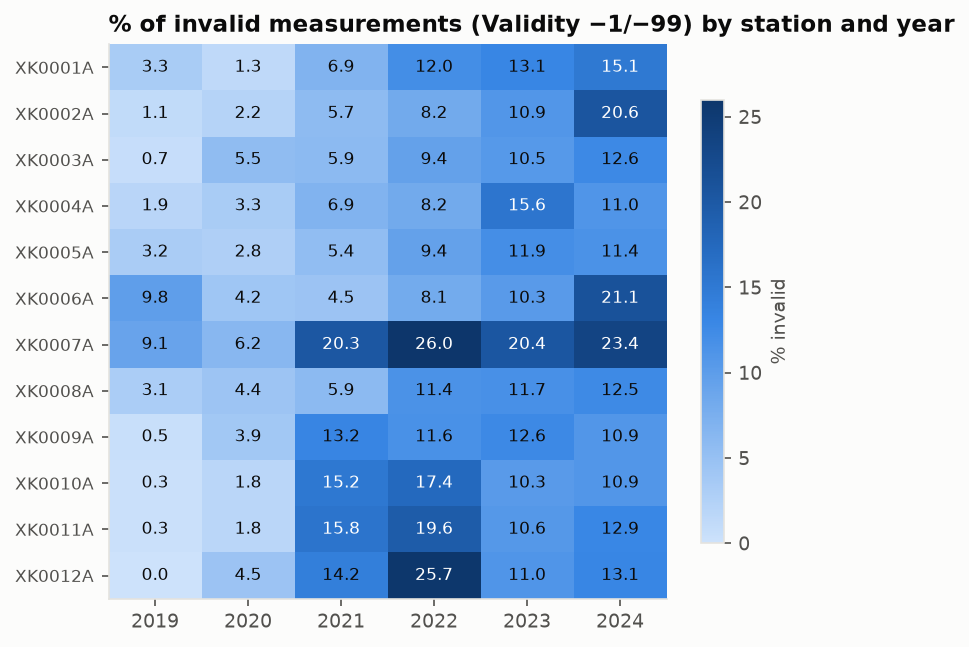

Mean share of invalid values by year: 2019: 2.8%, 2020: 3.5%, 2021: 10.0%, 2022: 13.9%, 2023: 12.4%, 2024: 14.6%. The trend is increasing:
from 2.8% in 2019 to 14.6% in 2024 (worst year:
2024). Worst station (mean over years): XK0007A (17.6%).

**Accuracy: noise and outliers.** The flags are computed, not applied (totals):

| f_invalid | f_below_dl | f_sentinel | f_absurd | f_negative | f_stuck | f_stuck_zero | f_spike | f_pm25_gt_pm10 | f_pm_out_tol | f_outlier_stat |
|---|---|---|---|---|---|---|---|---|---|---|
| 404961 | 873 | 328829 | 5 | 13490 | 9187 | 8759 | 666 | 1848 | 274 | 264700 |

- **Sentinel −9900** (disguised missing value): a code for "no value", not a measurement; the raw mean of all values
  is 93,115, while the mean of the usable raw values is 17.40.
- **Negatives with Validity 1/2** (noise or error; in the canonical unit, the "small → 0" threshold is
  -2.0 µg/m³, -0.1 mg/m³ for CO):

| pollutant | n | min_canonical | neg_zero_threshold | small_to_0 | large_to_null | pct_small |
|---|---|---|---|---|---|---|
| SO2 | 4421 | -20.23 | -2.0 | 3340 | 1081 | 75.5 |
| O3 | 560 | -11.24 | -2.0 | 423 | 137 | 75.5 |
| NO2 | 1529 | -28.81 | -2.0 | 1394 | 135 | 91.2 |
| NOx | 743 | -98.08 | -2.0 | 229 | 514 | 30.8 |
| CO | 1557 | -0.62 | -0.1 | 819 | 738 | 52.6 |
| NO | 4680 | -81.49 | -2.0 | 4173 | 507 | 89.2 |

  For SO2, O3, NO2, CO, NO most negatives are small values near zero (instrument noise → 0); for NOx most are large negatives (errors → null). PM10 and PM2.5 have no valid negatives.
- **Stuck sensor** (the same value for ≥ 6 hours, valid values only):

| pollutant | stuck_hours | of_which_zero |
|---|---|---|
| SO2 | 1477 | 1068 |
| PM10 | 1509 | 1509 |
| PM2_5 | 741 | 741 |
| O3 | 1463 | 1463 |
| NO2 | 456 | 456 |
| NOx | 442 | 442 |
| CO | 2700 | 2681 |
| NO | 399 | 399 |

  8,759 of 9,187 stuck hours (95%) are zero; most for CO (2,700), PM10 (1,509), SO2 (1,477) → long zero runs are judged per pollutant in p2.
- **Isolated spikes (noise):** a rise above P99.9 of the hourly changes followed immediately by a fall
  (`tables/p1_spike_thresholds.csv`).
- **Statistical outliers** (outside [Q1 − 1.5·IQR, Q3 + 1.5·IQR] per pollutant):
  264,700 (6.9% of usable values).
  The distributions are right-skewed (many hours with little pollution, few hours with a lot), so the rule mainly
  catches high-pollution winter hours. As the lecture notes, outliers may be legitimate values (real pollution
  episodes), so they are only flagged, never removed; true errors are caught by the rules above.

**Consistency.**
- PM2.5 > PM10 in the same hour: 924 hours; outside the tolerance
  max(5.0 µg/m³, 10%): 137.
- Declared units: 

| pollutant | declared_unit |
|---|---|
| SO2 | ug.m-3 |
| PM10 | ug.m-3 |
| PM2_5 | ug.m-3 |
| O3 | ug.m-3 |
| NO2 | ug.m-3 |
| NOx | ug.m-3 |
| CO | mg.m-3 |
| NO | ug.m-3 |

- **NOx.** Chemically NOx = NO2 + NO. In µg/m³ expressed as NO2: NOx ≈ NO2 + 1.53·NO, so the ratio should be ≈ 1. The
  ratio is ≈ 0.5233 = 1/1.912 → **NOx is in ppb even though it is
  labelled µg/m³**. However, 8 station-years (years:
  2019) have medians outside the ppb range:

| station_id | year | hours | median | pct_in_ppb_range |
|---|---|---|---|---|
| XK0001A | 2019 | 6908 | 0.344 | 15.4 |
| XK0002A | 2019 | 5525 | 0.31 | 14.8 |
| XK0003A | 2019 | 8243 | 0.338 | 11.1 |
| XK0004A | 2019 | 7980 | 0.302 | 12.5 |
| XK0006A | 2019 | 4672 | 0.374 | 24.4 |
| XK0008A | 2019 | 7507 | 0.391 | 8.1 |
| XK0009A | 2019 | 7587 | 0.254 | 4.1 |
| XK0011A | 2019 | 2343 | 0.297 | 44.2 |

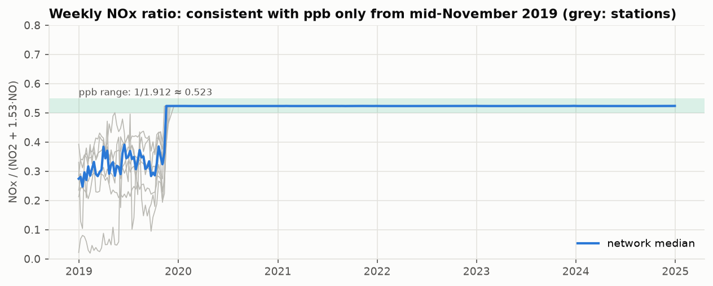

  Before mid-November 2019 the ratio is not constant (no single unit explains the values). Handling: see p2.

**Timeliness.** Days from measurement to publication of the result (`ResultTime`):

| year | min_delay_days | median_delay_days | max_delay_days |
|---|---|---|---|
| 2019 | 287 | 455.0 | 652 |
| 2020 | 266 | 452.0 | 632 |
| 2021 | 213 | 396.0 | 578 |
| 2022 | 197 | 392.0 | 562 |
| 2023 | 162 | 358.0 | 527 |
| 2024 | 260 | 444.0 | 625 |

**Duplicates.** 0 duplicate keys (station, pollutant, hour): every measurement
appears exactly once.

**Uninformative columns** (candidates for removal in p5):

| column | unique_values | pct_null | verdict |
|---|---|---|---|
| data_capture | 1 | 100.0 | 100% empty |
| agg_type | 1 | 0.0 | constant |
| verification | 1 | 0.0 | constant |
| fk_observation_log | 558 | 0.0 | administrative identifier, no information about pollution |
| unit | 2 | 0.0 | fully determined by the pollutant (CO mg/m³, others µg/m³): redundant |
| result_time | 6 | 0.0 | administrative: publication time, unrelated to the measurement |
| ts_end |  | 0.0 | redundant: End = Start + 1h (exceptions: 0) |

## 3. Data integration and cleaning

### 3.1 Integration of the station metadata
Integration combines two sources: the measurements (93 files) and the EEA metadata. Following the lecture, three
problems are solved:
- **Schema integration:** the same attribute has different names (`Air Quality Station EoI Code` in the metadata ≡
  the station inside `Samplingpoint` in the measurements) → both become `station_id`; the other columns get uniform
  names.
- **Entity identification:** the same station appears with several names and codes (e.g. names with quotes or HTML
  codes such as `Dardhisht&#235;` = Dardhishtë) → all variants are linked to one `station_id`.
- **Data value conflicts:** the metadata has 222 rows for 12 stations, coming from
  several record sets with contradictory values for the same station:

| attribute | stations_with_conflict | example_XK0002A |
|---|---|---|
| station_name | 11 | ['AQMS Prishtine Rilindje', 'Prishtine-Build ex Rilindja', 'Prishtine2'] |
| national_code | 12 | ['KS0102', 'KS0102A'] |
| lat | 9 | [42.39347, 42.65964] |
| lon | 11 | [21.09264, 21.15732] |
| altitude_m | 5 | [583.0] |
| station_type | 7 | ['background', 'traffic'] |
| station_area | 1 | ['urban'] |

**Record set analysis:**

| record_set | rows | stations | types | municipalities |
|---|---|---|---|---|
| 2017 | 1 | 1 | industrial |  |
| 2024 | 62 | 12 | background, industrial, traffic |  |
| 2024_municipality | 96 | 12 | background | AQMS Brezovica, AQMS Dardhishte, AQMS Obiliq, AQMS Peje, AQMS Prishtine - IHMK, AQMS Prishtine Rilindje, AQMS Prizren, Drenas-Municipality, Mitrovice, Podgorica |
| legacy | 63 | 12 | background, industrial, traffic |  |

The `2024_municipality` record set (the 2025 import with the Municipality column filled) labels **every station
"background"**, including XK0002A (Pristina, Rilindja) which the other sources call "traffic", and gives the
municipality **"Podgorica"** (the capital of Montenegro) for 3 stations in Kosovo: signs of an unfinished
template.
Yet this record set has the correct coordinates for Pristina, while the other record sets place both Pristina stations
up to 32 km away. So **no record set is reliable for all attributes**, and the rule "most recent
year" does not
work (in 2024 there are two record sets that contradict each other).

**Conflict resolution, one rule per attribute:**
- **Coordinates:** among all candidates, the one closest to the centre of the station's town/village is taken (an
  independent geographic check in `config.yaml`); a distance > 10 km stops the
  pipeline.
- **Altitude:** from the same record as the coordinates (so both describe the same place); 0 m → null.
- **Type and area:** majority vote among the trusted sources (`legacy`, `2024`, `2017`), without `2024_municipality`;
  ties go to the most recent report.
- **Name and national code:** from the 2024 report; names are cleaned (quotes, spaces, HTML codes) and all variants
  are kept.

Coordinate candidates and their distance from the town (`tables/p2_metadata_coordinate_candidates.csv`), e.g. Pristina:

| station_id | record_set | lat | lon | altitude_m | town | distance_km |
|---|---|---|---|---|---|---|
| XK0001A | 2024_municipality | 42.649 | 21.137 | 573.0 | Pristina | 2.8 |
| XK0001A | legacy | 42.386 | 21.081 | 573.0 | Pristina | 31.6 |
| XK0001A | 2024 | 42.386 | 21.081 |  | Pristina | 31.6 |
| XK0002A | 2024_municipality | 42.66 | 21.157 | 583.0 | Pristina | 0.8 |
| XK0002A | legacy | 42.393 | 21.093 | 583.0 | Pristina | 30.5 |
| XK0002A | 2024 | 42.393 | 21.093 |  | Pristina | 30.5 |

Result: 12 stations (every station within 2.8 km of its town):

| station_id | station_name | national_code | town | lat | lon | altitude_m | distance_km | coords_from | station_type | station_area |
|---|---|---|---|---|---|---|---|---|---|---|
| XK0001A | Prishtine1 | KS0101A | Pristina | 42.649 | 21.137 | 573.0 | 2.8 | 2024_municipality | background | suburban |
| XK0002A | Prishtine2 | KS0102A | Pristina | 42.66 | 21.157 | 583.0 | 0.8 | 2024_municipality | traffic | urban |
| XK0003A | Drenas | KS0103A | Drenas | 42.625 | 20.891 | 580.0 | 0.2 | 2024_municipality | industrial | urban |
| XK0004A | Mitrovice | KS0204 | Mitrovica | 42.892 | 20.869 | 489.0 | 0.3 | 2024 | background | urban |
| XK0005A | Peje | KS0305 | Peja | 42.666 | 20.305 | 509.0 | 1.5 | 2024 | background | urban |
| XK0006A | Prizren | KS0406 | Prizren | 42.22 | 20.728 | 479.0 | 1.2 | 2024 | background | urban |
| XK0007A | Brezovica | KS0507A | Brezovica | 42.188 | 21.03 | 1803.0 | 1.6 | 2024_municipality | background | rural-remote |
| XK0008A | Hani i Elezit | KS0508 | Hani i Elezit | 42.154 | 21.296 | 399.0 | 0.6 | 2024 | industrial | suburban |
| XK0009A | Gjilan | KS0609 | Gjilan | 42.468 | 21.46 | 499.0 | 0.8 | 2024 | traffic | urban |
| XK0010A | Palaj | KS0110 | Palaj (Obiliq) | 42.678 | 21.053 | 509.0 | 0.3 | 2024 | industrial | suburban |
| XK0011A | Obiliq | KS0111 | Obiliq | 42.684 | 21.073 | 519.0 | 0.4 | 2024 | industrial | urban |
| XK0012A | Dardhishtë | KS0112 | Dardhishte (Obiliq) | 42.66 | 21.083 | 529.0 | 0.3 | 2024 | industrial | suburban |

### 3.2 Unit conflict (harmonisation before cleaning, so thresholds are applied in the right unit)
The lecture gives the example of different scales for the same attribute (metric versus British units). Here, p1
showed that NOx is in ppb (ratio ≈ 0.523 = 1/1.912), while NO2 and NO are in µg/m³.
**Decision:** NOx × 1.912 → µg/m³ (as NO2), everywhere. CO stays in mg/m³ (standard practice). Before
mid-November 2019 the ratio matches no unit, so NOx in that period is flagged **inconsistent** using two sources of
evidence: (a) the period: every hour before the week from which the station's weekly median stays in the ppb range
(`consistent_from`); (b) the hour: after conversion, NOx/(NO2 + 1.53·NO) deviates from 1 by more than
20%.

| station_id | consistent_from | last_bad |
|---|---|---|
| XK0001A | 2019-11-18 00:00:00+00:00 | 2019-11-11 00:00:00+00:00 |
| XK0002A | 2019-11-25 00:00:00+00:00 | 2019-11-11 00:00:00+00:00 |
| XK0003A | 2019-11-18 00:00:00+00:00 | 2019-11-11 00:00:00+00:00 |
| XK0004A | 2019-11-18 00:00:00+00:00 | 2019-11-11 00:00:00+00:00 |
| XK0005A | 2019-11-25 00:00:00+00:00 | 2019-11-11 00:00:00+00:00 |
| XK0006A | 2019-11-11 00:00:00+00:00 | 2019-11-04 00:00:00+00:00 |
| XK0008A | 2019-12-02 00:00:00+00:00 | 2019-11-11 00:00:00+00:00 |
| XK0009A | 2019-12-16 00:00:00+00:00 | 2019-11-11 00:00:00+00:00 |
| XK0010A | 2019-11-18 00:00:00+00:00 | 2019-11-11 00:00:00+00:00 |
| XK0011A | 2019-11-18 00:00:00+00:00 | 2019-11-11 00:00:00+00:00 |
| XK0012A | 2019-11-18 00:00:00+00:00 | 2019-11-11 00:00:00+00:00 |

Flagged NOx hours: 52,898 from the period + 2,440 from the hourly rule only.
**Verification:** after conversion and cleaning, the median ratio of every station × year is within 1 ± 5%
(66/66 station-years; overall median 1.0007).

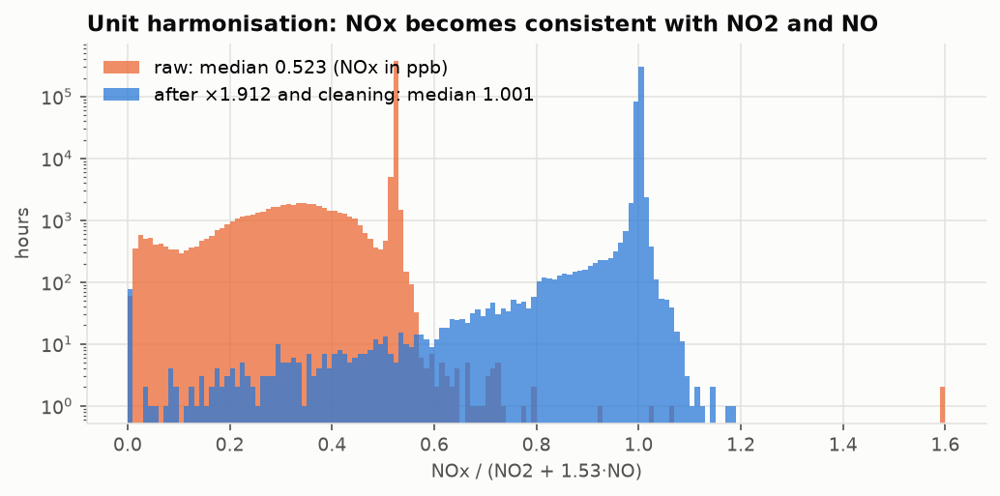

### 3.2.1 Gas analyzer change in November 2019 (inconsistent data)
Question: are NO and NO2 in that period correct (they would be used to recompute NOx)? The 2019 level is compared with
the seasonal normal of the same station in the same week of the year (median 2020–2024); particles (PM2.5), which come
from the same combustion sources but are measured by different instruments, serve as a control:

| pollutant | before_change | after_change |
|---|---|---|
| CO | 1.56 | 1.22 |
| NO | 3.61 | 1.15 |
| NO2 | 1.63 | 1.12 |
| NOx |  | 1.16 |
| O3 | 0.96 | 0.98 |
| PM10 | 1.05 | 1.06 |
| PM2_5 | 1.04 | 1.0 |
| SO2 | 1.26 | 0.66 |

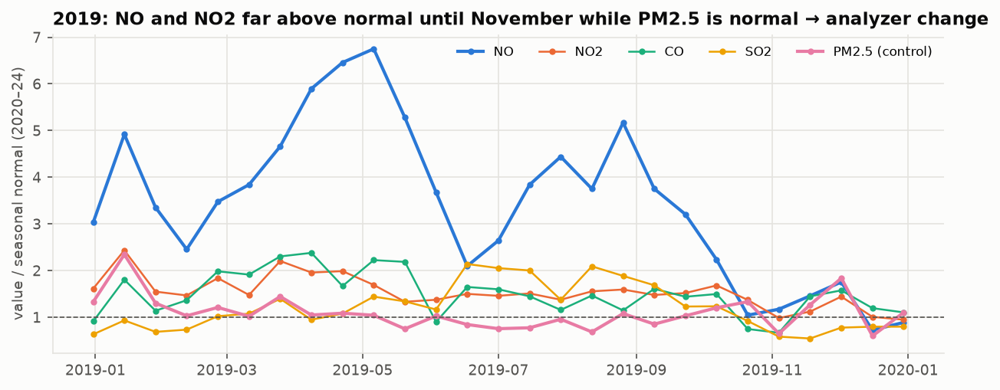

Before November **NO is ~3.61× and NO2 ~1.63× above normal**, while PM2.5 and O3 are normal; the
return to normal happens at the end of October / in November 2019, at the same moment NOx becomes
consistent. A sudden change that affects only the gases of the NOx analyzer and not the particles is not a real change
in pollution but an **analyzer replacement or recalibration** (lecture: faulty instruments as a source of incorrect
values).
**Decision:** NO and NO2 before the station's `consistent_from` → `null_calibration` (98,812 hours).
Consequence: 2019 NOx is **not recomputed** from NO2 + 1.53·NO, because it would inherit the same error (the
recomputation would give a mean of 65 µg/m³ versus 30 for the NOx measured
after the
change).

**Why NO/NO2 are removed but CO/SO2 are not:** a level change alone does not prove an instrument error, because
pollution can change for real. Two independent pieces of evidence are therefore required: (1) **physical proof** that
the instrument was not working correctly, and (2) a level change at the same moment. NO and NO2 are measured by the
same analyzer as NOx, and for this triple there is physical proof (NOx ≠ NO2 + 1.53·NO before the change) plus a
level change. CO and SO2 also show a level change (SO2 1.26× → 0.66×,
CO 1.56× → 1.22×), but they are measured by other analyzers and have no physical check; SO2 also
depends on the operation of the power plants, which changes for real. Deleting possibly correct values would be
another error, so they are **kept** with the flag `f_gas_period_flag` (108,577 hours) and treated as a
documented limitation: analyses of CO and SO2 can exclude this period through the flag.

### 3.3 Data cleaning
Cleaning follows the process from the lecture: (1) **discrepancy detection** using metadata (validity codes, physical
limits of each pollutant), domain knowledge (sentinel −9900, negatives, stuck sensors) and data auditing (the
relations PM2.5 ≤ PM10 and NOx ≈ NO2 + 1.53·NO); (2) **transformation**: the rules are applied in order and every
value receives only the first reason that applies; (3) **iteration**: every step is checked again (e.g. the NOx ratio
after conversion). **No row is deleted**: the value becomes null, the reason is stored in `clean_action` and the
original in `value_raw`.

| clean_action | SO2 | PM10 | PM2_5 | O3 | NO2 | NOx | CO | NO | TOTAL |
|---|---|---|---|---|---|---|---|---|---|
| keep | 467556 | 531247 | 531393 | 449982 | 432467 | 404211 | 477023 | 393642 | 3687521 |
| zero_negative | 3340 | 0 | 0 | 423 | 1394 | 229 | 819 | 4173 | 10378 |
| null_invalid | 73420 | 21112 | 21061 | 46595 | 61764 | 51433 | 65881 | 63695 | 404961 |
| null_calibration | 0 | 0 | 0 | 0 | 50915 | 0 | 0 | 47897 | 98812 |
| null_negative | 1081 | 0 | 0 | 137 | 135 | 514 | 738 | 507 | 3112 |
| null_stuck | 409 | 1509 | 741 | 0 | 51 | 442 | 19 | 0 | 3171 |
| null_spike | 109 | 90 | 37 | 136 | 0 | 46 | 30 | 25 | 473 |
| null_inconsistent | 0 | 75 | 137 | 0 | 0 | 52954 | 0 | 0 | 53166 |

**Kept on purpose:** Validity 2 below the detection limit (873; removing them would bias the mean
upwards), long plausible zero runs for CO/O3/SO2/NO (5,252; at night these gases really fall
close to zero), PM2.5 > PM10 within tolerance (1,574 rows, measurement uncertainty), statistical
outliers (264,700; real pollution episodes: the lecture stresses that outliers may be legitimate).

**PM2.5 > PM10 outside tolerance:** 137 hours (0.02% of PM2.5 hours);
**both** values become null, because there is no objective basis to know which instrument was wrong, and any choice
would be a guess. The loss is negligible and these hours are filled by interpolation in p3 when the gap is short.

**Small negatives → 0:** they are instrument noise around zero. How the mean would change if they became null instead
of 0:

| pollutant | mean_negatives_to_0 | mean_negatives_null | values_affected | change_pct |
|---|---|---|---|---|
| SO2 | 9.99 | 10.061 | 3340 | 0.71 |
| PM10 | 23.423 | 23.423 | 0 | 0.0 |
| PM2_5 | 16.904 | 16.904 | 0 | 0.0 |
| O3 | 45.96 | 46.003 | 423 | 0.09 |
| NO2 | 15.042 | 15.091 | 1394 | 0.32 |
| NOx | 29.534 | 29.551 | 229 | 0.06 |
| CO | 0.759 | 0.76 | 819 | 0.17 |
| NO | 9.301 | 9.399 | 4173 | 1.06 |

Removing them would raise the mean (up to 1.06% for
NO), because it removes exactly the small values. The "→ 0" policy keeps the
lower end of the distribution.

**Checks:** 0 negative values, 0 above the physical limit, rows 4,261,594 → 4,261,594 (none lost in the
join with the stations), every null has a reason.

**Statistics before/after** ("before" = values with Validity 1/2 in the canonical unit, without sentinel/absurd values):

| pollutant | stage | n | mean | std | min | median | p99 | max |
|---|---|---|---|---|---|---|---|---|
| SO2 | before | 472495 | 9.979 | 10.471 | -20.225 | 7.237 | 47.565 | 471.584 |
| SO2 | after | 470896 | 9.99 | 10.2 | 0.0 | 7.261 | 47.167 | 471.584 |
| PM10 | before | 532921 | 23.4 | 24.974 | 0.0 | 15.97 | 126.264 | 746.734 |
| PM10 | after | 531247 | 23.423 | 24.752 | 0.0 | 16.011 | 125.85 | 531.207 |
| PM2_5 | before | 532308 | 16.895 | 19.611 | 0.0 | 10.71 | 99.547 | 320.973 |
| PM2_5 | after | 531393 | 16.904 | 19.576 | 0.0 | 10.724 | 99.403 | 320.973 |
| O3 | before | 450678 | 45.971 | 30.489 | -11.238 | 42.652 | 122.621 | 298.434 |
| O3 | after | 450405 | 45.96 | 30.443 | 0.0 | 42.652 | 122.33 | 194.002 |
| NO2 | before | 484962 | 16.494 | 17.912 | -28.812 | 11.302 | 78.52 | 498.928 |
| NO2 | after | 433861 | 15.042 | 14.279 | 0.0 | 10.586 | 67.303 | 206.501 |
| NOx | before | 458396 | 29.36 | 39.402 | -98.08 | 16.994 | 184.727 | 1142.229 |
| NOx | after | 404440 | 29.534 | 39.742 | 0.0 | 16.743 | 188.55 | 1025.146 |
| CO | before | 478629 | 0.758 | 0.825 | -0.615 | 0.51 | 4.247 | 14.489 |
| CO | after | 477842 | 0.759 | 0.824 | 0.0 | 0.511 | 4.243 | 14.489 |
| NO | before | 446244 | 10.774 | 23.958 | -81.488 | 3.264 | 120.02 | 655.721 |
| NO | after | 397815 | 9.301 | 20.487 | 0.0 | 2.84 | 93.4 | 655.721 |

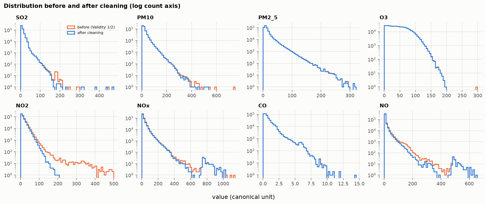

## 4. Missing values: identification and treatment strategy

### 4.1 Identification
A full hourly grid is built: every station × every pollutant × every hour over the station's period
(4,823,304 hours). This makes visible the hours that are **missing completely** (no row), which cannot be seen in
the raw data. Every hour receives a `status`:

| pollutant | missing_row | not_measured | null_calibration | null_inconsistent | null_invalid | null_negative | null_spike | null_stuck | ok | outside_period |
|---|---|---|---|---|---|---|---|---|---|---|
| SO2 | 49929 | 0 | 0 | 0 | 73420 | 1081 | 109 | 409 | 470896 | 7069 |
| PM10 | 48154 | 0 | 0 | 75 | 21112 | 0 | 90 | 1509 | 531247 | 726 |
| PM2_5 | 48818 | 0 | 0 | 137 | 21061 | 0 | 37 | 741 | 531393 | 726 |
| O3 | 46886 | 44732 | 0 | 0 | 46595 | 137 | 136 | 0 | 450405 | 14022 |
| NO2 | 49118 | 0 | 50915 | 0 | 61764 | 135 | 0 | 51 | 433861 | 7069 |
| NOx | 41283 | 44732 | 0 | 52954 | 51433 | 514 | 46 | 442 | 404440 | 7069 |
| CO | 51334 | 0 | 0 | 0 | 65881 | 738 | 30 | 19 | 477842 | 7069 |
| NO | 41173 | 44732 | 47897 | 0 | 63695 | 507 | 25 | 0 | 397815 | 7069 |

**Structural gaps** (a value "should not exist"): `not_measured` (134,196; e.g. XK0007A does
not measure NO, NOx, O3: attribute not applicable) and `outside_period` (50,819; the series
had not started yet or had already ended). They are not counted as missing and are **never imputed**.
**Real missing values:** 940,390 of 4,638,289 expected hours
(20.3%), of which 376,695 have no row at all and the rest
are nulls with a reason from p2.

**Reasons for missing values** (following the lecture: equipment malfunction, data deleted because it was
inconsistent with other recorded data, data not recorded, attributes not applicable) and the action for each:

| category | reason (lecture) | action | count | imputed? |
|---|---|---|---|---|
| Pollutant not measured by the station | attribute not applicable | not_measured | 134196 | Never |
| Before the start / after the end of the series | not collected | outside_period | 50819 | Never |
| Hour missing completely | equipment malfunction / not recorded | missing_row | 376695 | By gap length (≤ 24h inside the series) |
| Invalid / maintenance (Validity −1/−99) | deleted by the institution as incorrect | null_invalid | 404961 | By gap length (≤ 24h inside the series) |
| Sentinel / absurd (all also have Validity −1/−99, so they are counted as null_invalid) | disguised missing value | null_sentinel / null_absurd | 0 | By gap length (≤ 24h inside the series) |
| NO/NO2 before the analyzer change, November 2019 | deleted: inconsistent with other recorded data | null_calibration | 98812 | By gap length (≤ 24h inside the series); in practice longer → stays null |
| Above the physical limit | noise / instrument error | null_physical | 0 | By gap length (≤ 24h inside the series) |
| Large negative | noise / instrument error | null_negative | 3112 | By gap length (≤ 24h inside the series) |
| Stuck value (non-zero, or zero for PM10, PM2_5, NO2, NOx) | equipment malfunction | null_stuck | 3171 | By gap length (≤ 24h inside the series) |
| Isolated spike | noise | null_spike | 473 | By gap length (≤ 24h inside the series) |
| PM2.5 > PM10 outside tolerance, inconsistent NOx | deleted: inconsistent with other recorded data | null_inconsistent | 53166 | By gap length (≤ 24h inside the series); NOx by formula when NO and NO2 are valid |

% of real missing values by station and pollutant:

| station_id | SO2 | PM10 | PM2_5 | O3 | NO2 | NOx | CO | NO |
|---|---|---|---|---|---|---|---|---|
| XK0001A | 17.7 | 10.8 | 10.8 | 19.8 | 28.3 | 30.4 | 15.2 | 30.2 |
| XK0002A | 15.6 | 9.5 | 9.5 | 14.2 | 28.5 | 28.8 | 16.0 | 30.8 |
| XK0003A | 19.6 | 9.9 | 9.9 | 14.0 | 26.3 | 27.0 | 12.2 | 30.4 |
| XK0004A | 12.1 | 9.1 | 9.2 | 13.1 | 29.0 | 29.8 | 16.8 | 32.7 |
| XK0005A | 19.6 | 12.8 | 12.7 | 16.9 | 16.9 | 17.7 | 17.5 | 16.9 |
| XK0006A | 15.4 | 10.2 | 10.2 | 15.5 | 30.2 | 31.0 | 17.2 | 30.7 |
| XK0007A | 43.1 | 18.9 | 18.9 |  | 41.0 |  | 39.4 |  |
| XK0008A | 20.3 | 11.0 | 11.0 | 15.0 | 29.0 | 29.7 | 19.6 | 30.0 |
| XK0009A | 24.6 | 14.7 | 14.7 | 14.7 | 29.8 | 30.9 | 20.9 | 35.8 |
| XK0010A | 23.3 | 8.4 | 8.3 | 23.8 | 18.8 | 19.4 | 20.2 | 19.3 |
| XK0011A | 22.0 | 12.9 | 12.9 | 21.4 | 21.3 | 21.8 | 21.2 | 21.3 |
| XK0012A | 22.0 | 14.3 | 14.2 | 22.9 | 26.0 | 23.2 | 24.9 | 23.9 |

### 4.2 Analysis of the missing values
Gap length (a gap = consecutive hours without a value):

| length | gaps | hours | pct_gaps | pct_hours |
|---|---|---|---|---|
| 1 hour | 206042 | 206042 | 79.3 | 21.9 |
| 2–3 hours | 30367 | 71024 | 11.7 | 7.6 |
| 4–24 hours | 19827 | 169511 | 7.6 | 18.0 |
| 1–7 days | 3102 | 177789 | 1.2 | 18.9 |
| > 7 days | 418 | 316024 | 0.2 | 33.6 |

79.3% of the gaps last 1 hour, but gaps longer than 1 day (1.4% of the
gaps) hold 52.5% of the missing hours.
Longest gap per pollutant:

| pollutant | station_id | start | gap_len_h | days |
|---|---|---|---|---|
| SO2 | XK0009A | 2019-11-13 | 837 | 34.9 |
| PM10 | XK0005A | 2019-08-22 | 1961 | 81.7 |
| PM2_5 | XK0005A | 2019-08-27 | 1842 | 76.8 |
| O3 | XK0001A | 2021-09-27 | 842 | 35.1 |
| NO2 | XK0009A | 2019-01-01 | 8440 | 351.7 |
| NOx | XK0009A | 2019-01-01 | 8440 | 351.7 |
| CO | XK0008A | 2023-09-03 | 948 | 39.5 |
| NO | XK0009A | 2019-01-01 | 8440 | 351.7 |

For NO, NO2 and NOx the longest gaps (up to 352 days) are the 2019 period before the analyzer change
(p2); for the other pollutants the longest gap is 81.7 days (a long station outage).

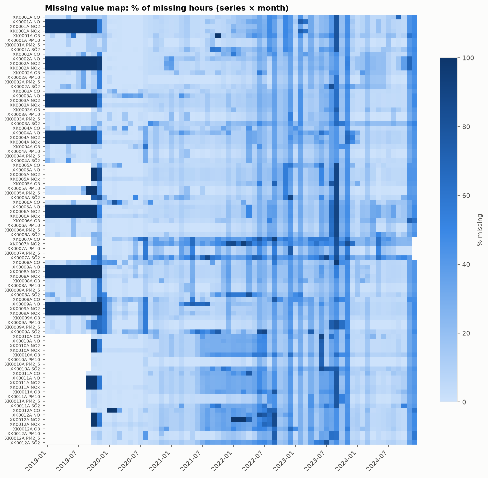

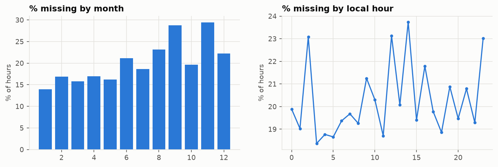

% missing by year: 2019: 37.45%, 2020: 6.37%, 2021: 12.97%, 2022: 26.25%, 2023: 29.25%, 2024: 14.57%.

**Are pollutants missing together?** Correlation (Pearson) of the missing indicators (1 = always missing together):

| pollutant | SO2 | PM10 | PM2_5 | O3 | NO2 | NOx | CO | NO |
|---|---|---|---|---|---|---|---|---|
| SO2 | 1.0 | 0.61 | 0.61 | 0.66 | 0.46 | 0.43 | 0.64 | 0.42 |
| PM10 | 0.61 | 1.0 | 1.0 | 0.67 | 0.52 | 0.51 | 0.63 | 0.49 |
| PM2_5 | 0.61 | 1.0 | 1.0 | 0.66 | 0.52 | 0.51 | 0.63 | 0.5 |
| O3 | 0.66 | 0.67 | 0.66 | 1.0 | 0.5 | 0.49 | 0.68 | 0.48 |
| NO2 | 0.46 | 0.52 | 0.52 | 0.5 | 1.0 | 0.97 | 0.49 | 0.93 |
| NOx | 0.43 | 0.51 | 0.51 | 0.49 | 0.97 | 1.0 | 0.46 | 0.94 |
| CO | 0.64 | 0.63 | 0.63 | 0.68 | 0.49 | 0.46 | 1.0 | 0.45 |
| NO | 0.42 | 0.49 | 0.5 | 0.48 | 0.93 | 0.94 | 0.45 | 1.0 |

The pollutants of the same station are missing together (correlation 0.42–1.00): outages of the whole
station (power, communication, maintenance), i.e. equipment malfunction, not deliberately hidden values.

**Does missingness depend on time? χ² test** (as in the lecture: contingency table missing/not missing × month, year
or hour; expected count = row total × column total / grand total; if χ² > the critical value at the 0.05 level, the
independence hypothesis is rejected; df = (rows − 1) × (columns − 1)):

| pollutant | attribute | chi2 | df | critical_value | result |
|---|---|---|---|---|---|
| SO2 | month | 10606.3 | 11 | 19.675 | dependent |
| SO2 | year | 33037.8 | 5 | 11.07 | dependent |
| SO2 | hour | 2668.7 | 23 | 35.172 | dependent |
| PM10 | month | 18859.2 | 11 | 19.675 | dependent |
| PM10 | year | 34027.4 | 5 | 11.07 | dependent |
| PM10 | hour | 192.2 | 23 | 35.172 | dependent |
| PM2_5 | month | 18755.5 | 11 | 19.675 | dependent |
| PM2_5 | year | 34327.1 | 5 | 11.07 | dependent |
| PM2_5 | hour | 193.6 | 23 | 35.172 | dependent |
| O3 | month | 12132.2 | 11 | 19.675 | dependent |
| O3 | year | 33170.0 | 5 | 11.07 | dependent |
| O3 | hour | 1294.0 | 23 | 35.172 | dependent |
| NO2 | month | 4993.0 | 11 | 19.675 | dependent |
| NO2 | year | 154020.0 | 5 | 11.07 | dependent |
| NO2 | hour | 1778.3 | 23 | 35.172 | dependent |
| NOx | month | 4966.6 | 11 | 19.675 | dependent |
| NOx | year | 160184.2 | 5 | 11.07 | dependent |
| NOx | hour | 897.5 | 23 | 35.172 | dependent |
| CO | month | 9028.4 | 11 | 19.675 | dependent |
| CO | year | 26304.1 | 5 | 11.07 | dependent |
| CO | hour | 2826.6 | 23 | 35.172 | dependent |
| NO | month | 4688.1 | 11 | 19.675 | dependent |
| NO | year | 149861.0 | 5 | 11.07 | dependent |
| NO | hour | 798.8 | 23 | 35.172 | dependent |

Missingness is **dependent** on time in 24 of 24 tests. The largest values are for the **year**
(years with long outages, and the 2019 period for NO/NO2/NOx); for the hour of the day the values are much smaller.
Consequence for the strategy: imputation must use time (the neighbouring hour, the month and the hour of the day), not
a single mean for the whole series. With this many hours even small differences come out "significant", so the sizes
of χ² are also compared between attributes.

### 4.3 Treatment strategy
The lecture lists these options: ignore the tuple, fill in manually, a global constant, the attribute mean, **the
attribute mean of the same class** and **the most probable value** (regression / formula). A global constant
("unknown") is meaningless for concentrations (it would create a fake value) and manual filling is impossible for
940,390 hours. Example (PM2.5, XK0001A): the attribute mean (18.0 µg/m³) is far from the class
values (winter evening versus summer morning), so the mean of the same class is smarter than the attribute mean:

| month | hour | class_mean | attribute_mean |
|---|---|---|---|
| 1 | 5 | 32.7 | 18.0 |
| 1 | 20 | 46.1 | 18.0 |
| 7 | 5 | 12.4 | 18.0 |
| 7 | 20 | 8.2 | 18.0 |

**Which method is best? Evaluation on hidden values.** In complete segments of the data, known values are hidden on
purpose (gaps of 1, 3, 6, 12, 24 hours, up to 150 per
series, seed 42), filled with each method and compared with the true value (mean absolute error, MAE, in the
unit of the pollutant; mean over the 8 pollutants):

| gap_h | attribute_mean | class_mean | linear |
|---|---|---|---|
| 1 | 11.998 | 9.428 | 2.845 |
| 3 | 12.268 | 9.617 | 4.028 |
| 6 | 12.118 | 9.487 | 5.624 |
| 12 | 12.265 | 9.605 | 7.533 |
| 24 | 12.856 | 10.193 | 9.666 |

The most probable value by **linear interpolation** between the hour before and after has the smallest error in
38 of 40 pollutant × gap-length combinations (`tables/p3_method_evaluation.csv`): pollution
changes slowly from hour to hour, so the neighbouring hours carry more information than any long-term mean. The mean of
the same class beats the attribute mean, but loses to interpolation, so it is not used. Exceptions: NO2 at 24h (class mean better, interpolation 9.7% worse); O3 at 24h (class mean better, interpolation 11.9% worse). There the class mean keeps the daily cycle of a long gap better; the differences are small and one rule for every pollutant avoids fitting the method to the evaluation sample.

**Does this hold for real gaps?** Real gaps often happen next to instrument failures, where the data may be less calm.
The same hidden values are therefore split by context: segments within 24 hours of a real
gap versus quiet periods (MAE, mean over all pollutants):

| gap_h | context | hours | attribute_mean | class_mean | linear |
|---|---|---|---|---|---|
| 1 | near a real gap | 9238 | 11.193 | 8.817 | 2.724 |
| 1 | quiet period | 4712 | 13.001 | 10.225 | 2.948 |
| 3 | near a real gap | 26835 | 11.6 | 9.099 | 3.889 |
| 3 | quiet period | 15015 | 12.901 | 10.144 | 4.088 |
| 6 | near a real gap | 51354 | 11.367 | 8.943 | 5.497 |
| 6 | quiet period | 32346 | 12.814 | 9.989 | 5.561 |
| 12 | near a real gap | 90264 | 11.649 | 9.138 | 7.709 |
| 12 | quiet period | 77136 | 12.538 | 9.83 | 7.002 |
| 24 | near a real gap | 74136 | 15.156 | 12.266 | 12.427 |
| 24 | quiet period | 260664 | 11.916 | 9.392 | 8.637 |

Interpolation has the smallest error in 9 of 10 gap-length × context cases. Exception: 24h near a real gap (interpolation 12.43 vs class or attribute mean 12.27, 1.3% worse). The difference is small, so one rule for all gaps up to 24h is kept.

Order (real missing values only; structural gaps never):
1. **Most probable value from other attributes (physical formula):** NOx = NO2 + 1.53·NO in the same hour, when NO2
   and NO are measured and valid. Check of the formula (hours where all three are measured): 

| hours | mean_absolute_error | mean_NOx |
|---|---|---|
| 392190 | 0.071 | 30.192 |

   The mean error (0.07 µg/m³) is negligible compared with the NOx mean
   (30.2 µg/m³). It is not applied before November 2019, because NO and NO2 are null there.
2. **Gap ≤ 24h inside the series: most probable value by linear interpolation** (the winner of the
   evaluation above).
3. **Gap > 24h or at the edge of the series: ignored (stays null).** Imputing whole days would invent
   data and artificially reduce the variance; at the edge there is no value on both sides.

| pollutant | deterministic | left_null | linear | none |
|---|---|---|---|---|
| SO2 | 0 | 49990 | 74958 | 477965 |
| PM10 | 0 | 40695 | 30245 | 531973 |
| PM2_5 | 0 | 40702 | 30092 | 532119 |
| O3 | 0 | 38165 | 55589 | 509159 |
| NO2 | 0 | 97753 | 64230 | 440930 |
| NOx | 3074 | 87999 | 55599 | 456241 |
| CO | 0 | 49609 | 68393 | 484911 |
| NO | 0 | 88886 | 64411 | 449616 |

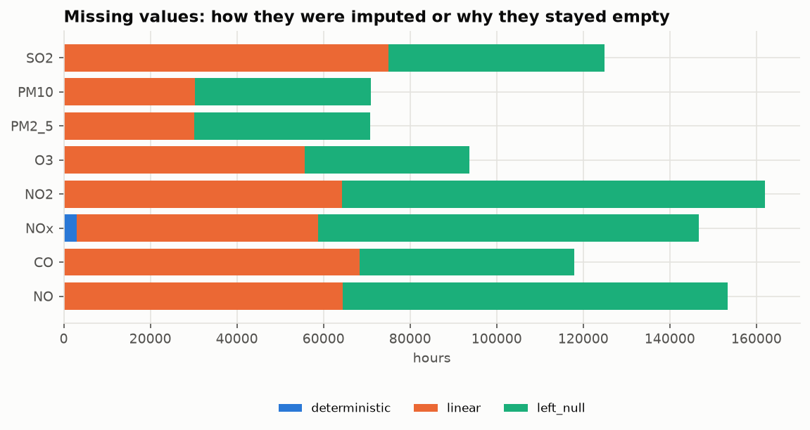

Why values stay null: 

| reason | len |
|---|---|
| gap > 24h | 316977 |
| 2019 period before the analyzer change | 149333 |
| at the edge of the series (no value on one side) | 27489 |

### 4.4 Checks
0 imputed values that are negative or above the physical limit; 0 imputed structural gaps; 0 measured values changed.
Distribution before/after:

| pollutant | n_before | n_after | mean_before | mean_after | std_before | std_after | mean_change_pct | std_change_pct |
|---|---|---|---|---|---|---|---|---|
| SO2 | 470896 | 545854 | 9.99 | 9.604 | 10.2 | 10.001 | -3.868 | -1.955 |
| PM10 | 531247 | 561492 | 23.423 | 23.209 | 24.752 | 24.464 | -0.913 | -1.165 |
| PM2_5 | 531393 | 561485 | 16.904 | 16.733 | 19.576 | 19.315 | -1.016 | -1.329 |
| O3 | 450405 | 505994 | 45.96 | 45.642 | 30.443 | 30.395 | -0.693 | -0.155 |
| NO2 | 433861 | 498091 | 15.042 | 14.682 | 14.279 | 14.046 | -2.397 | -1.631 |
| NOx | 404440 | 463113 | 29.534 | 29.315 | 39.742 | 39.554 | -0.744 | -0.473 |
| CO | 477842 | 546235 | 0.759 | 0.747 | 0.824 | 0.821 | -1.631 | -0.422 |
| NO | 397815 | 462226 | 9.301 | 9.08 | 20.487 | 19.992 | -2.368 | -2.418 |

The largest change of the mean is 3.9% and of the standard deviation
2.4%: imputation does not distort the distribution.
**Complete rows** in wide format (station × hour where every pollutant the station measures has a value):
56.4% → 77.0%. Output: `data/gold/hourly_long/`.

## 5. Aggregation and sampling

### 5.1 Aggregation
Aggregation combines many objects into one (lecture): it reduces the data, changes the scale (station → zone → Kosovo)
and gives more stable data (the daily mean varies less than the hourly value).

**Daily** (by local date, because the daily life of people and traffic follows local time): mean, maximum and number of
valid hours. **Completeness rule:** the daily mean is computed only when there are ≥ 18 valid
hours (75%); otherwise it is null, because a "mean" from few hours (e.g. only the night) would be biased.
**Monthly:** mean of the valid days, only when ≥ 75% of the days are valid.
**Annual:** mean and coverage (valid hours / hours of the year).

Aggregation is done twice: from the **measured** (official) values and from the **imputed** values. Valid days gained
thanks to imputation:

| pollutant | measured | imputed | days_gained | pct |
|---|---|---|---|---|
| SO2 | 18535 | 22449 | 3914 | 21.1 |
| PM10 | 21556 | 23175 | 1619 | 7.5 |
| PM2_5 | 21562 | 23176 | 1614 | 7.5 |
| O3 | 17955 | 20861 | 2906 | 16.2 |
| NO2 | 17349 | 20535 | 3186 | 18.4 |
| NOx | 16327 | 19121 | 2794 | 17.1 |
| CO | 18737 | 22487 | 3750 | 20.0 |
| NO | 15783 | 19075 | 3292 | 20.9 |

**Concept hierarchy and data cube.** The data is organised in two hierarchies: time (hour → day → month → year) and
space (station → zone → Kosovo). Moving up the hierarchy (*roll up*) replaces many values by one more general value;
moving down (*drill down*) returns to the details. Following the lecture, the smallest level that is enough for the
task is used: e.g. to compare towns, the annual mean of the zone is enough. Size reduction at every level:

| level | rows | reduction_x |
|---|---|---|
| hourly | 4638289 | 1.0 |
| daily | 193292 | 24.0 |
| monthly | 6373 | 728.0 |
| annual (station) | 558 | 8312.0 |
| annual (zone) | 414 | 11204.0 |
| annual (Kosovo) | 48 | 96631.0 |

PM2.5 roll-up (annual mean of the valid days, µg/m³) from station to zone and Kosovo
(`tables/p4_rollup_station_zone_kosovo.csv` has every pollutant and level):

| level | name | 2019 | 2020 | 2021 | 2022 | 2023 | 2024 |
|---|---|---|---|---|---|---|---|
| zone | Brezovica | 1.784 | 5.636 | 8.28 | 7.593 | 6.85 | 6.995 |
| zone | Drenas | 16.447 | 19.19 | 14.226 | 14.8 | 13.052 | 10.308 |
| zone | Gjilan | 22.092 | 29.222 | 23.456 | 25.487 | 26.616 | 16.099 |
| zone | Hani i Elezit | 16.619 | 17.72 | 13.479 | 15.061 | 13.734 | 10.68 |
| zone | Mitrovica | 22.745 | 22.408 | 19.11 | 19.019 | 17.295 | 13.837 |
| zone | Obiliq | 25.22 | 18.587 | 13.874 | 15.784 | 13.686 | 11.951 |
| zone | Peja | 26.603 | 28.597 | 21.426 | 17.163 | 17.527 | 12.837 |
| zone | Pristina | 18.715 | 23.267 | 19.844 | 19.23 | 17.786 | 15.119 |
| zone | Prizren | 22.615 | 22.09 | 15.975 | 14.534 | 14.395 | 9.838 |
| Kosovo | Kosovo | 20.611 | 20.657 | 16.571 | 16.776 | 15.429 | 12.287 |

**Annual coverage:** 402 of 558 station-pollutant-years are below 90%:
for them `mean_official` = null and only `mean` is kept as informative, because an annual mean from less than 90% of
the hours does not represent the year (e.g. a whole season may be missing). Full table: `tables/p4_annual_coverage.csv`.

| station_id | pollutant | 2019 | 2020 | 2021 | 2022 | 2023 | 2024 |
|---|---|---|---|---|---|---|---|
| XK0001A | SO2 | 0.958 | 0.973 | 0.797 | 0.683 | 0.689 | 0.833 |
| XK0001A | PM10 | 0.956 | 0.983 | 0.955 | 0.808 | 0.756 | 0.892 |
| XK0001A | PM2_5 | 0.957 | 0.983 | 0.955 | 0.808 | 0.757 | 0.892 |
| XK0001A | O3 | 0.875 | 0.967 | 0.845 | 0.671 | 0.652 | 0.801 |
| XK0001A | NO2 | 0.107 | 0.981 | 0.942 | 0.708 | 0.716 | 0.847 |
| XK0001A | NOx | 0.107 | 0.977 | 0.927 | 0.678 | 0.641 | 0.844 |
| XK0001A | CO | 0.941 | 0.977 | 0.94 | 0.712 | 0.71 | 0.805 |
| XK0001A | NO | 0.107 | 0.978 | 0.921 | 0.697 | 0.635 | 0.846 |
| XK0002A | SO2 | 0.854 | 0.98 | 0.932 | 0.834 | 0.655 | 0.799 |
| XK0002A | PM10 | 0.902 | 0.994 | 0.994 | 0.883 | 0.796 | 0.85 |
| XK0002A | PM2_5 | 0.902 | 0.994 | 0.994 | 0.883 | 0.796 | 0.85 |
| XK0002A | O3 | 0.886 | 0.983 | 0.9 | 0.802 | 0.769 | 0.799 |

*… 81 more rows in the CSV.*

**Heating season (October–April) versus the rest of the year** (mean of the valid days):

| pollutant | heating_season | rest_of_year | ratio |
|---|---|---|---|
| SO2 | 10.145 | 10.57 | 0.96 |
| PM10 | 29.34 | 15.16 | 1.94 |
| PM2_5 | 22.569 | 8.886 | 2.54 |
| O3 | 38.44 | 58.71 | 0.65 |
| NO2 | 17.786 | 11.788 | 1.51 |
| NOx | 36.691 | 19.413 | 1.89 |
| CO | 0.924 | 0.531 | 1.74 |
| NO | 12.425 | 4.881 | 2.55 |

Particles (PM2.5, PM10), CO and NO are much higher in the heating season (burning of wood and coal, and thermal
inversion in winter); O3 is higher outside it (it is formed by sunlight). SO2 changes little over the year, because
its main source is industry and the power plants, not household heating.

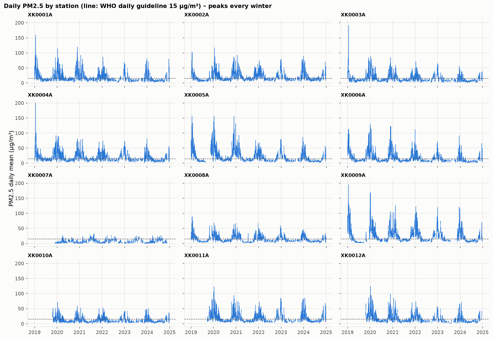

### 5.2 Sampling
Population: 602,913 station-hours (wide format, after imputation). Following the lecture, a sample works almost
as well as the whole data set only if it is **representative**: it has approximately the same properties as the
population. Three methods are compared with 10% (seed 42):
- **SRSWOR** (simple random sample without replacement): every row is selected at most once;
- **SRSWR** (simple random sample with replacement): the same row can be selected more than once;
- **stratified** by station × season: the same share from every stratum, so no group is left out.

Properties of the sample versus the population:

| method | pollutant | mean_population | mean_sample | mean_deviation_pct | std_population | std_sample | p95_population | p95_sample |
|---|---|---|---|---|---|---|---|---|
| SRSWOR | PM2_5 | 16.733 | 16.74 | 0.047 | 19.315 | 19.199 | 53.896 | 54.094 |
| SRSWOR | PM10 | 23.209 | 23.155 | -0.231 | 24.464 | 24.162 | 69.584 | 69.539 |
| SRSWOR | NO2 | 14.682 | 14.676 | -0.039 | 14.046 | 13.972 | 42.665 | 42.475 |
| SRSWOR | O3 | 45.642 | 45.746 | 0.228 | 30.395 | 30.451 | 99.76 | 100.348 |
| SRSWR | PM2_5 | 16.733 | 16.769 | 0.22 | 19.315 | 19.52 | 53.896 | 53.832 |
| SRSWR | PM10 | 23.209 | 23.207 | -0.005 | 24.464 | 24.562 | 69.584 | 69.793 |
| SRSWR | NO2 | 14.682 | 14.637 | -0.302 | 14.046 | 14.029 | 42.665 | 42.748 |
| SRSWR | O3 | 45.642 | 45.832 | 0.417 | 30.395 | 30.481 | 99.76 | 99.868 |
| stratified | PM2_5 | 16.733 | 16.743 | 0.06 | 19.315 | 19.399 | 53.896 | 53.646 |
| stratified | PM10 | 23.209 | 23.215 | 0.029 | 24.464 | 24.622 | 69.584 | 69.049 |
| stratified | NO2 | 14.682 | 14.658 | -0.163 | 14.046 | 14.056 | 42.665 | 42.791 |
| stratified | O3 | 45.642 | 45.554 | -0.191 | 30.395 | 30.409 | 99.76 | 100.046 |

Representation of the strata (maximum deviation of a station's/season's share from the population, in percentage
points) and rows selected more than once:

| method | n | repeated_rows | max_station_deviation_pp | max_season_deviation_pp |
|---|---|---|---|---|
| SRSWOR | 60291 | 0 | 0.154 | 0.328 |
| SRSWR | 60291 | 2891 | 0.215 | 0.177 |
| stratified | 60291 | 0 | 0.002 | 0.004 |

**Decision:** the **stratified** sample is kept (`data/gold/sample_10pct.parquet`). All three methods preserve the
mean (maximum deviation: SRSWOR 0.23%, SRSWR 0.42%, stratified
0.19%), but SRSWR has 2,891 repeated rows (duplicated information),
and only the stratified sample guarantees the shares of stations and seasons (deviation ≤ 0.004 pp versus
0.328 pp for SRSWOR). This matters because pollution varies strongly by station and season.

## 6. Feature selection and creation, discretization and binarization, transformation, dimensionality reduction

### 6.1 Wide format
The long table (p3) is turned into a wide table: one row = station × hour (602,913 rows), one column per pollutant
(value after imputation) and `
_obs` (the measured value, so lagged features use measurements only).

### 6.2 Feature subset selection
The lecture distinguishes **irrelevant** attributes (no information for the task, e.g. a student ID for predicting
GPA) and **redundant** attributes (they duplicate the information of other attributes, e.g. the price and the sales
tax).

**Source columns that are dropped** (evidence in p1, "uninformative columns"):

| column | reason |
|---|---|
| DataCapture | irrelevant: 100% empty |
| AggType | irrelevant: constant (always 'hour'), zero variance |
| Verification | irrelevant: constant (always 1), zero variance |
| End | redundant: End = Start + 1h (0 exceptions) |
| ResultTime | irrelevant: publication time, unrelated to pollution |
| FkObservationLog | irrelevant: administrative identifier (like a student ID for predicting GPA) |
| Unit | redundant after harmonisation (all values in canonical units) |
| Samplingpoint | redundant: split into station_id and pollutant |
| Validity | redundant: absorbed into clean_action/status (p2–p3) |

**Variance filter** over the 29 numeric features: every feature with variance 0 (constant, no
information) is removed. Features with variance 0: none (`tables/p5_feature_variance.csv`).

**Redundant attributes: covariance and correlation.** For every pair of measured pollutants,
Cov(A, B) = E[(A − Ā)(B − B̄)] and r = Cov(A, B) / (σA·σB) are computed (`tables/p5_covariance_correlation.csv`).
A positive covariance means the two rise together; its size depends on the units, so the comparison uses
r ∈ [−1, 1].

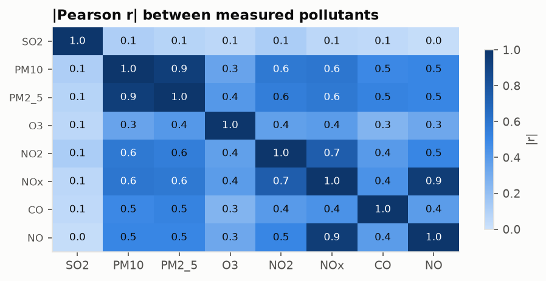

Pairs with |r| > 0.9:

| a | b | hours | covariance | correlation |
|---|---|---|---|---|
| PM10 | PM2_5 | 531010 | 455.568 | 0.942 |
| NOx | NO | 394282 | 770.994 | 0.952 |

- **NOx is derivable:** NOx = NO2 + 1.53·NO (lecture: "derivable data", like age from the date of birth); the
  correlation between NOx and NO2 + 1.53·NO is r = 1.0000. NOx is removed from PCA so it does not double the
  weight of NO/NO2. This is also why the NOx–NO pair is highly correlated.
- **PM10 and PM2.5** (r = 0.942) are both kept, because `pm_coarse` = PM10 − PM2.5 shows that PM10 also carries other
  information (dust).

**Heuristic search.** With d features there are 2^d subsets, so the three methods from the lecture are used, with the
measured PM2.5 of the next hour as the target and linear regression: the regression is fitted on 50,000
random rows of 2019–2023 and R² is measured on 50,000 rows of 2024 it has not seen
(seed 42), out of
262,141 rows that have a value for all 29 features (11 stations: XK0007A does not measure
NO and O3). Stopping rule: the improvement of R² is < 0.001.
- **Step-wise forward selection** (starts from the empty set and adds the best feature at each step):

| step | feature_added | R2 | gain |
|---|---|---|---|
| 1 | PM2_5_obs | 0.851 | 0.851 |
| 2 | PM2_5_roll_mean_24h | 0.855 | 0.004 |
| 3 | PM2_5_lag_1h | 0.858 | 0.003 |
| 4 | hour_sin | 0.859 | 0.001 |

- **Step-wise backward elimination** (starts from all features and removes the worst one at each step; full table:
  `tables/p5_backward_elimination.csv`): 4 of 29 features remain, R² =
  0.8593 (with all features: 0.8600).
- **Decision tree induction** (a tree of depth 8; features that do not appear in the tree are
  considered irrelevant): 28 features appear in the tree.

| feature | forward | backward | tree_importance | in_tree | selected_by |
|---|---|---|---|---|---|
| PM2_5_obs | True | True | 0.968 | True | 3 |
| hour_sin | True | True | 0.009 | True | 3 |
| PM2_5_roll_mean_24h | True | True | 0.002 | True | 3 |
| PM2_5_lag_1h | True | True | 0.002 | True | 3 |
| PM10_roll_mean_24h | False | False | 0.002 | True | 1 |
| O3_obs | False | False | 0.002 | True | 1 |
| NO2_obs | False | False | 0.002 | True | 1 |
| hour_cos | False | False | 0.002 | True | 1 |
| PM10_obs | False | False | 0.001 | True | 1 |
| PM10_lag_1h | False | False | 0.001 | True | 1 |
| NOx_obs | False | False | 0.001 | True | 1 |
| NO2_roll_mean_24h | False | False | 0.001 | True | 1 |
| NO_obs | False | False | 0.001 | True | 1 |
| PM10_lag_24h | False | False | 0.001 | True | 1 |
| PM2_5_lag_24h | False | False | 0.001 | True | 1 |
| NO2_lag_24h | False | False | 0.001 | True | 1 |
| NO2_lag_1h | False | False | 0.001 | True | 1 |
| hour | False | False | 0.001 | True | 1 |
| CO_obs | False | False | 0.0 | True | 1 |
| altitude_m | False | False | 0.0 | True | 1 |
| pm_coarse | False | False | 0.0 | True | 1 |
| SO2_obs | False | False | 0.0 | True | 1 |
| pm25_pm10_ratio | False | False | 0.0 | True | 1 |
| is_heating_season | False | False | 0.0 | True | 1 |
| month_cos | False | False | 0.0 | True | 1 |
| month | False | False | 0.0 | True | 1 |
| month_sin | False | False | 0.0 | True | 1 |
| dow | False | False | 0.0 | True | 1 |
| is_weekend | False | False | 0.0 | False | 0 |

Forward selection reaches R² = 0.8593 with only 4 features, almost as much as with
all 29 (0.8600). All three methods agree on: PM2_5_obs, hour_sin, PM2_5_roll_mean_24h, PM2_5_lag_1h. The
pollution of the next hour depends mainly on the pollution of the current and the most recent hours (persistence);
the day of the week and the weekend add almost nothing.

### 6.3 Feature creation
Following the lecture: **attribute extraction** (hour, day, month from the time) and **attribute construction**
(combining existing attributes, like BMI = weight / height²; discretization).

| feature | formula | reason |
|---|---|---|
| hour, dow, month, year | extracted from local time | pollution follows daily (traffic), weekly and seasonal rhythms |
| is_weekend | day of week ≥ 6 (like "weekend?" from a timestamp in the lecture) | less traffic at weekends |
| season, is_heating_season | month → season; October–April | wood/coal heating: much higher PM2.5 |
| hour_sin, hour_cos, month_sin, month_cos | sin/cos(2π·x/period) | hour 23 and hour 0 are neighbours; the numbers 23 and 0 do not show this |
| 
_is_imputed | the hour's value was imputed in p3 | transparency: analyses can treat these values differently |
| gas_period_2019 | the hour falls before the gas analyzer change (November 2019) | suspicious CO/SO2 (p2): analyses can exclude this period |
| pm25_pm10_ratio | measured PM2.5 / PM10 (when PM10 > 0 and PM2.5 ≤ PM10) | attribute construction (like BMI): high = combustion (fine particles); low = dust |
| pm_coarse | measured PM10 − PM2.5 | coarse particles (dust, roads) |
| 
_lag_1h, 
_lag_24h | measured value 1h / 24h earlier, within the station | pollution is persistent |
| 
_roll_mean_24h | mean of the previous 24h (without the current hour) | recent pollution level |
| station_type, altitude_m | from the metadata (p2) | type of source (traffic/industry/background) and altitude |
| pm25_bin_*, pm10_exceed_eu, pm25_exceed_who, one-hot | discretization and binarization (6.4–6.5) | classes and 0/1 indicators |
| 
_minmax, 
_z, 
_dec | normalization (6.6) | every pollutant on a comparable scale |

Lagged features are computed within the same station, over the full hourly grid (shift 1 = exactly 1 hour earlier),
from measured values and without the current hour (`closed="left"`). Check: every `PM2_5_lag_1h` equals the measured
value of the previous hour exactly (0 errors).

### 6.4 Discretization of PM2.5
Discretization divides the range of a continuous attribute into intervals, and the values are replaced by the label of
their interval. Three methods are compared (unsupervised, top-down split):

| method | edges |
|---|---|
| equal_width | 64.19, 128.39, 192.58, 256.78 |
| equal_frequency | 5.54, 9.12, 13.79, 24.09 |
| eaqi | 5.0, 15.0, 50.0, 90.0, 140.0 |

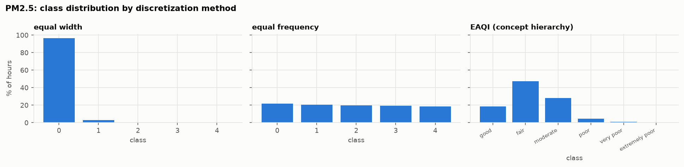

- **Equal width** (W = (B − A) / N): the strongly skewed distribution and the outliers put 96.6% of the
  hours in the first class, as the lecture warns.
- **Equal frequency:** balanced classes (about 20% each), but the edges have no health meaning.
- **EAQI = concept hierarchy:** numeric values are replaced by higher-level concepts ("good" … "extremely poor"),
  following the official EEA thresholds (https://airindex.eea.europa.eu/AQI/index.html). The classes are unbalanced but **interpretable** and
  comparable with the rest of Europe → chosen for analysis.

| pm25_bin_eaqi | count | class | pct |
|---|---|---|---|
| 0 | 104537 | good | 18.6 |
| 1 | 265719 | fair | 47.3 |
| 2 | 158589 | moderate | 28.2 |
| 3 | 25096 | poor | 4.5 |
| 4 | 6162 | very poor | 1.1 |
| 5 | 1382 | extremely poor | 0.2 |

**Smoothing by binning** (binning for noise, lectures of weeks 4 and 5): the sorted values are split into
5 equal-frequency bins; then every value is replaced by the bin mean or by the closest bin boundary. The
code is checked with the lecture example (4, 8, 9, 15 | 21, 21, 24, 25 | 26, 28, 29, 34 → means 9, 23, 29; boundaries
4, 4, 4, 15 | 21, 21, 25, 25 | 26, 26, 26, 34) before it is applied. For PM2.5:

| bin | values | min | max | bin_mean |
|---|---|---|---|---|
| 1 | 112297 | 0.0 | 5.245 | 3.191 |
| 2 | 112297 | 5.245 | 8.671 | 6.942 |
| 3 | 112297 | 8.671 | 13.109 | 10.726 |
| 4 | 112297 | 13.109 | 22.701 | 17.022 |
| 5 | 112297 | 22.701 | 320.973 | 45.781 |

The standard deviation drops from 19.32 to 15.23 (means) and 11.81
(boundaries); the mean absolute smoothing error is 4.81 and 5.69 µg/m³. The last bin
holds the high-pollution episodes, where smoothing would remove exactly the peaks; so smoothing is shown as a method,
but the original values are kept for analysis (noise was handled in p2).

### 6.5 Binarization and encoding
- `pm10_exceed_eu` = 1 when the daily PM10 mean > 50 µg/m³ (EU daily limit);
  `pm25_exceed_who` = 1 when the daily PM2.5 mean > 15 µg/m³ (WHO 2021 guideline).
  They are computed from **measured** daily means and only for valid days (≥ 18 hours, p4), because legal limits are
  assessed on measurements, not on imputed values.

| station_id | year | days_PM10_>50 | days_PM2.5_>15 |
|---|---|---|---|
| XK0001A | 2019 | 51 | 146 |
| XK0001A | 2020 | 59 | 178 |
| XK0001A | 2021 | 35 | 167 |
| XK0001A | 2022 | 25 | 105 |
| XK0001A | 2023 | 20 | 65 |
| XK0001A | 2024 | 11 | 65 |
| XK0002A | 2019 | 28 | 110 |
| XK0002A | 2020 | 77 | 195 |
| XK0002A | 2021 | 63 | 200 |
| XK0002A | 2022 | 56 | 173 |
| XK0002A | 2023 | 31 | 132 |
| XK0002A | 2024 | 28 | 148 |

*… 60 more rows in the CSV.*

- **One-hot** encoding of station, season and station type (19 0/1 columns): nominal categories have no
  order, so they cannot be encoded as 1, 2, 3.

**χ² test between two nominal attributes** (as in the lecture): is the heating season related to the daily PM2.5
exceedance? The values in brackets are the expected counts (row total × column total / grand total):

| season | daily PM2.5 > 15 | daily PM2.5 ≤ 15 | sum |
|---|---|---|---|
| heating season | 7,294 (4,683.9) | 5,503 (8,113.1) | 12,797 |
| rest of the year | 598 (3,208.1) | 8,167 (5,556.9) | 8,765 |
| sum | 7,892 | 13,670 | 21,562 |

χ² = 5,643.8, df = (2 − 1)·(2 − 1) = 1, critical value at the 0.05 level = 3.841.
χ² > critical value → the independence hypothesis is rejected: in the heating season 57% of the days exceed the WHO guideline, outside it
7%.

### 6.6 Transformation: normalization
The pollutants are measured in different units and scales (CO in mg/m³ with values < 1, O3 up to hundreds of µg/m³);
without normalization, in distance-based methods (k-NN, clustering, PCA) the pollutant with the largest numbers would
dominate. The three methods from the lecture are applied to every pollutant (columns `
_minmax`, `
_z`, `
_dec`):
- **Min-max** to [0, 1]: v' = (v − min) / (max − min);
- **Z-score:** v' = (v − μ) / σ (how many standard deviations above/below the mean);
- **Decimal scaling:** v' = v / 10^j, where j is the smallest integer such that max|v'| < 1.

The formulas are checked with the lecture examples (73,600 → 0.716 with min-max on [12,000, 98,000]; → 1.225 with
z-score μ = 54,000, σ = 16,000; −986 and 917 → −0.986 and 0.917 with j = 3). Parameters and an example (v = P95 of the
pollutant):

| pollutant | min | max | mean | std | j | example_v_P95 | v_minmax | v_zscore | v_decimal |
|---|---|---|---|---|---|---|---|---|---|
| SO2 | 0.0 | 471.584 | 9.792 | 10.319 | 3 | 28.682 | 0.061 | 1.831 | 0.029 |
| PM10 | 0.0 | 531.207 | 24.351 | 25.566 | 3 | 73.114 | 0.138 | 1.907 | 0.073 |
| PM2_5 | 0.0 | 320.973 | 17.646 | 20.233 | 3 | 56.886 | 0.177 | 1.939 | 0.057 |
| O3 | 0.0 | 194.002 | 45.108 | 30.31 | 3 | 99.219 | 0.511 | 1.785 | 0.099 |
| NO2 | 0.0 | 206.501 | 15.018 | 14.082 | 3 | 43.063 | 0.209 | 1.992 | 0.043 |
| NOx | 0.0 | 1025.146 | 29.896 | 39.889 | 4 | 95.617 | 0.093 | 1.648 | 0.01 |
| CO | 0.0 | 14.489 | 0.773 | 0.863 | 2 | 2.296 | 0.158 | 1.765 | 0.023 |
| NO | 0.0 | 655.721 | 9.282 | 20.101 | 3 | 38.398 | 0.059 | 1.448 | 0.038 |

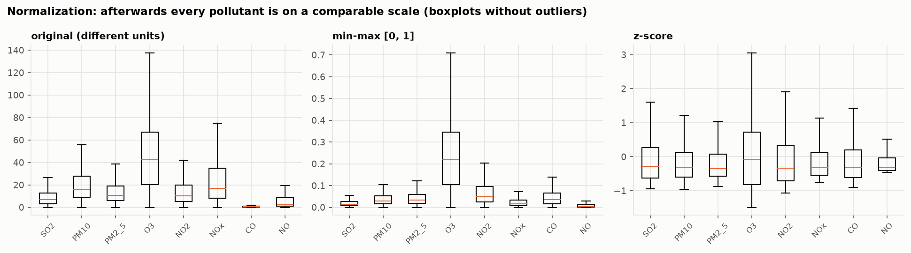

All parameters (min, max, μ, σ, j, the equal-width and equal-frequency edges, the PCA mean and components) are
learned from 2019–2023 only and then applied unchanged to 2024, so the last year stays unseen for
later analyses (no data leakage); in 2024 a value can therefore fall slightly outside [0, 1].
Checks (2019–2023): every min-max column has min 0 and max 1, every z-score column has mean 0 and standard
deviation 1, every decimal value has |v'| < 1. Min-max is strongly affected by the maximum value (outliers):
for SO2, PM10, PM2_5, NO2, NOx, CO, NO even
the P95 falls below 0.25, so most values are squeezed close to 0. Z-score is used for PCA (6.7), because it gives
every pollutant equal weight.

### 6.7 Dimensionality reduction (PCA)
The steps from the lecture: (1) z-score normalization of the 7 pollutants (without NOx, 6.2); (2) the eigenvectors of
the covariance matrix = the principal components; (3) every hour is expressed as a linear combination of them;
(4) sorting by variance; (5) the strong components are kept. PCA works with numeric data and complete rows only:
427,162 hours from 11 stations (**XK0007A is excluded**, it does not measure NO and O3); values
after imputation, so hours with a single gap are not lost. The mean, standard deviation and components are computed
from the 342,164 complete hours of 2019–2023, without the 2019 period when CO and SO2 are suspicious (p2).

| component | variance | cumulative |
|---|---|---|
| PC1 | 0.502 | 0.502 |
| PC2 | 0.143 | 0.645 |
| PC3 | 0.107 | 0.753 |
| PC4 | 0.089 | 0.841 |
| PC5 | 0.084 | 0.925 |
| PC6 | 0.068 | 0.993 |
| PC7 | 0.007 | 1.0 |

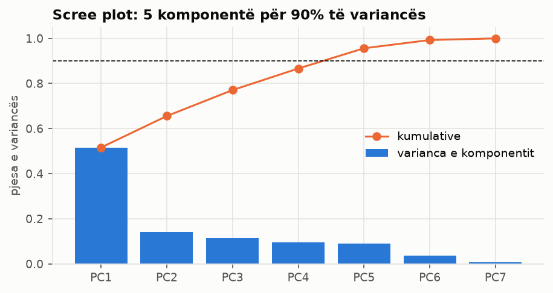

Loadings:

| pollutant | PC1 | PC2 | PC3 |
|---|---|---|---|
| SO2 | 0.072 | 0.972 | 0.183 |
| PM10 | 0.476 | -0.015 | 0.225 |
| PM2_5 | 0.48 | -0.027 | 0.142 |
| O3 | -0.303 | -0.164 | 0.91 |
| NO2 | 0.404 | -0.036 | 0.038 |
| CO | 0.369 | -0.105 | 0.252 |
| NO | 0.383 | -0.12 | -0.057 |

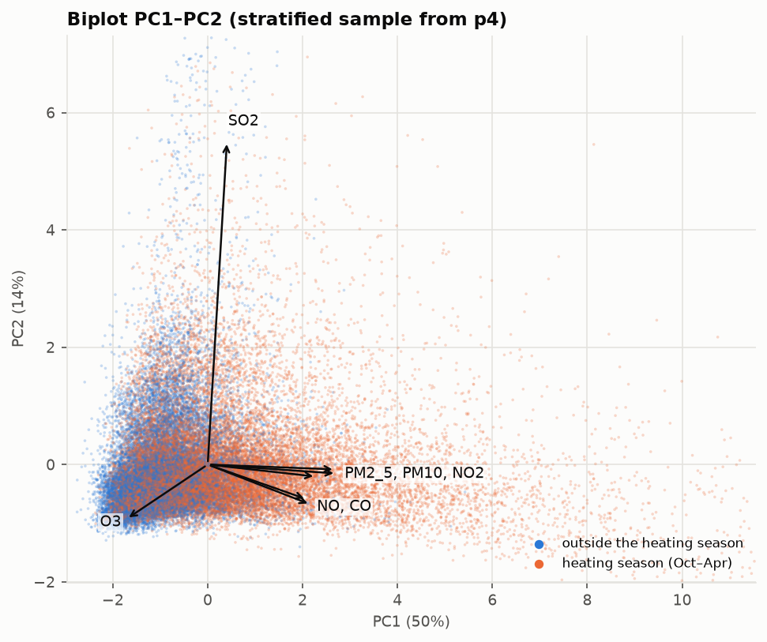

**Interpretation:**
- **PC1 (50%)** = overall combustion pollution: PM2.5, PM10, NO, NO2 and CO load with the same sign, O3 with the
  opposite sign (O3 drops where NO consumes it). The mean PC1 score in the heating season is
  0.44, outside it -0.86.
- **PC2 (14%)** is dominated by SO2: a separate source (industry/power plants).
- **5 components** are enough for 90% of the variance, out of 7 pollutants.

Output: `data/gold/features_hourly.parquet` (602,913 rows × 100 columns).

### 6.8 Techniques from the lectures that were not used
Some lecture techniques were considered and deliberately left out, because they are not needed for this data or for the 
Phase I requirements: **numerosity reduction** by histograms or clustering, **wavelet transforms** and **data compression** 
(the volume is already reduced by aggregation, sampling and PCA, and Parquet/zstd storage); **noise detection by 
regression or clustering** (noise is handled by validity rules, spike and stuck-sensor detection and, as a method, 
smoothing by binning; regression over series with long gaps would add complexity without a better result); and 
**supervised discretization** (decision tree, ChiMerge), which needs a class label, while Phase I has no classification 
task. The unsupervised methods and the EAQI concept hierarchy are enough for the discretization requirement.

## 7. Decision log
The most important preprocessing decisions in one place (details in the sections above):

| No. | Step | Decision | Reason |
|---|---|---|---|
| 1 | p1 | No row is ever deleted; a wrong value becomes null and the reason is stored | every change stays traceable and can be undone |
| 2 | p1 | Every value is checked again, even if the institution marked it as valid | believability: the validity flag alone does not catch every impossible value |
| 3 | p2 | NOx is converted from ppb to µg/m³ where the NOx/NO2/NO ratio shows ppb | value conflict between sources (different units for the same attribute) |
| 4 | p2 | CO and SO2 before the analyzer change of November 2019 are flagged, not deleted | suspicious, but there is no proof that they are wrong; analyses can exclude them |
| 5 | p2 | Statistical outliers are kept | high winter PM values are real pollution episodes, not errors (lecture: outliers may be legitimate) |
| 6 | p3 | Structural gaps (not measured, outside the period) are separated from real missing values | a station that never measures a pollutant has nothing to impute |
| 7 | p3 | Imputation order: physical formula (NOx), linear interpolation for inside gaps ≤ 24h, otherwise null | linear interpolation has the smallest error in the evaluation; longer gaps would be invented data |
| 8 | p3 | Imputed values are stored next to the measured ones (`value`, `value_imputed`, `impute_method`) | transparency: every analysis can choose measured or imputed values |
| 9 | p4 | A day needs ≥ 18 valid hours, a month ≥ 75% valid days, a year ≥ 90% coverage | a mean of a few hours does not represent a day (EU coverage rules) |
| 10 | p4 | Stratified sample 10% by station_id × season | small strata are not left out (lecture: SRS performs poorly under skew) |
| 11 | p5 | NOx is excluded from PCA | derivable data: NOx = NO2 + 1.53·NO |
| 12 | p5 | EAQI classes are chosen for PM2.5 discretization | concept hierarchy with health meaning, comparable with the rest of Europe |
| 13 | p5 | Z-score (not min-max) is used before PCA | min-max is dominated by outliers |
| 14 | p5 | All parameters are learned from 2019–2023 only | 2024 stays unseen for later analyses (no data leakage) |

## Appendix A. Analyses beyond the lectures
These analyses are **not** part of the lecture material and are not needed for the assignment. They only check the
main pipeline from another angle and change no data.

### A.1 Are the 1-hour gaps missing completely at random (MCAR)?
If short gaps were completely random, (a) they would happen equally often at every hour of the day and (b) the hour
before a gap would have the same pollution as any other hour. (a) χ² goodness-of-fit of the hour of the 1-hour gaps
against the share of hours:

| gaps_1h | chi2_hour | df | critical_value | cramers_v |
|---|---|---|---|---|
| 206042 | 22472.3 | 23 | 35.2 | 0.069 |

χ² > critical value, so the hour is not completely random, but Cramér's V = 0.069 shows that the effect is
very small (the χ² is large because there are 206,042 gaps).
(b) Mean of the hour before a 1-hour gap versus the mean of the series:

| pollutant | series_mean | mean_hour_before_gap | difference_pct |
|---|---|---|---|
| CO | 0.759 | 0.705 | -7.1 |
| NO | 9.301 | 8.686 | -6.6 |
| NO2 | 15.042 | 13.538 | -10.0 |
| NOx | 29.534 | 27.32 | -7.5 |
| O3 | 45.96 | 43.73 | -4.9 |
| PM10 | 23.423 | 19.917 | -15.0 |
| PM2_5 | 16.904 | 13.363 | -20.9 |
| SO2 | 9.99 | 8.186 | -18.1 |

For 8 of 8 pollutants the hour before a gap is less polluted than usual. **Conclusion:** the
1-hour gaps are approximately but not completely MCAR; they depend on observed values (missing at random, MAR).
This supports interpolation, which uses the neighbouring measured hours, over a global mean.

### A.2 RMSE instead of MAE
The method evaluation of section 4.3 measured again with the root mean squared error (same hidden values):

| gap_h | attribute_mean | class_mean | linear |
|---|---|---|---|
| 1 | 18.158 | 15.081 | 5.674 |
| 3 | 20.482 | 17.244 | 7.709 |
| 6 | 18.692 | 15.521 | 10.477 |
| 12 | 19.544 | 16.217 | 13.405 |
| 24 | 19.636 | 16.373 | 16.798 |

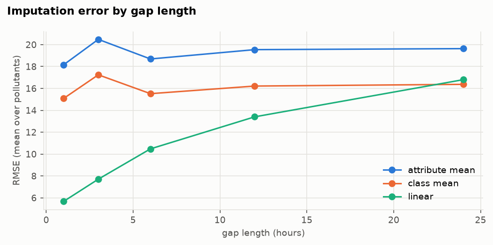

The best method is the same with MAE and RMSE in 37 of 40 pollutant × gap-length cases. Only for 24h gaps does the class mean have a slightly smaller RMSE (16.37 vs 16.80): RMSE punishes the few large errors of interpolation over a full day more than MAE does. The
strategy of section 4.3 does not change.

### A.3 Kolmogorov–Smirnov test
The KS statistic is the largest distance between two cumulative distributions (0 = identical).
- **Imputation** (measured values versus values after imputation):

| pollutant | ks_statistic |
|---|---|
| CO | 0.013 |
| NO | 0.012 |
| NO2 | 0.012 |
| NOx | 0.004 |
| O3 | 0.004 |
| PM10 | 0.004 |
| PM2_5 | 0.004 |
| SO2 | 0.022 |

  The largest distance is 0.022: imputation does not change the shape of the distributions.
- **Sampling** (each 10% sample versus the population):

| method | pollutant | ks_statistic | p_value |
|---|---|---|---|
| SRSWOR | PM2_5 | 0.003 | 0.89 |
| SRSWOR | PM10 | 0.002 | 0.895 |
| SRSWOR | NO2 | 0.002 | 0.979 |
| SRSWOR | O3 | 0.003 | 0.788 |
| SRSWR | PM2_5 | 0.005 | 0.13 |
| SRSWR | PM10 | 0.005 | 0.221 |
| SRSWR | NO2 | 0.003 | 0.654 |
| SRSWR | O3 | 0.004 | 0.561 |
| stratified | PM2_5 | 0.002 | 0.936 |
| stratified | PM10 | 0.003 | 0.606 |
| stratified | NO2 | 0.002 | 0.95 |
| stratified | O3 | 0.004 | 0.545 |

  The smallest p-value is 0.13 > 0.05: no sample differs significantly from the population, which confirms section 5.

### A.4 Yeo-Johnson transformation
The pollutants are strongly right-skewed. The Yeo-Johnson power transformation (fitted on 2019–2023; unlike
Box-Cox it accepts zeros) is compared with log(1 + x):

| pollutant | lambda | skew_original | skew_log1p | skew_yeo_johnson |
|---|---|---|---|---|
| SO2 | 0.068 | 4.1 | -0.16 | 0.0 |
| PM10 | 0.057 | 3.22 | -0.17 | 0.01 |
| PM2_5 | -0.055 | 3.38 | 0.15 | 0.0 |
| O3 | 0.519 | 0.53 | -1.22 | -0.15 |
| NO2 | 0.125 | 2.03 | -0.29 | -0.01 |
| NOx | -0.052 | 5.89 | 0.14 | 0.0 |
| CO | -1.203 | 2.84 | 1.13 | 0.14 |
| NO | -0.329 | 9.64 | 0.75 | 0.12 |

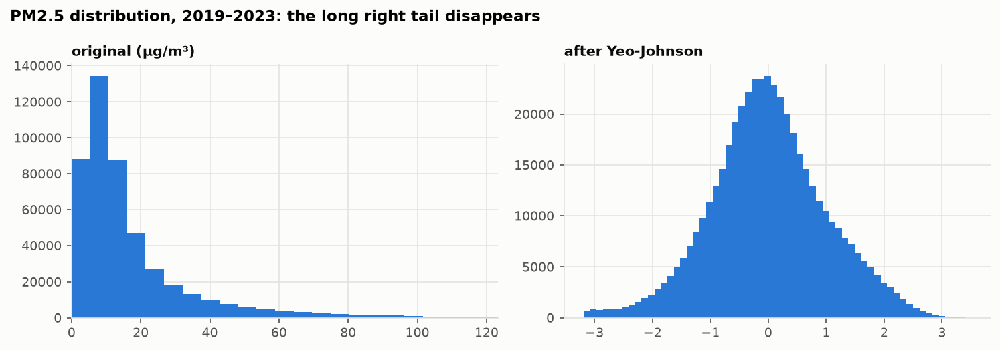

Yeo-Johnson brings the skewness of every pollutant close to 0 (|skew| ≤ 0.15), better than log(1 + x). It is
useful for later methods that assume roughly normal data; the main pipeline keeps the lecture normalizations (6.6).

### A.5 Mutual information
Mutual information measures any (also non-linear) dependence between a feature and the target (PM2.5 of the next
hour), on 50,000 rows of 2019–2023. The top 10 features and how many of the
three lecture methods of section 6.2 selected them (`tables/x_mutual_information.csv`):

| feature | mutual_information | selected_by |
|---|---|---|
| PM2_5_obs | 1.212 | 3 |
| PM10_obs | 0.825 | 1 |
| PM2_5_lag_1h | 0.821 | 3 |
| PM10_lag_1h | 0.608 | 1 |
| PM2_5_roll_mean_24h | 0.458 | 3 |
| PM10_roll_mean_24h | 0.376 | 1 |
| PM2_5_lag_24h | 0.291 | 1 |
| NOx_obs | 0.216 | 1 |
| PM10_lag_24h | 0.211 | 1 |
| month | 0.204 | 1 |

The five most informative features are PM2_5_obs, PM10_obs, PM2_5_lag_1h, PM10_lag_1h, PM2_5_roll_mean_24h; 5 of them were also selected by the lecture
methods, so both approaches point to the same information: recent PM levels.

