# Phase II report: anomaly detection in the air quality data of Kosovo

**Data set:** the cleaned measurements of phase I (EEA Air Quality, country XK, E1a, CC BY 4.0): station-day means
(`data/gold/daily.parquet`) and hourly series (`data/gold/hourly_long/`). This phase only **detects** anomalies; no
value is changed or removed.

**Approach.** An anomaly (outlier) is an object that differs from most other objects. Following the lecture it can be
caused by a measurement error, by natural variation or by a different mechanism (a real pollution episode), and it has
one of three structures. Every structure needs its own representation of the data and its own methods:

| Section | Type of anomaly (lecture) | Representation | Methods | Evaluated with injected |
|---|---|---|---|---|
| 1 | point | station-day: six daily means | KNN distance, LOF, K-Means, Mahalanobis, one-class SVM (z-score as baseline) | gain error, sensor at zero, PM2.5 > PM10 |
| 2 | contextual | station-day relative to its station × month | robust z-score and LOF on the context residuals | wrong season, wrong station |
| 3 | collective | hourly series of every station and pollutant | isolated-spike, stuck-sensor and drift detectors | spikes, frozen runs, drifts |
| 4 | summary | all flags together | catalogue of all anomalies | – |

The setting is **unsupervised** (no labels), so every method follows the three steps of the lecture – build a profile
of normal behaviour, measure how far every observation is from it (the anomaly score), flag the largest scores – and
every parameter is chosen with **known anomalies injected into a copy of the data**, as in the exercises
(precision, recall, F1).

## 1. Point anomalies

A **point anomaly** is a single observation that differs from the rest of the data (lecture: o₁, o₂ in the figure of
N₁ and N₂). Here an observation is one **station-day**, and it is anomalous when its combination of pollutant levels is
unusual. One method from each of the four families of the lecture, plus the one-class SVM, is applied with the same
threshold rule (a point is an outlier when its score is above the 99th percentile of the scores):

| Method | Family | Score of a point | Parameters analysed |
|---|---|---|---|
| KNN distance | proximity-based | mean distance to the k nearest neighbours (exercise) or distance to the k-th (lecture) | k, distance metric, mean vs k-th |
| Local Outlier Factor (LOF) | density-based | density of the neighbours / density of the point | n_neighbors |
| K-Means | clustering-based | distance to the nearest centroid | K, elbow |
| Mahalanobis distance | statistical (multivariate Gaussian) | (x − x̄) S⁻¹ (x − x̄)ᵀ | classic vs robust covariance, log values, χ² threshold |
| One-class SVM | boundary around the normal data | distance outside the learned boundary | gamma, nu |
| z-score (baseline) | statistical (univariate) | largest \|z\| of the day over the pollutants | – |

### 1.1 Feature space
One point = one **station-day**: the daily means of PM10, PM2_5, NO2, O3, SO2, CO (step p4, measured values only, valid days
with ≥ 18 hours). NO and NOx are not used, because they repeat the
information of NO2 (NOx = NO2 + 1.53·NO, phase I). Only days with all six pollutants are kept, because a distance
needs every coordinate: **13,266 station-days from 11 stations**. Daily means are used because a day
is the unit of the limit values and of the episodes, and the distance-based methods have O(n²) complexity (lecture);
the hourly series are analysed separately for temporal anomalies (section 3).

Every pollutant is standardized with the **z-score** (StandardScaler, mean 0, standard deviation 1), as in the
exercise: CO is around 1 mg/m³ and PM10 up to 200 µg/m³, so without scaling the distance would be decided almost only
by PM10 and PM2.5. All pollutants are right-skewed (skewness PM10 2.2, PM2_5 2.4, NO2 1.7, O3 0.2, SO2 3.3, CO 2.8), which matters for the methods that assume a
Gaussian distribution.

| statistic | PM10 | PM2_5 | NO2 | O3 | SO2 | CO |
|---|---|---|---|---|---|---|
| count | 13266.0 | 13266.0 | 13266.0 | 13266.0 | 13266.0 | 13266.0 |
| null_count | 0.0 | 0.0 | 0.0 | 0.0 | 0.0 | 0.0 |
| mean | 24.399 | 17.631 | 16.06 | 46.368 | 10.301 | 0.773 |
| std | 19.183 | 15.799 | 10.2 | 23.351 | 9.089 | 0.766 |
| min | 1.34 | 0.906 | 0.0 | 0.0 | 0.0 | 0.0 |
| 25% | 12.136 | 7.824 | 8.812 | 27.221 | 4.521 | 0.285 |
| 50% | 18.42 | 11.953 | 13.529 | 46.33 | 8.143 | 0.547 |
| 75% | 30.142 | 21.592 | 21.057 | 63.462 | 13.124 | 0.97 |
| max | 166.872 | 155.95 | 107.457 | 122.14 | 115.577 | 7.637 |

### 1.2 How the parameters are evaluated
The real data has no labels that say which days are anomalies (unsupervised setting). The approach of the exercises
is therefore used: to a copy of the data **known anomalies** are added, 133 points
(1%), each a real station-day changed in one of three ways that a faulty instrument produces:

| Injected type | Change | Why it is hard |
|---|---|---|
| gain error | one random pollutant × 2–5 (wrong calibration) | the new value is often still in the normal range |
| sensor at zero | one pollutant that was above its median is set to 0 | a low value is never extreme in skewed data |
| PM2.5 > PM10 | PM2.5 = 1.2–2 × PM10 (physically impossible) | both values stay in their normal range |

The other pollutants stay real, so the anomalies can only be found through the *combination* of the values. Every
setting is evaluated on 3 different injections (seeds 42, 7, 2024);
the tables show the mean and the standard deviation of F1 between them.

- **Precision** = TP / (TP + FP): of the points marked as outliers, the share that are injected anomalies;
- **Recall** = TP / (TP + FN): of the injected anomalies, the share that was found;
- **F1** = 2·P·R / (P + R): the balance of the two, used to choose the best parameter.

Precision, recall and F1 depend on the threshold. Two threshold-free measures check the ranking of the score itself:
- **PR-AUC** (average precision): the mean precision over all recall levels, i.e. how well the anomalies are
  concentrated at the top of the ranking. A random score gets the share of anomalies (≈ 0.01), so
  it is the more informative measure for rare anomalies;
- **ROC-AUC**: the probability that a random anomaly gets a higher score than a random normal day (0.5 = random,
  1 = perfect). With 99% normal days it is easily high, so it is reported but not used for decisions.

The precision is a lower bound: the real data also contains real outliers (pollution episodes), which are counted
as false positives although they are genuinely unusual.

### 1.3 KNN distance (proximity-based): k, metric and score
The exercise uses the mean distance to the k nearest neighbours, the lecture the distance to the k-th neighbour; both
are compared, with the Euclidean and the Manhattan distance (the exercise task). k + 1 neighbours are searched,
because the nearest one is the point itself; k = 1 is not used, because two similar anomalies would hide each other
(lecture figure 10.5). F1 for every k and variant (precision and recall in `tables/o1_knn_evaluation.csv`):

| k | euclidean, mean | euclidean, kth | manhattan, mean | manhattan, kth |
|---|---|---|---|---|
| 3 | 0.262 | 0.247 | 0.215 | 0.22 |
| 5 | 0.247 | 0.227 | 0.212 | 0.197 |
| 10 | 0.227 | 0.19 | 0.195 | 0.182 |
| 15 | 0.212 | 0.18 | 0.19 | 0.17 |
| 20 | 0.195 | 0.175 | 0.18 | 0.16 |
| 30 | 0.185 | 0.165 | 0.17 | 0.14 |
| 50 | 0.172 | 0.14 | 0.16 | 0.135 |

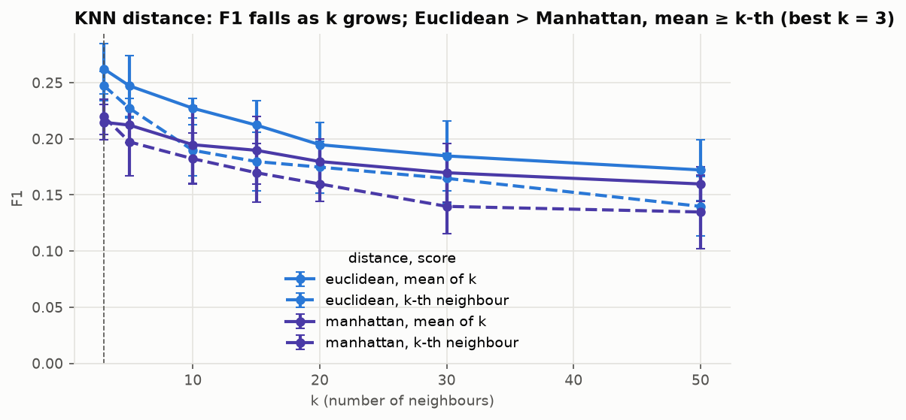

F1 falls as k grows: with many neighbours the score becomes the distance to the whole region, so an anomaly just
outside a dense group looks as normal as a point on the edge of the group (the score is sensitive to k, as the lecture
warns). **Euclidean versus Manhattan:** Euclidean is better for every k: the Manhattan distance adds the differences of all six pollutants, so the
small natural differences of the five unchanged pollutants weigh as much as the one changed pollutant, while the
Euclidean distance squares the differences and lets the one large difference dominate. **Mean versus k-th
neighbour:** the mean is equal or better for every k; the mean of
k distances is less noisy than one single distance.
**Choice: k = 3, euclidean, mean** (F1 = 0.262).

### 1.4 Local Outlier Factor (density-based): n_neighbors
LOF compares the density of a point (reciprocal of the mean distance to its k neighbours) with the density of its
neighbours: LOF ≈ 1 normal, LOF ≫ 1 the point is much sparser than its neighbours. Unlike the KNN distance it is
relative, which matters here because the stations have very different levels (variable density): a day that is normal
for an industrial station in Obiliq can be unusual for a background station, and LOF judges every point by its own
neighbourhood.

| n_neighbors | precision | recall | f1 | f1_std | pr_auc | roc_auc |
|---|---|---|---|---|---|---|
| 5 | 0.48 | 0.484 | 0.482 | 0.028 | 0.474 | 0.923 |
| 10 | 0.512 | 0.516 | 0.514 | 0.016 | 0.493 | 0.929 |
| 15 | 0.49 | 0.494 | 0.492 | 0.03 | 0.474 | 0.929 |
| 20 | 0.468 | 0.471 | 0.469 | 0.019 | 0.452 | 0.926 |
| 30 | 0.428 | 0.431 | 0.429 | 0.016 | 0.416 | 0.922 |
| 50 | 0.386 | 0.388 | 0.387 | 0.019 | 0.35 | 0.914 |
| 100 | 0.291 | 0.293 | 0.292 | 0.02 | 0.248 | 0.898 |

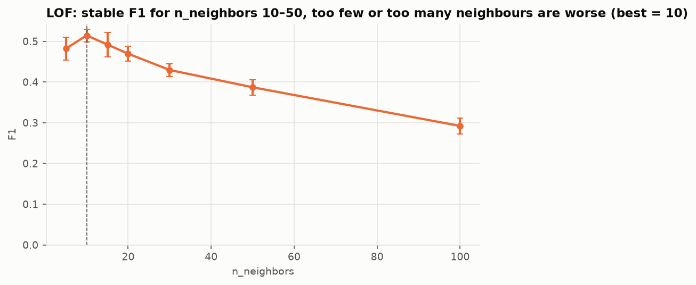

F1 is highest at n_neighbors = 10. With fewer neighbours the density is estimated from too few
points (F1 0.482 at 5), with more the neighbourhood mixes different groups of
stations and seasons and the local view is lost (F1 0.292 at 100).
**Choice: n_neighbors = 10** (F1 = 0.514).

### 1.5 K-Means (clustering-based): K
Every point is assigned to the nearest of K centroids; the score is the distance to it. The inertia (sum of squared
distances to the own centroid, real data) is used for the elbow method.

| K | inertia | precision | recall | f1 | f1_std | pr_auc | roc_auc |
|---|---|---|---|---|---|---|---|
| 2 | 52449.534 | 0.095 | 0.095 | 0.095 | 0.016 | 0.059 | 0.728 |
| 3 | 44101.414 | 0.082 | 0.083 | 0.082 | 0.007 | 0.059 | 0.737 |
| 4 | 38385.367 | 0.092 | 0.093 | 0.092 | 0.011 | 0.074 | 0.748 |
| 5 | 34172.881 | 0.087 | 0.088 | 0.087 | 0.004 | 0.073 | 0.759 |
| 6 | 30794.174 | 0.119 | 0.12 | 0.12 | 0.022 | 0.077 | 0.761 |
| 8 | 26465.11 | 0.147 | 0.148 | 0.147 | 0.023 | 0.096 | 0.767 |
| 10 | 23680.941 | 0.149 | 0.15 | 0.15 | 0.027 | 0.107 | 0.775 |

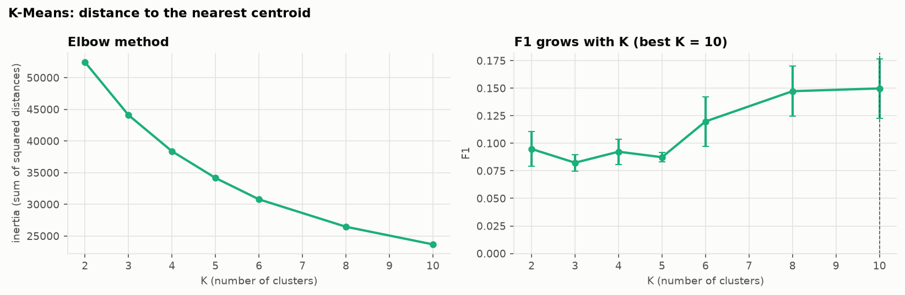

The inertia falls steadily without a clear elbow: the station-days do not form a few separate groups but a continuous
cloud (from clean summer days to polluted winter days). With few clusters a centroid stands in the middle of a large,
spread group, so the most distant points are simply the most polluted days and the anomalies are missed (the same
effect as K = 2 in the exercise; lecture: sensitive to the number of clusters). More clusters describe the cloud
better and F1 grows slowly, but even the best K stays far below the other methods, because a centroid describes a
group by a single point and cannot follow its shape. **Choice: K = 10** (F1 =
0.150).

### 1.6 Mahalanobis distance (statistical): covariance and threshold
The multivariate statistical approach of the lecture: the squared distance (x − x̄) S⁻¹ (x − x̄)ᵀ uses the covariance
matrix S, so a day that goes *against* the correlation of the pollutants is far even if every value is normal. Three
variants are compared: **classic** (mean and covariance of all days), **robust (MCD)** (Minimum Covariance
Determinant: estimated from the most central days only, the "robust covariance estimator" of the lecture) and
**classic on log values** (log(1 + x) makes the skewed distributions closer to the Gaussian that the method assumes).

| variant | precision | recall | f1 | f1_std | pr_auc | roc_auc |
|---|---|---|---|---|---|---|
| classic | 0.174 | 0.175 | 0.175 | 0.011 | 0.16 | 0.836 |
| robust (MCD) | 0.164 | 0.165 | 0.165 | 0.02 | 0.153 | 0.82 |
| classic, log values | 0.321 | 0.323 | 0.322 | 0.007 | 0.348 | 0.908 |

The robust variant is not better (F1 0.165): the central days form a narrow ellipse, and in
skewed data every ordinary polluted day lies far outside it. The log transformation helps most
(0.175 → 0.322), because the method works best when its Gaussian
assumption is closer to the truth.

**Static χ² threshold versus percentile.** For Gaussian data the squared Mahalanobis distance follows a χ²
distribution with 6 degrees of freedom, so the threshold χ²(1 − α) should flag a share α of the days:

| covariance | alpha | chi2_threshold | expected_pct | flagged_pct |
|---|---|---|---|---|
| classic | 0.01 | 16.812 | 1.0 | 5.714 |
| classic | 0.001 | 22.458 | 0.1 | 3.882 |
| robust (MCD) | 0.01 | 16.812 | 1.0 | 28.999 |
| robust (MCD) | 0.001 | 22.458 | 0.1 | 23.044 |

At α = 0.01 the classic distance flags 5.7% and the robust one
29.0% instead of 1%. The Gaussian assumption does not hold, so the
static threshold is not reliable and the percentile is used, as the lecture recommends for non-normal data.
**Choice: classic covariance on log values** (F1 = 0.322).

### 1.7 One-class SVM: gamma and nu
The one-class SVM learns a boundary that encloses as much data as possible with minimum volume; with the RBF kernel the
boundary can follow any shape (lecture: it adapts to several clusters, where a single Gaussian envelope fails).
**gamma** sets how tightly the boundary follows the data (small: smooth, almost an ellipse; large: it wraps every small
group), **nu** is the upper limit of the share of points allowed outside the boundary. F1 for every combination:

| gamma | nu=0.01 | nu=0.05 |
|---|---|---|
| 0.05 | 0.18 | 0.13 |
| 0.1 | 0.205 | 0.177 |
| 0.5 | 0.107 | 0.255 |
| 1.0 | 0.047 | 0.287 |
| 2.0 | 0.045 | 0.027 |

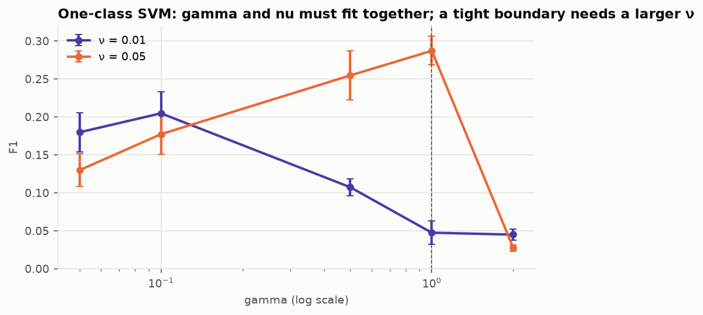

The two parameters must fit together. A larger gamma lets the boundary follow the groups of stations and seasons and
F1 rises, but with a large gamma every support vector only "sees" its close surroundings, and a small nu allows only
few support vectors: most days are then far from all of them, get almost the same score, and the ranking collapses
(gamma = 2, nu=0.05: F1 = 0.027). It is the method that is most
sensitive to its parameters. **Choice: gamma = 1, nu=0.05**
(F1 = 0.287).

### 1.8 Lecture methods that are not used
| Method | Why it is not used for this data |
|---|---|
| Grubbs' test | univariate and assumes a normal distribution, but the daily means are right-skewed; it is made for a few suspects in a small sample (one outlier at a time). For N = 13,266 the critical value is G = 4.62, i.e. just a fixed \|z\| limit; 274 days have a pollutant above it. This is the z-score baseline with another threshold. |
| Likelihood approach | needs a probability model M of the normal data; with a Gaussian M it ranks the days like the Mahalanobis distance (1.6), and a better M would need a mixture model, which is beyond the lectures |
| Density in a fixed radius (DBSCAN) | one radius for all points; the lecture notes that it works poorly with variable density, and LOF (1.4) is its relative version |
| Removing objects / discarding small clusters | needs thresholds for "small" and "far" and repeated clustering; the clustering family is represented by the K-Means distance (1.5) |

### 1.9 Choice of the threshold
The exercises use the 95th percentile (5% outliers). For the best setting of every method:

| method | percentile | precision | recall | f1 |
|---|---|---|---|---|
| KNN | 90.0 | 0.064 | 0.649 | 0.117 |
| KNN | 95.0 | 0.096 | 0.481 | 0.159 |
| KNN | 97.5 | 0.14 | 0.353 | 0.201 |
| KNN | 99.0 | 0.261 | 0.263 | 0.262 |
| KNN | 99.5 | 0.393 | 0.198 | 0.263 |
| LOF | 90.0 | 0.082 | 0.827 | 0.149 |
| LOF | 95.0 | 0.15 | 0.757 | 0.251 |
| LOF | 97.5 | 0.267 | 0.672 | 0.382 |
| LOF | 99.0 | 0.512 | 0.516 | 0.514 |
| LOF | 99.5 | 0.637 | 0.321 | 0.427 |
| K-Means | 90.0 | 0.041 | 0.414 | 0.075 |
| K-Means | 95.0 | 0.058 | 0.293 | 0.097 |
| K-Means | 97.5 | 0.09 | 0.226 | 0.128 |
| K-Means | 99.0 | 0.149 | 0.15 | 0.15 |
| K-Means | 99.5 | 0.209 | 0.105 | 0.14 |
| Mahalanobis | 90.0 | 0.077 | 0.774 | 0.14 |
| Mahalanobis | 95.0 | 0.124 | 0.627 | 0.208 |
| Mahalanobis | 97.5 | 0.178 | 0.449 | 0.255 |
| Mahalanobis | 99.0 | 0.321 | 0.323 | 0.322 |
| Mahalanobis | 99.5 | 0.552 | 0.278 | 0.37 |
| One-class SVM | 90.0 | 0.071 | 0.714 | 0.129 |
| One-class SVM | 95.0 | 0.1 | 0.501 | 0.166 |
| One-class SVM | 97.5 | 0.163 | 0.411 | 0.234 |
| One-class SVM | 99.0 | 0.286 | 0.288 | 0.287 |
| One-class SVM | 99.5 | 0.418 | 0.211 | 0.28 |
| z-score | 90.0 | 0.027 | 0.273 | 0.049 |
| z-score | 95.0 | 0.042 | 0.211 | 0.07 |
| z-score | 97.5 | 0.062 | 0.155 | 0.088 |
| z-score | 99.0 | 0.097 | 0.098 | 0.097 |
| z-score | 99.5 | 0.144 | 0.073 | 0.097 |

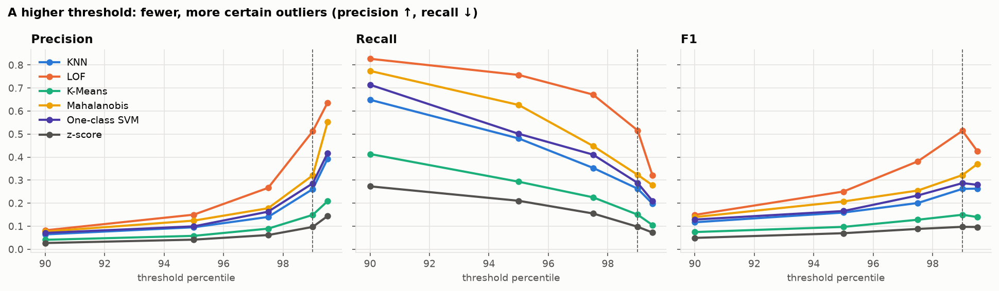

A lower threshold finds more anomalies but marks many normal days (LOF at the 95th percentile: recall
0.76, precision 0.15); a higher threshold marks fewer but more certain days.
**Choice: the 99th percentile** (top 1%, about 133 station-days per method),
where precision and recall are balanced (LOF: 0.51 / 0.52) and the number of days
can still be checked one by one. The 95th percentile of the exercise would mark about 663 days,
most of them ordinary winter days.

### 1.10 Comparison and final decision
Best setting of every method at the 99th percentile:

| method | variant | parameter | precision | recall | f1 | f1_std | pr_auc | roc_auc |
|---|---|---|---|---|---|---|---|---|
| KNN | euclidean, mean | 3.0 | 0.261 | 0.263 | 0.262 | 0.022 | 0.239 | 0.875 |
| LOF | - | 10.0 | 0.512 | 0.516 | 0.514 | 0.016 | 0.493 | 0.929 |
| K-Means | - | 10.0 | 0.149 | 0.15 | 0.15 | 0.027 | 0.107 | 0.775 |
| Mahalanobis | classic, log values | 0.0 | 0.321 | 0.323 | 0.322 | 0.007 | 0.348 | 0.908 |
| One-class SVM | nu=0.05 | 1.0 | 0.286 | 0.288 | 0.287 | 0.019 | 0.261 | 0.884 |
| z-score | - | 0.0 | 0.097 | 0.098 | 0.097 | 0.007 | 0.062 | 0.685 |

Recall of every method by type of injected anomaly and by changed pollutant (gain error and sensor at zero):

| type | KNN | LOF | K-Means | Mahalanobis | One-class SVM | z-score |
|---|---|---|---|---|---|---|
| PM2.5 > PM10 | 0.242 | 0.644 | 0.114 | 0.053 | 0.265 | 0.068 |
| gain error | 0.385 | 0.467 | 0.281 | 0.289 | 0.415 | 0.215 |
| sensor at zero | 0.159 | 0.439 | 0.053 | 0.629 | 0.182 | 0.008 |

| pollutant | KNN | LOF | K-Means | Mahalanobis | One-class SVM | z-score |
|---|---|---|---|---|---|---|
| CO | 0.109 | 0.174 | 0.065 | 0.043 | 0.13 | 0.043 |
| NO2 | 0.256 | 0.385 | 0.205 | 0.513 | 0.282 | 0.154 |
| O3 | 0.31 | 0.405 | 0.262 | 0.476 | 0.333 | 0.19 |
| PM10 | 0.404 | 0.75 | 0.25 | 0.885 | 0.442 | 0.135 |
| PM2_5 | 0.4 | 0.756 | 0.178 | 0.711 | 0.444 | 0.133 |
| SO2 | 0.14 | 0.186 | 0.047 | 0.047 | 0.14 | 0.023 |

The methods see different anomalies. **LOF** finds the impossible PM2.5 > PM10 best (recall
0.64): the two values stay high together, i.e. along the PM10–PM2.5 correlation, so the Mahalanobis
distance hardly grows (recall 0.05), while LOF sees that such a ratio is locally
rare. **Mahalanobis** finds the sensor at zero best (0.63): on log values a zero lies far below every
usual value, while the univariate z-score almost never sees it (0.01), because a
low value is never extreme in right-skewed data. Errors in CO and SO2 are hard for every method: these pollutants
already vary strongly between stations (SO2 near the power plants, CO from heating).

**Threshold-free check.** Is the result an effect of the 99th-percentile threshold? For every method the setting
chosen by F1 is compared with the setting that has the highest PR-AUC:

| method | f1_variant | f1_param | f1 | pr_auc | roc_auc | pr_auc_variant | pr_auc_param | best_pr_auc | same_choice |
|---|---|---|---|---|---|---|---|---|---|
| KNN | euclidean, mean | 3.0 | 0.262 | 0.239 | 0.875 | euclidean, mean | 3.0 | 0.239 | True |
| LOF | - | 10.0 | 0.514 | 0.493 | 0.929 | - | 10.0 | 0.493 | True |
| K-Means | - | 10.0 | 0.15 | 0.107 | 0.775 | - | 10.0 | 0.107 | True |
| Mahalanobis | classic, log values | 0.0 | 0.322 | 0.348 | 0.908 | classic, log values | 0.0 | 0.348 | True |
| One-class SVM | nu=0.05 | 1.0 | 0.287 | 0.261 | 0.884 | nu=0.05 | 1.0 | 0.261 | True |
| z-score | - | 0.0 | 0.097 | 0.062 | 0.685 | - | 0.0 | 0.062 | True |

PR-AUC chooses **the same setting for every method** and ranks the methods **in the same order** as F1 (LOF > Mahalanobis > One-class SVM > KNN > K-Means > z-score; a random score would get 0.01). The decision therefore does not depend on the chosen threshold. ROC-AUC gives the same picture but squeezes the methods into a narrow range (0.68–0.93) because of the many normal days, which is why PR-AUC is the more useful threshold-free measure here.

**How to combine the methods.** Because the methods are complementary, four combination rules are evaluated on the
same injections:

| rule | flagged_pct | precision | recall | f1 | f1_std |
|---|---|---|---|---|---|
| LOF only | 1.0 | 0.512 | 0.516 | 0.514 | 0.016 |
| LOF or Mahalanobis | 1.717 | 0.359 | 0.622 | 0.455 | 0.012 |
| ≥ 2 of 5 methods | 1.271 | 0.305 | 0.391 | 0.343 | 0.028 |
| ≥ 3 of 5 methods | 0.709 | 0.35 | 0.251 | 0.292 | 0.024 |

| rule | gain error | sensor at zero | PM2.5 > PM10 |
|---|---|---|---|
| LOF only | 0.467 | 0.439 | 0.644 |
| LOF or Mahalanobis | 0.541 | 0.682 | 0.644 |
| ≥ 2 of 5 methods | 0.481 | 0.424 | 0.265 |
| ≥ 3 of 5 methods | 0.378 | 0.159 | 0.212 |

Majority voting is clearly worse (≥ 3 of 5 methods: F1 0.292): the weaker methods outvote LOF on the
anomalies that only LOF finds (PM2.5 > PM10 recall 0.21). LOF or
Mahalanobis finds the most anomalies (recall 0.62, sensor at zero
0.68) but marks 1.7% of the days with a
lower precision (0.36).

**Final decision.** Ranking of the single methods by F1:
LOF 0.514, Mahalanobis 0.322, One-class SVM 0.287, KNN 0.262, K-Means 0.150, z-score 0.097.
- **Point anomaly = LOF only** (highest F1 of all rules: 0.514): LOF is the best method for
  2 of the 3 types (gain error, PM2.5 > PM10), its relative density fits data in which
  every station has its own level, and it is stable between the injections.
- If finding as many faults as possible matters more than false alarms (e.g. a data-quality check before an
  analysis), **LOF or Mahalanobis** is the better rule, because Mahalanobis adds the zero readings.
- K-Means and the univariate z-score are the weakest and are not needed for the decision.

### 1.11 Point anomalies in the real data
The five methods run with their chosen settings on the 13,266 real station-days (no injected points):

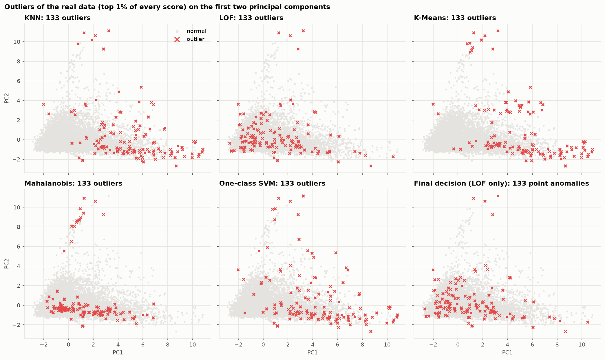

Number of methods that flag the same day, and the overlap of every pair of methods:

| n_methods | days |
|---|---|
| 0 | 12884 |
| 1 | 221 |
| 2 | 80 |
| 3 | 48 |
| 4 | 25 |
| 5 | 8 |

| pair | common | jaccard |
|---|---|---|
| KNN & LOF | 49 | 0.226 |
| KNN & K-Means | 68 | 0.343 |
| KNN & Mahalanobis | 19 | 0.077 |
| KNN & One-class SVM | 100 | 0.602 |
| LOF & K-Means | 25 | 0.104 |
| LOF & Mahalanobis | 24 | 0.099 |
| LOF & One-class SVM | 52 | 0.243 |
| K-Means & Mahalanobis | 31 | 0.132 |
| K-Means & One-class SVM | 59 | 0.285 |
| Mahalanobis & One-class SVM | 27 | 0.113 |

The methods agree only partly, because they define "different" differently (far away, less dense, far from a
centroid, against the correlation, outside a boundary). The final decision (LOF only) gives **133 point
anomalies**; 86 of them have no pollutant with \|z\| > 3, so they are anomalies only because of
the combination of the pollutants and a univariate rule would not find them.

Per station (share of its days) and the pollutant with the largest \|z\| on these days:

| station_id | outlier_days | days | pct |
|---|---|---|---|
| XK0001A | 15 | 1253 | 1.197 |
| XK0002A | 16 | 1314 | 1.218 |
| XK0003A | 8 | 1369 | 0.584 |
| XK0004A | 16 | 1345 | 1.19 |
| XK0005A | 5 | 1320 | 0.379 |
| XK0006A | 12 | 1310 | 0.916 |
| XK0008A | 11 | 1188 | 0.926 |
| XK0009A | 6 | 998 | 0.601 |
| XK0010A | 6 | 1067 | 0.562 |
| XK0011A | 9 | 1112 | 0.809 |
| XK0012A | 29 | 990 | 2.929 |

| driver | outlier_days |
|---|---|
| CO | 29 |
| PM10 | 26 |
| SO2 | 26 |
| O3 | 24 |
| NO2 | 21 |
| PM2_5 | 7 |

Dates on which the point anomalies appear at several stations at once:

| date | stations | PM10 | PM2_5 | pm25_pm10_ratio | main_driver |
|---|---|---|---|---|---|
| 2020-03-28 | 5 | 112.026 | 58.161 | 0.526 | PM10 |
| 2020-05-15 | 5 | 79.341 | 19.504 | 0.249 | PM10 |
| 2020-03-27 | 4 | 122.156 | 58.113 | 0.475 | PM10 |
| 2020-03-20 | 3 | 56.239 | 41.104 | 0.734 | PM10 |
| 2020-03-29 | 3 | 79.347 | 45.858 | 0.57 | PM10 |
| 2021-02-17 | 3 | 80.528 | 75.41 | 0.926 | PM2_5 |
| 2021-08-17 | 3 | 31.563 | 17.584 | 0.563 | O3 |
| 2020-04-10 | 2 | 43.348 | 28.575 | 0.656 | O3 |
| 2021-06-26 | 2 | 25.21 | 8.792 | 0.349 | O3 |
| 2021-09-18 | 2 | 7.824 | 5.319 | 0.756 | NO2 |

*… 2 more rows in the CSV.*

The largest episode is **2020-03-28**: 5 stations at once, mean PM10 112 µg/m³ with a PM2.5/PM10 ratio of only 0.53 (median of all station-days: 0.72). Many stations together and a low share of fine particles is the pattern of transported coarse dust, not of local smoke from heating (which has a high ratio); such a day is a real event, not a sensor error.

The strongest point anomalies (most methods first, then by LOF; all in `tables/o1_top_outliers.csv`):

| station_id | date | PM10 | PM2_5 | NO2 | O3 | SO2 | CO | driver | driver_z | n_methods | score_lof |
|---|---|---|---|---|---|---|---|---|---|---|---|
| XK0001A | 2020-03-27 | 138.98 | 61.76 | 8.96 | 76.92 | 11.8 | 3.68 | PM10 | 5.97 | 5 | 1.96 |
| XK0001A | 2020-03-28 | 125.87 | 60.16 | 14.4 | 61.17 | 12.84 | 3.91 | PM10 | 5.29 | 5 | 1.92 |
| XK0004A | 2020-05-15 | 69.98 | 18.54 | 21.9 | 23.9 | 98.59 | 0.31 | SO2 | 9.71 | 5 | 1.87 |
| XK0002A | 2020-05-15 | 104.31 | 22.46 | 20.49 | 55.95 | 10.42 | 1.82 | PM10 | 4.17 | 5 | 1.83 |
| XK0001A | 2020-05-15 | 83.42 | 20.35 | 9.81 | 67.85 | 9.61 | 0.47 | PM10 | 3.08 | 5 | 1.79 |
| XK0012A | 2021-11-13 | 102.64 | 70.48 | 1.08 | 16.26 | 5.0 | 2.01 | PM10 | 4.08 | 5 | 1.55 |
| XK0004A | 2020-05-14 | 41.14 | 11.55 | 23.23 | 14.32 | 109.87 | 0.33 | SO2 | 10.96 | 5 | 1.5 |
| XK0004A | 2020-06-05 | 15.87 | 6.89 | 22.12 | 14.73 | 111.41 | 0.21 | SO2 | 11.12 | 5 | 1.48 |
| XK0010A | 2023-07-26 | 27.03 | 7.51 | 5.94 | 106.44 | 37.75 | 0.07 | SO2 | 3.02 | 4 | 2.02 |
| XK0010A | 2023-07-27 | 4.17 | 3.4 | 5.26 | 90.12 | 44.82 | 0.07 | SO2 | 3.8 | 4 | 2.01 |
| XK0004A | 2020-03-28 | 131.16 | 56.47 | 20.8 | 59.86 | 41.79 | 0.09 | PM10 | 5.57 | 4 | 1.97 |
| XK0002A | 2021-08-17 | 42.68 | 22.6 | 28.49 | 78.08 | 14.1 | 5.55 | CO | 6.24 | 4 | 1.95 |
| XK0001A | 2022-01-14 | 97.58 | 86.64 | 61.51 | 14.35 | 3.3 | 5.21 | CO | 5.79 | 4 | 1.88 |
| XK0004A | 2020-05-16 | 57.65 | 26.98 | 22.45 | 11.13 | 115.58 | 0.36 | SO2 | 11.58 | 4 | 1.87 |
| XK0002A | 2020-01-11 | 94.49 | 70.88 | 52.58 | 13.56 | 18.72 | 0.0 | PM10 | 3.65 | 4 | 1.86 |

The list contains both kinds of outliers: **real events** (regional dust and winter smog days on several stations at
once; SO2 episodes at a single station, e.g. Mitrovica in May 2020, while NO2 and CO stay normal, which points to one
local source) and **suspicious values** (e.g. very high daily CO at a station while the particles are moderate), which
need a check of the instrument. This is why the anomalies are only flagged and not removed.

## 2. Contextual anomalies

A **contextual anomaly** is a value that is anomalous only in its context (lecture: 20 °C is normal in May but not in
January). The lecture separates **contextual attributes**, which define the context, from **behavioural attributes**,
whose values are judged. Here the contextual attributes are the **station** (every station has its own sources and
level) and the **month** (heating season, sunshine for O3); the behavioural attributes are the six daily means of
section 1. A day with summer values in January, or with the values of an industrial station at a background station,
is globally normal, so the point methods of section 1 cannot see it.

### 2.1 Method: remove the context, then detect
1. **Context profile:** for every context group (e.g. station XK0001A in January) the median and the MAD of
   log(1 + value) of every pollutant: what is usual for that station in that month. The log makes the skewed values
   more symmetric; the median and the MAD are not pulled by the outliers of the group.
2. **Residual:** every value becomes a robust z-score within its group, (log value − median) / (1.4826 · MAD), i.e.
   how unusual it is *for its context*.
3. **Detection on the residuals** with two methods: the **contextual robust z-score** (largest \|residual\| of the
   day, statistical, one pollutant at a time) and **LOF on the residual vectors** (the best point method of section
   1, all pollutants together), with the same 99th-percentile threshold.

The context granularity is the main parameter: **none** (global, as in section 1), **station**, **station × season**
or **station × month**; for LOF also n_neighbors (10, 20, 50).

### 2.2 Evaluation with injected contextual anomalies
As in section 1, 1% known anomalies are added to a copy of the data, now of two
contextual types: **wrong season** (the real values of the same station from a day 150–215 days away, e.g. summer
values in winter) and **wrong station** (the real values of another station on the same date). Every injected day is
a real day, so its values are normal for the data set as a whole.

Contextual robust z-score, F1 by context:

| context | precision | recall | f1 | f1_std | pr_auc | roc_auc |
|---|---|---|---|---|---|---|
| none | 0.005 | 0.005 | 0.005 | 0.004 | 0.01 | 0.498 |
| station | 0.037 | 0.038 | 0.037 | 0.013 | 0.019 | 0.585 |
| station × season | 0.095 | 0.095 | 0.095 | 0.023 | 0.051 | 0.753 |
| station × month | 0.092 | 0.093 | 0.092 | 0.024 | 0.068 | 0.8 |

LOF on the residuals, F1 by n_neighbors (rows) and context (columns):

| param | none | station | station × season | station × month |
|---|---|---|---|---|
| 10 | 0.002 | 0.105 | 0.165 | 0.205 |
| 20 | 0.0 | 0.097 | 0.16 | 0.202 |
| 50 | 0.002 | 0.092 | 0.132 | 0.182 |

The same for the threshold-free PR-AUC (a random score gets ≈ 0.01):

| param | none | station | station × season | station × month |
|---|---|---|---|---|
| 10 | 0.008 | 0.046 | 0.114 | 0.132 |
| 20 | 0.009 | 0.047 | 0.118 | 0.132 |
| 50 | 0.009 | 0.045 | 0.102 | 0.121 |

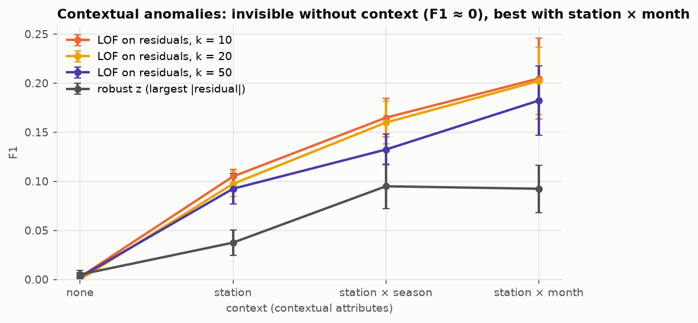

**Without context both methods find nothing** (best recall of any global setting: wrong season 0.005,
wrong station 0.005; the global robust z-score has ROC-AUC 0.50 and PR-AUC
0.010, exactly the values of a random score): this confirms the lecture – a contextual anomaly cannot be detected by
looking at the values alone. The station alone already helps, adding the season or the month helps much more, and
**station × month** gives the best result. LOF on the residuals is clearly better than
the robust z-score (F1 0.205 vs 0.095), because a wrong day changes several pollutants
at once only a little, and LOF sees the whole vector while the robust z-score sees one pollutant at a time.
Recall of the best setting of each method by type:

| context | method | param | wrong station | wrong season |
|---|---|---|---|---|
| station × month | LOF | 10 | 0.172 | 0.239 |
| station × season | robust z | 0 | 0.066 | 0.124 |

**Choice: LOF on the residuals, context station × month, n_neighbors = 10** (F1 = 0.205, PR-AUC =
0.132, 13× a random score). The highest PR-AUC is reached by
LOF, context station × month, n_neighbors = 20 (0.132),
the same context, so the threshold-free measure confirms the choice. The F1 is lower
than for the point anomalies, because a real day from another month or station is often similar to a normal day of the
right context (e.g. April and May, or two background stations); only clearly different contexts are found.

### 2.3 Contextual anomalies in the real data
The chosen setting marks **133 station-days**; **114** of them are *not* point anomalies of
section 1, so the context adds anomalies that the global methods do not see.

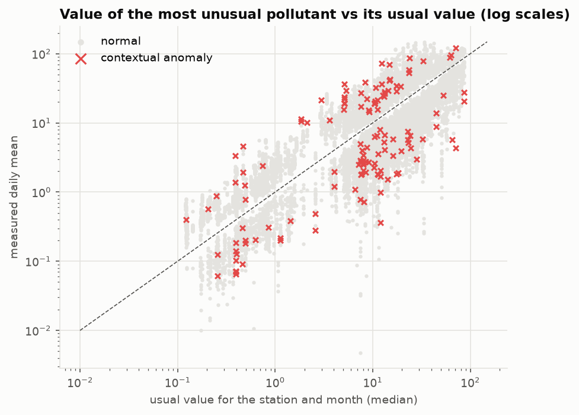

77 of the 133 days are **lower** than usual for their context, the others higher. The most frequent
pollutant is shown below, and the most anomalies fall in month 7 (26 days):

| context_driver | days |
|---|---|
| SO2 | 42 |
| CO | 30 |
| NO2 | 23 |
| PM10 | 16 |
| O3 | 13 |
| PM2_5 | 9 |

| month | days |
|---|---|
| 1 | 3 |
| 2 | 9 |
| 3 | 2 |
| 4 | 16 |
| 5 | 14 |
| 6 | 20 |
| 7 | 26 |
| 8 | 10 |
| 9 | 11 |
| 10 | 10 |
| 11 | 5 |
| 12 | 7 |

The strongest contextual anomalies that are not point anomalies (`tables/o2_top_contextual.csv`):

| station_id | date | context_driver | value | usual_value | context_residual | score_contextual |
|---|---|---|---|---|---|---|
| XK0011A | 2024-07-28 | SO2 | 34.17 | 17.47 | 4.24 | 2.5 |
| XK0008A | 2021-12-10 | SO2 | 27.37 | 7.61 | 6.53 | 2.44 |
| XK0011A | 2023-07-26 | SO2 | 1.81 | 17.47 | -12.4 | 2.39 |
| XK0011A | 2023-07-09 | O3 | 5.68 | 64.97 | -11.92 | 2.38 |
| XK0011A | 2021-09-14 | NO2 | 32.23 | 10.72 | 3.87 | 2.28 |
| XK0003A | 2020-09-16 | CO | 0.09 | 0.46 | -6.14 | 2.2 |
| XK0011A | 2021-10-11 | SO2 | 0.72 | 8.12 | -7.25 | 2.15 |
| XK0008A | 2023-06-03 | O3 | 4.37 | 70.52 | -13.97 | 2.11 |
| XK0002A | 2021-02-11 | SO2 | 0.37 | 12.0 | -12.76 | 2.09 |
| XK0010A | 2024-06-23 | SO2 | 23.83 | 5.14 | 3.56 | 1.91 |
| XK0010A | 2024-04-09 | SO2 | 21.42 | 2.97 | 3.27 | 1.89 |
| XK0002A | 2021-06-09 | CO | 3.36 | 0.39 | 12.84 | 1.88 |

Two kinds stand out. **Too low for the context:** e.g. O3 of a few µg/m³ on a July day when 60–70 µg/m³ is usual, or
SO2 near zero at a station that usually measures 10–20 µg/m³. A low value is never a global outlier, but it is a
typical sign of an analyzer that stopped working properly (or a real, very clean day). **Too high for the context:**
e.g. SO2 or CO several times the usual summer value at an industrial station, which points to a local emission event.
Both kinds are flagged for a check, not removed.

## 3. Collective anomalies in the hourly series

A **collective anomaly** is a sequence of related values that is anomalous together, while the single values may look
normal (lecture: the flat segment in an ECG). It needs sequential data, so this section uses the **hourly series** of
every station and pollutant (93 series, 3,697,899 measured hours that passed the cleaning of phase I)
instead of the station-days. Three typical faults of an air-quality analyzer are searched, each with a detector that
fits its shape:

| Fault | Shape in the series | Detector (score) | Parameter |
|---|---|---|---|
| isolated spike | one value jumps up and falls straight back | min(v − previous, v − next) / robust std of the hourly changes | threshold t |
| stuck sensor | the same value repeated hour after hour (a flat line) | length of the run of identical values | minimum length L |
| drift | the station slowly moves away from the others | shift of the last W days against the previous 60 days, relative to the other stations, as a robust z-score | window W, threshold t |

The spike score takes the *smaller* of the two jumps, so the start of a real episode (a rise that is not followed by a
fall) gets a low score; dividing by the robust spread of the hourly changes (1.4826 · MAD) makes quiet and busy series
comparable. For the stuck sensor, runs of 0 are ignored for CO, O3, SO2, NO, which
can really stay below the detection limit in clean air (the same rule as phase I). For the drift the other stations
are the reference: the regional weather moves all stations together and cancels out.

### 3.1 Evaluation with injected faults
Every detector is evaluated with injected faults of its own type (3 seeds): spikes in
0.1% of the hours (value × 3–6), 200
frozen runs of 3–24 hours, and 30 drifts in which a series
grows to 2× its value over 30 days. For the faults that last several points,
precision is counted on points and recall on events (one alarm is enough to find a frozen or drifting sensor).

Isolated spike:

| param | precision | recall | f1 | f1_std |
|---|---|---|---|---|
| t = 10 | 0.116 | 0.656 | 0.198 | 0.001 |
| t = 20 | 0.233 | 0.434 | 0.304 | 0.003 |
| t = 30 | 0.324 | 0.296 | 0.31 | 0.005 |
| t = 50 | 0.493 | 0.159 | 0.24 | 0.009 |
| t = 80 | 0.665 | 0.074 | 0.134 | 0.005 |

Stuck sensor:

| param | precision | recall | f1 | f1_std |
|---|---|---|---|---|
| L = 3 h | 0.579 | 1.0 | 0.733 | 0.005 |
| L = 4 h | 0.679 | 0.935 | 0.786 | 0.002 |
| L = 6 h | 0.779 | 0.785 | 0.782 | 0.007 |
| L = 12 h | 0.93 | 0.462 | 0.617 | 0.022 |

Drift:

| param | precision | recall | f1 | f1_std |
|---|---|---|---|---|
| W = 3 d, t = 3 | 0.021 | 0.467 | 0.041 | 0.017 |
| W = 3 d, t = 4 | 0.02 | 0.256 | 0.037 | 0.02 |
| W = 3 d, t = 5 | 0.017 | 0.144 | 0.03 | 0.011 |
| W = 7 d, t = 3 | 0.024 | 0.444 | 0.045 | 0.018 |
| W = 7 d, t = 4 | 0.023 | 0.256 | 0.042 | 0.022 |
| W = 7 d, t = 5 | 0.019 | 0.111 | 0.032 | 0.012 |
| W = 14 d, t = 3 | 0.021 | 0.378 | 0.04 | 0.017 |
| W = 14 d, t = 4 | 0.022 | 0.222 | 0.04 | 0.021 |
| W = 14 d, t = 5 | 0.022 | 0.089 | 0.034 | 0.001 |

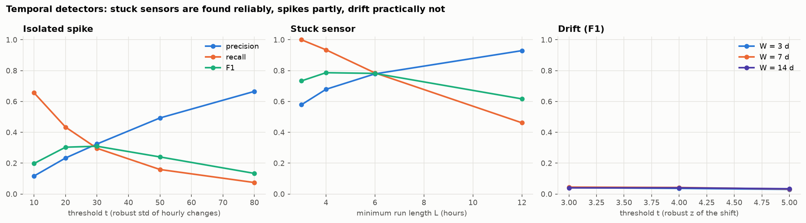

- **Stuck sensor** is found reliably: with L = 3 h every run is found but short natural repeats
  also count; longer L misses the short faults. **Choice: L = 4 h** (F1 = 0.786).
- **Spike:** a low threshold finds most spikes but also many short natural peaks (a passing truck, a plume from a
  chimney); a high threshold is precise but misses the smaller spikes. **Choice: t = 30** (F1 =
  0.310); the injected spikes are only 0.1% of the hours, so even a few hundred natural
  peaks lower the precision.
- **Drift is not detectable** with this data: the best setting (W = 7 d, t = 3) finds 44% of the
  drifts, but 98% of its alarms are false. A slow change up to ×2 in a month
  is within the natural day-to-day differences between stations. In practice drift is found with a reference
  instrument at the same place or with regular calibration checks; the detector is therefore **not used** for flags,
  and drift remains a limitation of the analysis.

### 3.2 Check against the rules of phase I (real labels)
Phase I removed 473 hours as spikes and 3171 hours as
stuck with fixed rules. Running the statistical detectors on the raw values of these hours shows whether both
approaches agree on real faults:

| fault | phase1_hours | found_again | share_found | flags_on_kept_hours |
|---|---|---|---|---|
| spike | 473 | 258 | 0.545 | 2248 |
| stuck sensor | 3171 | 3171 | 1.0 | 222 |

The stuck detector finds **100%** of the stuck hours of phase I again, the spike
detector 55% of the spikes: phase I used one threshold per pollutant (P99.9 of the
changes), the detector one per series, so small spikes in very variable series are judged differently. The agreement
on real faults supports both the rules of phase I and the detectors.

### 3.3 Temporal anomalies in the real (cleaned) data
After the cleaning of phase I the detectors still find **2,303 spike hours** and **1,093 stuck
hours** (`data/gold/anomalies_temporal.parquet`):

| pollutant | spike_hours | stuck_hours | hours | spikes_per_1000h |
|---|---|---|---|---|
| CO | 394 | 93 | 477842 | 0.825 |
| NO | 900 | 4 | 397815 | 2.262 |
| NO2 | 109 | 861 | 433861 | 0.251 |
| NOx | 39 | 99 | 404440 | 0.096 |
| PM10 | 90 | 5 | 531247 | 0.169 |
| PM2_5 | 8 | 5 | 531393 | 0.015 |
| SO2 | 763 | 26 | 470896 | 1.62 |

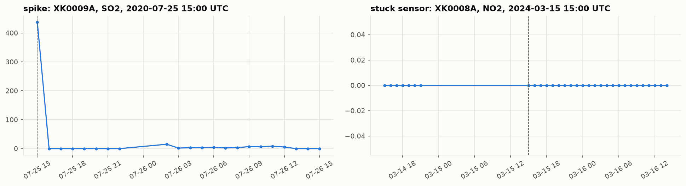

The strongest spikes:

| station_id | pollutant | ts_utc | v | spike_score |
|---|---|---|---|---|
| XK0009A | SO2 | 2020-07-25 15:00:00+00:00 | 437.7 | 637.7 |
| XK0010A | NO | 2021-11-02 10:00:00+00:00 | 133.1 | 345.4 |
| XK0008A | SO2 | 2021-03-12 10:00:00+00:00 | 198.7 | 323.0 |
| XK0012A | NO | 2020-02-04 20:00:00+00:00 | 132.6 | 270.0 |
| XK0012A | CO | 2020-04-28 13:00:00+00:00 | 14.5 | 261.1 |
| XK0007A | NO2 | 2022-03-25 15:00:00+00:00 | 83.9 | 226.7 |
| XK0011A | SO2 | 2024-08-08 10:00:00+00:00 | 193.4 | 215.5 |
| XK0010A | SO2 | 2020-07-01 10:00:00+00:00 | 115.5 | 178.0 |
| XK0008A | SO2 | 2019-07-08 09:00:00+00:00 | 97.4 | 175.0 |
| XK0012A | NO | 2023-12-19 16:00:00+00:00 | 105.7 | 172.7 |

Spikes are most frequent for NO, SO2 and CO, the pollutants of local sources: a plume from a chimney or the power plant
(SO2) or traffic near the analyzer (NO, CO) can raise a single hour; such hours may be real short events or faults and
need a look at the neighbouring stations. Of the stuck hours, 962 are runs of 0, mostly NO2 at
Brezovica (XK0007A), a remote mountain station. 870 of these zeros exist only because phase I
set small negative readings to 0 (`zero_negative`): the analyzer was measuring noise around zero, i.e. NO2 at the
detection limit, which after the conversion looks like a frozen line. They are therefore low-concentration periods
rather than frozen sensors, and the phase-I rule "0 is not plausible for NO2" is too strict for such a clean station.
The non-zero runs (e.g. CO at Palaj, XK0010A, in 2024) are more likely real frozen values. All of them are flagged,
none is removed.

## 4. Summary: catalogue of all anomalies

Every anomaly type was detected with the representation and the method that fit it, and every choice was checked with
injected anomalies of that type. The overview of the chosen methods (`tables/o4_methods_overview.csv`):

| type | representation | method | precision | recall | f1 |
|---|---|---|---|---|---|
| point | station-day (6 daily means) | LOF + Mahalanobis + KNN + K-Means + SVM, rule: LOF only | 0.512 | 0.516 | 0.514 |
| contextual | station-day minus the station × month profile | LOF on residuals, context station × month, k = 10 | 0.204 | 0.206 | 0.205 |
| spike | hourly series | isolated spike, t = 30 | 0.324 | 0.296 | 0.31 |
| stuck sensor | hourly series | constant non-zero run, L = 4 h | 0.679 | 0.935 | 0.786 |
| drift | daily series vs other stations | shift of the recent days, W = 7 d, t = 3 | 0.024 | 0.444 | 0.045 |

The F1 values are not comparable between the types (different data and different injected faults), but they show how
reliably each type can be detected: stuck sensors very well, point anomalies well, spikes and contextual anomalies
partly, drift not.

### 4.1 One catalogue
All results are combined into one catalogue (`data/gold/anomaly_catalogue.parquet`): **2,256 station-days**
have at least one anomaly, 52 of them more than one type.

| type | station_days |
|---|---|
| point | 133 |
| contextual | 133 |
| spike | 1885 |
| stuck sensor | 160 |

| types | station_days |
|---|---|
| spike | 1852 |
| stuck sensor | 153 |
| contextual | 107 |
| point | 92 |
| point + spike | 19 |
| point + contextual | 16 |
| contextual + spike | 7 |
| spike + stuck sensor | 4 |
| point + stuck sensor | 3 |
| point + contextual + spike | 3 |

The types overlap little: each representation finds its own anomalies, which is why all of them are needed to find
"any" anomaly. Spikes are the most frequent (1,885 station-days) because a single hour is enough.

### 4.2 Where and when

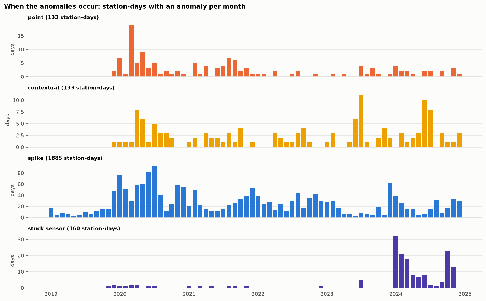

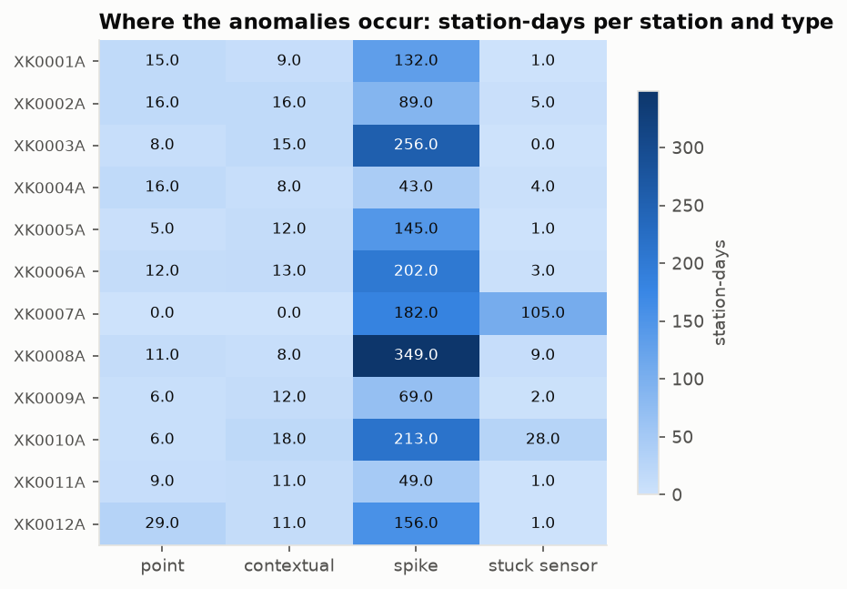

| year | point | contextual | spike | stuck sensor |
|---|---|---|---|---|
| 2019 | 2 | 1 | 147 | 3 |
| 2020 | 56 | 31 | 639 | 8 |
| 2021 | 36 | 20 | 320 | 6 |
| 2022 | 8 | 15 | 337 | 1 |
| 2023 | 12 | 31 | 196 | 5 |
| 2024 | 19 | 35 | 246 | 137 |

Point anomalies are most frequent in 2020 (56 station-days, among them the dust
episode of March 2020 and the SO2 episode in Mitrovica in May 2020, section 1.11). The stuck-sensor alarms
are concentrated at Brezovica (XK0007A, NO2 at zero) and Palaj (XK0010A), which shows that a few instruments cause
most of the technical faults.

### 4.3 Decisions of the anomaly detection
| Decision | Reason |
|---|---|
| Three types of anomalies (point, contextual, collective) with their own representation | the lecture's structure of anomalies; one representation cannot show all types |
| Every choice evaluated with injected anomalies of its type (3 seeds) | the real data has no labels; injection gives precision, recall and F1 |
| Point anomalies: LOF, threshold 99th percentile; Mahalanobis as an optional addition | best F1 of all methods and combination rules; Mahalanobis adds the zero readings |
| Majority voting is not used | the weaker methods outvote LOF (lower F1) |
| Contextual anomalies: LOF on residuals of the station × month profile | without context the F1 is ≈ 0 |
| Temporal anomalies: isolated-spike and stuck-sensor detectors; drift not flagged | drift cannot be separated from natural differences without a reference instrument |
| Static thresholds (\|z\| > 3, χ², Grubbs) are not used | the data is not Gaussian; the χ² threshold marks several times the expected share |
| Anomalies are flagged, not removed | many are real events (dust, smog, local emissions); removal needs the reason for every anomaly |

