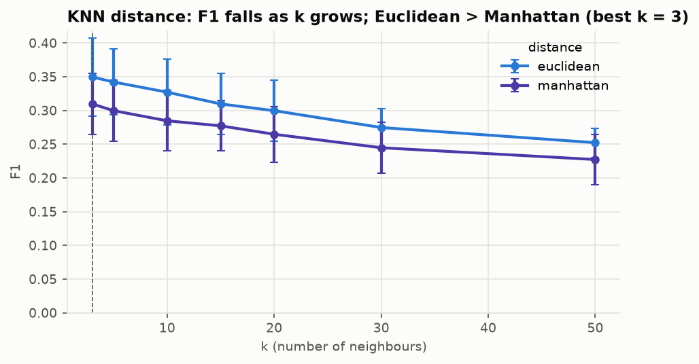
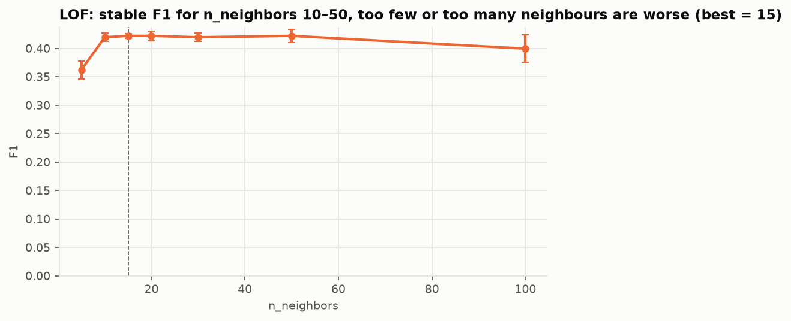
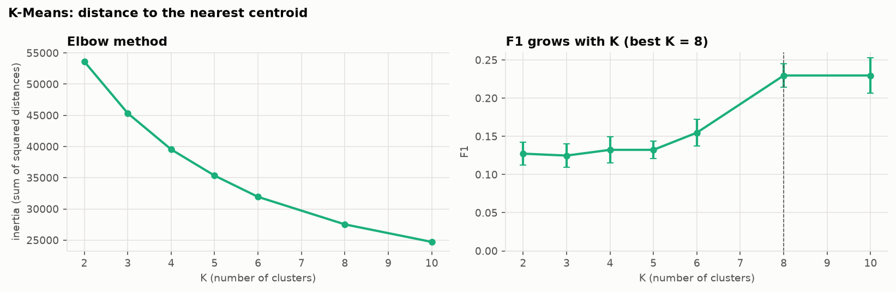
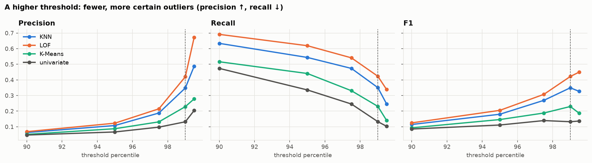
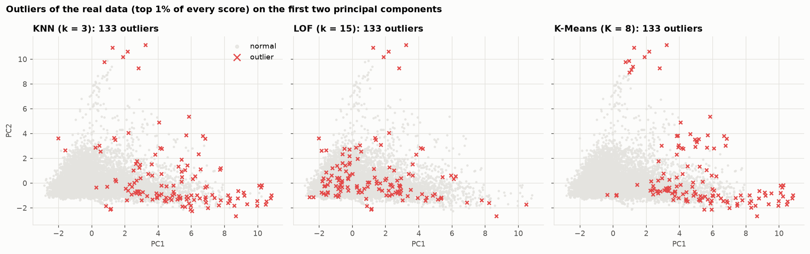
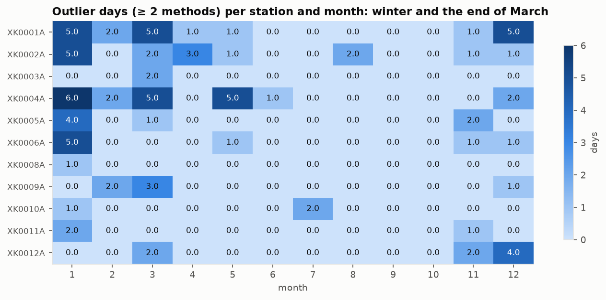

## 1. Outlier detection

An **outlier** is an observation that differs strongly from the rest of the data. It may be an error (a broken or
miscalibrated sensor) or a real but rare event (a pollution episode). This phase only **detects** outliers: every
station-day keeps its values, and the result is a score and a 0/1 flag per method
(`data/gold/outlier_flags.parquet`). Whether an outlier is removed or kept is a later decision that needs the reason
for the outlier.

Three methods from the exercises are applied, each with the same threshold rule (a point is an outlier when its score
is above the 99th percentile of the scores):

| Method | Type | Score of a point | Parameter analysed |
|---|---|---|---|
| KNN distance | distance-based | mean distance to its k nearest neighbours, D_i = (1/k)·Σ d(i, NN_j) | k, distance metric |
| Local Outlier Factor (LOF) | density-based | local density of the neighbours / local density of the point | n_neighbors |
| K-Means | clustering-based | distance to the nearest centroid | K (number of clusters) |

### 1.1 Feature space
One point = one **station-day**: the daily means of PM10, PM2_5, NO2, O3, SO2, CO (step p4, measured values only, valid days
with ≥ 18 hours). NO and NOx are not used, because they repeat the
information of NO2 (NOx = NO2 + 1.53·NO, phase I). Only days with all six pollutants are kept, because a distance
needs every coordinate: **13,266 station-days from 11 stations**. Daily means are used instead of
hours because a day is the unit of the limit values and of the episodes, the hourly noise was already treated in
phase I, and the methods search the neighbours of every point, which is fast for 13,000 points but slow for the
4 million hourly values.

Before the distances are computed every pollutant is standardized with the **z-score** (StandardScaler, mean 0,
standard deviation 1), as in the exercise: CO is around 1 mg/m³ and PM10 up to 200 µg/m³, so without scaling the
distance would be decided almost only by PM10 and PM2.5.

| statistic | PM10 | PM2_5 | NO2 | O3 | SO2 | CO |
|---|---|---|---|---|---|---|
| count | 13266.0 | 13266.0 | 13266.0 | 13266.0 | 13266.0 | 13266.0 |
| null_count | 0.0 | 0.0 | 0.0 | 0.0 | 0.0 | 0.0 |
| mean | 24.399 | 17.631 | 16.06 | 46.368 | 10.301 | 0.773 |
| std | 19.183 | 15.799 | 10.2 | 23.351 | 9.089 | 0.766 |
| min | 1.34 | 0.906 | 0.0 | 0.0 | 0.0 | 0.0 |
| 25% | 12.136 | 7.824 | 8.812 | 27.221 | 4.521 | 0.285 |
| 50% | 18.42 | 11.953 | 13.529 | 46.33 | 8.143 | 0.547 |
| 75% | 30.142 | 21.592 | 21.057 | 63.462 | 13.124 | 0.97 |
| max | 166.872 | 155.95 | 107.457 | 122.14 | 115.577 | 7.637 |

### 1.2 How the parameters are evaluated
The real data has no labels that say which days are anomalies. The approach of the exercises is therefore used: to a
copy of the data **known anomalies** are added, 133 points (1%). Each one is a real
station-day in which one random pollutant is multiplied by a factor between 2 and 5, as a miscalibrated
analyzer would do. The other five pollutants stay real, so many of these anomalies are hard: the changed value alone
may still be in the normal range, only the combination with the other pollutants is unusual. Every setting is
evaluated on 3 different injections (seeds 42, 7, 2024); the tables
show the mean and the standard deviation of F1 between them.

- **Precision** = TP / (TP + FP): of the points marked as outliers, the share that are injected anomalies;
- **Recall** = TP / (TP + FN): of the injected anomalies, the share that was found;
- **F1** = 2·P·R / (P + R): the balance of the two, used to choose the best parameter.

The precision is a lower bound: the real data also contains real outliers (pollution episodes), which are counted
as false positives although they are genuinely unusual. A univariate baseline (the largest |z| of the day over the
six pollutants) is evaluated in the same way, to see what the multivariate methods add.

### 1.3 KNN distance: choice of k and of the distance metric
The score is the mean distance to the k nearest neighbours (k + 1 neighbours are searched, because the nearest one is
the point itself). k = 1 is not used: two similar anomalies close to each other would hide each other.

| metric | k | precision | recall | f1 | f1_std |
|---|---|---|---|---|---|
| euclidean | 3 | 0.348 | 0.351 | 0.35 | 0.058 |
| euclidean | 5 | 0.341 | 0.343 | 0.342 | 0.049 |
| euclidean | 10 | 0.326 | 0.328 | 0.327 | 0.049 |
| euclidean | 15 | 0.308 | 0.311 | 0.31 | 0.045 |
| euclidean | 20 | 0.299 | 0.301 | 0.3 | 0.045 |
| euclidean | 30 | 0.274 | 0.276 | 0.275 | 0.028 |
| euclidean | 50 | 0.251 | 0.253 | 0.252 | 0.022 |
| manhattan | 3 | 0.308 | 0.311 | 0.31 | 0.045 |
| manhattan | 5 | 0.299 | 0.301 | 0.3 | 0.045 |
| manhattan | 10 | 0.284 | 0.286 | 0.285 | 0.045 |
| manhattan | 15 | 0.276 | 0.278 | 0.277 | 0.037 |
| manhattan | 20 | 0.264 | 0.266 | 0.265 | 0.041 |
| manhattan | 30 | 0.244 | 0.246 | 0.245 | 0.038 |
| manhattan | 50 | 0.226 | 0.228 | 0.227 | 0.037 |

F1 falls as k grows: with many neighbours the score becomes the distance to the whole region, so an anomaly that sits
just outside a dense group looks as normal as a point on the edge of the group. **Euclidean versus Manhattan**
(the exercise task): Euclidean is better for every k.

| k | euclidean | manhattan |
|---|---|---|
| 3 | 0.35 | 0.31 |
| 5 | 0.342 | 0.3 |
| 10 | 0.327 | 0.285 |
| 15 | 0.31 | 0.277 |
| 20 | 0.3 | 0.265 |
| 30 | 0.275 | 0.245 |
| 50 | 0.252 | 0.227 |

The Manhattan distance adds the differences of all six pollutants, so the small natural differences of the five
unchanged pollutants weigh as much as the one changed pollutant; the Euclidean distance squares the differences and
lets the one large difference dominate, which is exactly the shape of these anomalies.
**Choice: k = 3, euclidean distance** (F1 = 0.350).

### 1.4 Local Outlier Factor: choice of n_neighbors
LOF compares the local density of a point with the density of its neighbours: LOF ≈ 1 normal, LOF > 1 the point is in a
sparser region than its neighbours. Unlike the KNN distance it is relative, which matters here because the stations
have very different levels: a day that is normal for an industrial station in Obiliq can be unusual for a background
station, and LOF judges every point by its own neighbourhood.

| k | precision | recall | f1 | f1_std |
|---|---|---|---|---|
| 5 | 0.361 | 0.363 | 0.362 | 0.016 |
| 10 | 0.418 | 0.421 | 0.419 | 0.007 |
| 15 | 0.42 | 0.424 | 0.422 | 0.004 |
| 20 | 0.42 | 0.424 | 0.422 | 0.009 |
| 30 | 0.418 | 0.421 | 0.419 | 0.007 |
| 50 | 0.42 | 0.424 | 0.422 | 0.011 |
| 100 | 0.398 | 0.401 | 0.4 | 0.024 |

With n_neighbors = 5 the density is estimated from too few points and is noisy (F1 = 0.362);
between 10 and 50 the F1 is almost constant, and with 100 neighbours the neighbourhood mixes different
groups and F1 falls again (0.400). As in the exercise with make_blobs, the result is not very sensitive
to the exact value once the neighbourhood is large enough. **Choice: n_neighbors = 15** (F1 =
0.422, the smallest of the values with the highest F1, with the smallest spread between the injections).

### 1.5 K-Means: choice of K
Every point is assigned to the nearest of K centroids; the score is the distance to it. The inertia (sum of squared
distances to the own centroid) is used for the elbow method.

| k | inertia | precision | recall | f1 | f1_std |
|---|---|---|---|---|---|
| 2 | 53622.604 | 0.127 | 0.128 | 0.127 | 0.015 |
| 3 | 45344.615 | 0.124 | 0.125 | 0.125 | 0.016 |
| 4 | 39545.133 | 0.132 | 0.133 | 0.132 | 0.017 |
| 5 | 35343.674 | 0.132 | 0.133 | 0.132 | 0.011 |
| 6 | 31938.275 | 0.154 | 0.155 | 0.155 | 0.017 |
| 8 | 27527.764 | 0.229 | 0.231 | 0.23 | 0.016 |
| 10 | 24720.331 | 0.229 | 0.231 | 0.23 | 0.023 |

The inertia falls steadily without a clear elbow: the station-days do not form a few separate groups but a continuous
cloud (from clean summer days to polluted winter days). With few clusters a centroid stands in the middle of a large,
spread group, so the most distant points are simply the most polluted days and the hard anomalies are missed
(the same effect as K = 2 in the exercise). More clusters describe the cloud better and F1 grows, but slowly.
**Choice: K = 8** (F1 = 0.230); even so K-Means stays the weakest of the three
methods, because a centroid describes a group by a single point and cannot follow its shape.

### 1.6 Choice of the threshold
The exercises use the 95th percentile (5% outliers). For the best setting of every method:

| method | percentile | precision | recall | f1 |
|---|---|---|---|---|
| KNN | 90.0 | 0.063 | 0.634 | 0.115 |
| KNN | 95.0 | 0.108 | 0.544 | 0.18 |
| KNN | 97.5 | 0.188 | 0.474 | 0.269 |
| KNN | 99.0 | 0.348 | 0.351 | 0.35 |
| KNN | 99.5 | 0.488 | 0.246 | 0.327 |
| LOF | 90.0 | 0.069 | 0.692 | 0.125 |
| LOF | 95.0 | 0.123 | 0.619 | 0.205 |
| LOF | 97.5 | 0.215 | 0.541 | 0.308 |
| LOF | 99.0 | 0.42 | 0.424 | 0.422 |
| LOF | 99.5 | 0.672 | 0.338 | 0.45 |
| K-Means | 90.0 | 0.051 | 0.516 | 0.093 |
| K-Means | 95.0 | 0.088 | 0.441 | 0.146 |
| K-Means | 97.5 | 0.131 | 0.331 | 0.188 |
| K-Means | 99.0 | 0.229 | 0.231 | 0.23 |
| K-Means | 99.5 | 0.279 | 0.14 | 0.187 |
| univariate | 90.0 | 0.047 | 0.474 | 0.086 |
| univariate | 95.0 | 0.067 | 0.336 | 0.111 |
| univariate | 97.5 | 0.098 | 0.246 | 0.14 |
| univariate | 99.0 | 0.132 | 0.133 | 0.132 |
| univariate | 99.5 | 0.204 | 0.103 | 0.137 |

A lower threshold finds more anomalies but marks many normal days (LOF at the 95th percentile: recall
0.62, precision 0.12); a higher threshold marks fewer but more certain days.
**Choice: the 99th percentile** (top 1%, about 133 station-days per method),
where precision and recall are balanced (LOF: 0.42 / 0.42). It is also a number of
days that a person can still check one by one. The 95th percentile of the exercise would mark about
663 days, most of them ordinary winter days.

### 1.7 Comparison of the methods
Best setting of every method at the 99th percentile:

| method | metric | k | precision | recall | f1 | f1_std |
|---|---|---|---|---|---|---|
| KNN | euclidean | 3 | 0.348 | 0.351 | 0.35 | 0.058 |
| LOF | euclidean | 15 | 0.42 | 0.424 | 0.422 | 0.004 |
| K-Means | euclidean | 8 | 0.229 | 0.231 | 0.23 | 0.016 |
| univariate | - | 0 | 0.132 | 0.133 | 0.132 | 0.004 |

**LOF is the best method** (F1 0.422, 1.2× KNN, 1.8× K-Means and
3.2× the univariate baseline). All three multivariate methods beat the univariate rule,
because they compare the whole day and not each pollutant alone. Recall by the size of the error and by the changed
pollutant:

| factor | KNN | LOF | K-Means | univariate |
|---|---|---|---|---|
| ×2–3 | 0.255 | 0.314 | 0.146 | 0.058 |
| ×3–4 | 0.338 | 0.444 | 0.203 | 0.113 |
| ×4–5 | 0.465 | 0.519 | 0.349 | 0.233 |

| pollutant | KNN | LOF | K-Means | univariate |
|---|---|---|---|---|
| CO | 0.112 | 0.112 | 0.088 | 0.062 |
| NO2 | 0.408 | 0.245 | 0.367 | 0.184 |
| O3 | 0.589 | 0.625 | 0.518 | 0.268 |
| PM10 | 0.44 | 0.587 | 0.293 | 0.147 |
| PM2_5 | 0.493 | 0.836 | 0.164 | 0.096 |
| SO2 | 0.136 | 0.121 | 0.061 | 0.091 |

Larger errors are found more easily by every method. Errors in PM2.5, PM10 and O3 are found best: PM2.5 and PM10 are
strongly correlated and O3 is inversely related to NO2, so a change in one of them breaks a relation that the methods
see. Errors in CO and SO2 are found worst, because these pollutants already vary strongly from station to station
(SO2 near the power plants, CO from heating), so ×2–5 is still inside their normal spread.

### 1.8 Outliers in the real data
The three methods run with their chosen parameters on the 13,266 real station-days (no injected points):

Number of methods that flag the same day, and the overlap of every pair of methods:

| n_methods | days |
|---|---|
| 0 | 12987 |
| 1 | 185 |
| 2 | 68 |
| 3 | 26 |

| pair | common | jaccard |
|---|---|---|
| KNN & LOF | 55 | 0.261 |
| KNN & K-Means | 64 | 0.317 |
| LOF & K-Means | 27 | 0.113 |

The methods agree only partly, because they define "different" differently (far away, less dense, far from a
centroid). A day flagged by **at least two methods** is treated as a reliable outlier: **94 station-days**.
Of them, 6 have no pollutant with |z| > 3, so they are outliers only because of the combination
of the pollutants and a univariate rule (|z| > 3 for one pollutant) would not find them.

Per station (share of its days) and per month:

| station_id | outlier_days | days | pct |
|---|---|---|---|
| XK0001A | 20 | 1253 | 1.596 |
| XK0002A | 15 | 1314 | 1.142 |
| XK0003A | 2 | 1369 | 0.146 |
| XK0004A | 21 | 1345 | 1.561 |
| XK0005A | 7 | 1320 | 0.53 |
| XK0006A | 8 | 1310 | 0.611 |
| XK0008A | 1 | 1188 | 0.084 |
| XK0009A | 6 | 998 | 0.601 |
| XK0010A | 3 | 1067 | 0.281 |
| XK0011A | 3 | 1112 | 0.27 |
| XK0012A | 8 | 990 | 0.808 |

The pollutant with the largest |z| on these days (the one that pulls the day away from the others):

| driver | outlier_days |
|---|---|
| PM10 | 23 |
| CO | 21 |
| PM2_5 | 19 |
| SO2 | 17 |
| NO2 | 14 |

Dates on which the outliers appear at several stations at once:

| date | stations | PM10 | PM2_5 | pm25_pm10_ratio | main_driver |
|---|---|---|---|---|---|
| 2020-03-28 | 7 | 116.613 | 56.748 | 0.489 | PM10 |
| 2020-03-27 | 6 | 125.368 | 58.664 | 0.469 | PM10 |
| 2020-01-10 | 4 | 133.175 | 106.275 | 0.791 | PM2_5 |
| 2020-05-15 | 4 | 82.069 | 20.173 | 0.25 | PM10 |
| 2020-01-03 | 3 | 110.291 | 88.944 | 0.792 | PM2_5 |
| 2020-01-04 | 3 | 120.936 | 99.641 | 0.812 | PM2_5 |
| 2020-03-29 | 3 | 79.347 | 45.858 | 0.57 | PM10 |
| 2020-01-11 | 2 | 127.813 | 102.059 | 0.788 | PM10 |
| 2020-11-26 | 2 | 141.177 | 120.995 | 0.855 | PM2_5 |
| 2020-11-28 | 2 | 153.271 | 138.799 | 0.903 | PM2_5 |

The largest episode is **2020-03-28**: 7 stations at once, mean PM10 117 µg/m³ with a PM2.5/PM10 ratio of only 0.49 (median of all station-days: 0.72). Many stations together and a low share of fine particles is the pattern of transported coarse dust, not of local smoke from heating (which has a high ratio); such a day is a real event, not a sensor error.

The strongest outliers (flagged by all three methods, sorted by LOF; all in `tables/o1_top_outliers.csv`):

| station_id | date | PM10 | PM2_5 | NO2 | O3 | SO2 | CO | driver | driver_z | score_knn | score_lof | score_kmeans |
|---|---|---|---|---|---|---|---|---|---|---|---|---|
| XK0004A | 2020-05-16 | 57.65 | 26.98 | 22.45 | 11.13 | 115.58 | 0.36 | SO2 | 11.58 | 1.79 | 2.08 | 5.88 |
| XK0001A | 2020-03-28 | 125.87 | 60.16 | 14.4 | 61.17 | 12.84 | 3.91 | PM10 | 5.29 | 2.27 | 2.07 | 4.22 |
| XK0001A | 2020-03-27 | 138.98 | 61.76 | 8.96 | 76.92 | 11.8 | 3.68 | PM10 | 5.97 | 2.01 | 2.04 | 5.0 |
| XK0004A | 2020-03-28 | 131.16 | 56.47 | 20.8 | 59.86 | 41.79 | 0.09 | PM10 | 5.57 | 2.48 | 1.89 | 5.26 |
| XK0004A | 2020-05-15 | 69.98 | 18.54 | 21.9 | 23.9 | 98.59 | 0.31 | SO2 | 9.71 | 2.05 | 1.86 | 4.3 |
| XK0001A | 2022-01-14 | 97.58 | 86.64 | 61.51 | 14.35 | 3.3 | 5.21 | CO | 5.79 | 2.47 | 1.85 | 4.96 |
| XK0002A | 2020-05-15 | 104.31 | 22.46 | 20.49 | 55.95 | 10.42 | 1.82 | PM10 | 4.17 | 2.18 | 1.81 | 3.49 |
| XK0012A | 2019-12-06 | 97.47 | 85.87 | 27.38 | 14.28 | 14.12 | 7.03 | CO | 8.18 | 1.56 | 1.73 | 6.43 |
| XK0004A | 2020-03-27 | 119.52 | 56.9 | 20.57 | 49.32 | 41.33 | 0.18 | PM10 | 4.96 | 2.05 | 1.67 | 4.81 |
| XK0004A | 2020-06-05 | 15.87 | 6.89 | 22.12 | 14.73 | 111.41 | 0.21 | SO2 | 11.12 | 1.37 | 1.61 | 5.49 |
| XK0009A | 2020-03-27 | 133.99 | 69.84 | 15.55 | 50.6 | 2.04 | 0.63 | PM10 | 5.71 | 1.48 | 1.61 | 4.11 |
| XK0004A | 2020-05-14 | 41.14 | 11.55 | 23.23 | 14.32 | 109.87 | 0.33 | SO2 | 10.96 | 1.18 | 1.6 | 5.21 |
| XK0009A | 2020-03-28 | 123.01 | 70.24 | 13.74 | 49.01 | 2.56 | 0.36 | PM10 | 5.14 | 1.22 | 1.59 | 4.06 |
| XK0012A | 2019-12-07 | 86.48 | 78.63 | 27.55 | 6.03 | 14.83 | 6.92 | CO | 8.03 | 1.13 | 1.59 | 5.87 |
| XK0003A | 2020-03-27 | 114.74 | 54.87 | 5.59 | 73.4 | 5.0 | 0.1 | PM10 | 4.71 | 1.37 | 1.56 | 4.84 |

The list contains both kinds of outliers: **real events** (regional dust and winter smog days on several stations at
once; SO2 episodes at a single station, e.g. Mitrovica in May 2020, while NO2 and CO stay normal, which points to
one local source) and **suspicious values**
(e.g. a daily CO mean of exactly 0 on a day with very high particles and NO2, which a working CO analyzer would not
measure). This is why the outliers are only flagged: deleting them would remove the most important pollution
episodes of the data set together with the errors.

### 1.9 Decisions
| Decision | Reason |
|---|---|
| Station-days of six standardized daily means | the unit of the episodes and of the limit values; z-score so that every pollutant counts the same |
| Parameters chosen by F1 on injected anomalies, mean of 3 injections | the real data has no labels; several injections make the choice independent of one random draw |
| KNN k = 3 (euclidean), LOF n_neighbors = 15, K-Means K = 8 | highest F1 of every method (sections 1.3–1.5) |
| Threshold: 99th percentile | balance of precision and recall; a number of days that can be checked |
| An outlier = flagged by ≥ 2 methods | the methods see different kinds of outliers; agreement makes the flag more reliable |
| Outliers are flagged, not removed | many are real pollution episodes; removal needs the reason for every outlier |
