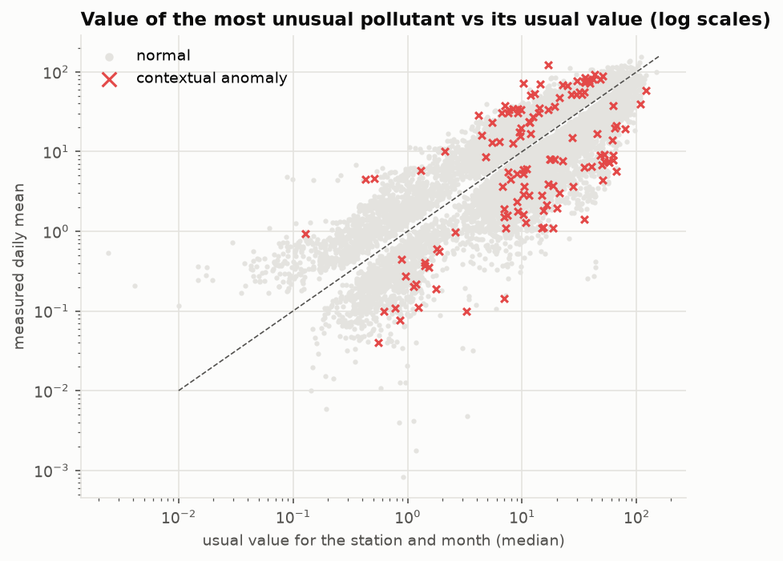

## 2. Contextual anomalies

A **contextual anomaly** is a value that is anomalous only in its context (lecture: 20 °C is normal in May but not in
January). The lecture separates **contextual attributes**, which define the context, from **behavioural attributes**,
whose values are judged. Here the behavioural attributes are the six daily means of section 1, and four contextual
attributes are tested: the **station** (every station has its own sources and level), the **month** (heating season,
sunshine for O3), the **day type** (weekday or weekend, because of traffic) and the **regional level of the day**
(the other stations on the same date, a proxy for the weather). A day with summer values in January, or with the values
of an industrial station at a background station, is globally normal, so the point methods of section 1 cannot see it.

### 2.1 Method: remove the context, then detect
1. **Context profile:** for every context group (e.g. station XK0001A in January) the median and the MAD of
   log(1 + value) of every pollutant: what is usual for that station in that month. The log makes the skewed values
   more symmetric; the median and the MAD are not pulled by the outliers of the group.
2. **Residual:** every value becomes a robust z-score within its group, (log value − median) / (1.4826 · MAD), i.e.
   how unusual it is *for its context*.
3. **Detection on the residuals** with two methods: the **contextual robust z-score** (largest \|residual\| of the
   day, statistical, one pollutant at a time) and **LOF on the residual vectors** (the best point method of section
   1, all pollutants together), with the same 99th-percentile threshold.

**Regional level (weather proxy).** The data set contains no meteorological data, but the weather – wind, thermal
inversion, rain, transported dust – moves all stations of Kosovo together. For the context "station × month + regional level" every log value
is first compared with the mean log value of the *other* stations on the same day (at least three); the residual of
this difference within the station × month group shows what is special about the station on that day, after the
weather of the day has been taken out. Real meteorological data (e.g. ERA5 reanalysis) would be the next step.

The context is the main parameter, from none to the richest: **none**, **station**, **station × season**, **station × month**, **station × month × day type**, **station × month + regional level**; for LOF also
n_neighbors (10, 20, 50, 100).

### 2.2 Evaluation with injected contextual anomalies
As in section 1, 1% known anomalies are added to a copy of the data, now of two
contextual types: **wrong season** (the real values of the same station from a day 150–215 days away, e.g. summer
values in winter) and **wrong station** (the real values of another station on the same date). Every injected day is
a real day, so its values are normal for the data set as a whole.

Contextual robust z-score, by context:

| context | precision | recall | f1 | f1_std | pr_auc | roc_auc |
|---|---|---|---|---|---|---|
| none | 0.005 | 0.005 | 0.005 | 0.004 | 0.01 | 0.498 |
| station | 0.037 | 0.038 | 0.037 | 0.013 | 0.019 | 0.585 |
| station × season | 0.095 | 0.095 | 0.095 | 0.023 | 0.051 | 0.753 |
| station × month | 0.092 | 0.093 | 0.092 | 0.024 | 0.068 | 0.8 |
| station × month × day type | 0.107 | 0.108 | 0.107 | 0.026 | 0.063 | 0.792 |
| station × month + regional level | 0.147 | 0.148 | 0.147 | 0.024 | 0.093 | 0.852 |

LOF on the residuals, F1 by n_neighbors (rows) and context (columns):

| param | none | station | station × season | station × month | station × month × day type | station × month + regional level |
|---|---|---|---|---|---|---|
| 10 | 0.002 | 0.105 | 0.165 | 0.205 | 0.16 | 0.267 |
| 20 | 0.0 | 0.097 | 0.16 | 0.202 | 0.165 | 0.285 |
| 50 | 0.002 | 0.092 | 0.132 | 0.182 | 0.16 | 0.3 |
| 100 | 0.005 | 0.08 | 0.13 | 0.18 | 0.167 | 0.297 |

The same for the threshold-free PR-AUC (a random score gets ≈ 0.01):

| param | none | station | station × season | station × month | station × month × day type | station × month + regional level |
|---|---|---|---|---|---|---|
| 10 | 0.008 | 0.046 | 0.114 | 0.132 | 0.1 | 0.188 |
| 20 | 0.009 | 0.047 | 0.118 | 0.132 | 0.098 | 0.222 |
| 50 | 0.009 | 0.045 | 0.102 | 0.121 | 0.096 | 0.229 |
| 100 | 0.009 | 0.038 | 0.096 | 0.123 | 0.096 | 0.228 |

**Without context both methods find nothing** (best recall of any global setting: wrong season 0.005,
wrong station 0.010; the global robust z-score has ROC-AUC 0.50 and PR-AUC
0.010, exactly the values of a random score): this confirms the lecture – a contextual anomaly cannot be
detected by looking at the values alone. Every contextual attribute is then judged by what it adds (best F1 of LOF):
- **station** (0.105) and **month** (station × month 0.205) are the basis:
  every station and every season has its own normal level;
- **day type** (0.167) adds nothing:
  the weekday/weekend difference is small in daily means, and splitting every group in two leaves fewer days to
  estimate what is usual;
- the **regional level** (0.300) helps most: a large part of the day-to-day variation is weather that
  all stations share, and once it is removed, a day that does not belong to its station stands out clearly.

LOF on the residuals is clearly better than the robust z-score (F1 0.300 vs 0.147),
because a wrong day changes several pollutants at once only a little, and LOF sees the whole vector while the robust
z-score sees one pollutant at a time. Recall of the best setting of each method by type:

| context | method | param | wrong season | wrong station |
|---|---|---|---|---|
| station × month + regional level | LOF | 50 | 0.423 | 0.177 |
| station × month + regional level | robust z | 0 | 0.254 | 0.04 |

**Choice: LOF on the residuals, context station × month + regional level, n_neighbors = 50** (F1 = 0.300, PR-AUC =
0.229, 23× a random score). The highest PR-AUC is reached by
LOF, context station × month + regional level, n_neighbors = 50 (0.229),
the same context, so the threshold-free measure confirms the choice. The F1 stays lower than for the point anomalies, because a real day
from another month or station is often similar to a normal day of the right context (e.g. April and May, or two
background stations); only clearly different contexts are found.

### 2.3 Contextual anomalies in the real data
The chosen setting marks **133 station-days**; **119** of them are *not* point anomalies of
section 1, so the context adds anomalies that the global methods do not see. Regional events (e.g. the dust of March
2020, which raised all stations together) are *not* contextual anomalies here, because the regional level removes them.

76 of the 133 days are **lower** than expected for their context, the others higher. The most frequent
pollutant is shown below, and the most anomalies fall in month 7 (23 days):

| context_driver | days |
|---|---|
| O3 | 41 |
| PM2_5 | 24 |
| CO | 20 |
| NO2 | 19 |
| SO2 | 16 |
| PM10 | 13 |

| month | days |
|---|---|
| 1 | 13 |
| 2 | 16 |
| 3 | 6 |
| 4 | 3 |
| 5 | 6 |
| 6 | 11 |
| 7 | 23 |
| 8 | 18 |
| 9 | 14 |
| 10 | 8 |
| 11 | 4 |
| 12 | 11 |

Station-pollutant-months with three or more contextual anomalies (`tables/o2_repeated_anomalies.csv`):

| station_id | context_driver | month | days | share_low |
|---|---|---|---|---|
| XK0011A | O3 | 2023-06 | 6 | 1.0 |
| XK0012A | PM2_5 | 2023-08 | 4 | 1.0 |
| XK0012A | O3 | 2023-09 | 4 | 0.0 |
| XK0011A | O3 | 2023-07 | 3 | 1.0 |
| XK0012A | NO2 | 2021-12 | 3 | 1.0 |
| XK0012A | O3 | 2024-02 | 3 | 0.0 |
| XK0008A | NO2 | 2024-03 | 3 | 1.0 |
| XK0008A | PM2_5 | 2021-07 | 3 | 0.0 |

The anomalies are not spread at random: 8 station-pollutant-months have three or more contextual anomalies, the most 6 days of O3 at XK0011A in 2023-06 (100% of them lower than usual). Several unusual days of the same pollutant at the same station in a row are typical of an instrument problem (e.g. an O3 analyzer that measures too low for weeks), not of a single real event.

The strongest contextual anomalies that are not point anomalies (`tables/o2_top_contextual.csv`; the usual value is
what is expected for the station, the month and the regional level of that day):

| station_id | date | context_driver | value | usual_value | context_residual | score_contextual |
|---|---|---|---|---|---|---|
| XK0011A | 2023-07-09 | O3 | 5.68 | 66.27 | -25.42 | 4.15 |
| XK0008A | 2021-07-17 | PM2_5 | 34.03 | 9.2 | 8.1 | 3.21 |
| XK0011A | 2023-07-01 | O3 | 9.18 | 52.16 | -18.2 | 2.77 |
| XK0011A | 2023-07-02 | O3 | 8.95 | 47.87 | -17.52 | 2.75 |
| XK0012A | 2023-08-16 | O3 | 76.89 | 30.13 | 7.96 | 2.65 |
| XK0012A | 2023-08-02 | PM2_5 | 1.52 | 6.98 | -5.64 | 2.49 |
| XK0012A | 2023-08-15 | O3 | 93.04 | 43.32 | 6.53 | 2.48 |
| XK0011A | 2023-07-26 | SO2 | 1.81 | 15.22 | -9.19 | 2.44 |
| XK0009A | 2023-07-02 | O3 | 72.14 | 39.35 | 5.63 | 2.26 |
| XK0012A | 2023-08-14 | SO2 | 1.97 | 20.12 | -5.32 | 2.25 |
| XK0011A | 2023-08-16 | O3 | 7.49 | 51.92 | -11.56 | 2.23 |
| XK0012A | 2023-08-12 | SO2 | 3.03 | 21.1 | -4.62 | 2.22 |

Two kinds stand out. **Too low for the context:** e.g. O3 of a few µg/m³ on a summer day when about 50–65 µg/m³ is
expected, or SO2 near zero at a station that usually measures 15–20 µg/m³. A low value is never a global outlier, but it
is a typical sign of an analyzer that stopped working properly (or a real, very clean day). **Too high for the
context:** e.g. PM2.5 or O3 several times what the station and the other stations of the day suggest, which points to a
local source (a fire, a local emission). Both kinds are flagged for a check, not removed.
