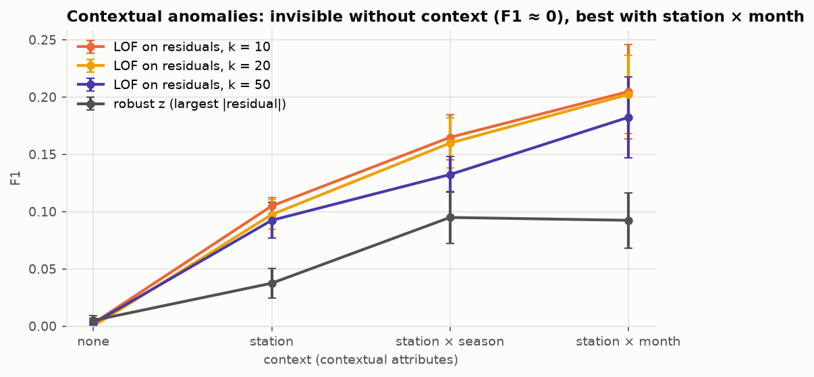

## 2. Contextual anomalies

A **contextual anomaly** is a value that is anomalous only in its context (lecture: 20 °C is normal in May but not in
January). The lecture separates **contextual attributes**, which define the context, from **behavioural attributes**,
whose values are judged. Here the contextual attributes are the **station** (every station has its own sources and
level) and the **month** (heating season, sunshine for O3); the behavioural attributes are the six daily means of
section 1. A day with summer values in January, or with the values of an industrial station at a background station,
is globally normal, so the point methods of section 1 cannot see it.

### 2.1 Method: remove the context, then detect
1. **Context profile:** for every context group (e.g. station XK0001A in January) the median and the MAD of
   log(1 + value) of every pollutant: what is usual for that station in that month. The log makes the skewed values
   more symmetric; the median and the MAD are not pulled by the outliers of the group.
2. **Residual:** every value becomes a robust z-score within its group, (log value − median) / (1.4826 · MAD), i.e.
   how unusual it is *for its context*.
3. **Detection on the residuals** with two methods: the **contextual robust z-score** (largest \|residual\| of the
   day, statistical, one pollutant at a time) and **LOF on the residual vectors** (the best point method of section
   1, all pollutants together), with the same 99th-percentile threshold.

The context granularity is the main parameter: **none** (global, as in section 1), **station**, **station × season**
or **station × month**; for LOF also n_neighbors (10, 20, 50).

### 2.2 Evaluation with injected contextual anomalies
As in section 1, 1% known anomalies are added to a copy of the data, now of two
contextual types: **wrong season** (the real values of the same station from a day 150–215 days away, e.g. summer
values in winter) and **wrong station** (the real values of another station on the same date). Every injected day is
a real day, so its values are normal for the data set as a whole.

Contextual robust z-score, F1 by context:

| context | precision | recall | f1 | f1_std | pr_auc | roc_auc |
|---|---|---|---|---|---|---|
| none | 0.005 | 0.005 | 0.005 | 0.004 | 0.01 | 0.498 |
| station | 0.037 | 0.038 | 0.037 | 0.013 | 0.019 | 0.585 |
| station × season | 0.095 | 0.095 | 0.095 | 0.023 | 0.051 | 0.753 |
| station × month | 0.092 | 0.093 | 0.092 | 0.024 | 0.068 | 0.8 |

LOF on the residuals, F1 by n_neighbors (rows) and context (columns):

| param | none | station | station × season | station × month |
|---|---|---|---|---|
| 10 | 0.002 | 0.105 | 0.165 | 0.205 |
| 20 | 0.0 | 0.097 | 0.16 | 0.202 |
| 50 | 0.002 | 0.092 | 0.132 | 0.182 |

The same for the threshold-free PR-AUC (a random score gets ≈ 0.01):

| param | none | station | station × season | station × month |
|---|---|---|---|---|
| 10 | 0.008 | 0.046 | 0.114 | 0.132 |
| 20 | 0.009 | 0.047 | 0.118 | 0.132 |
| 50 | 0.009 | 0.045 | 0.102 | 0.121 |

**Without context both methods find nothing** (best recall of any global setting: wrong season 0.005,
wrong station 0.005; the global robust z-score has ROC-AUC 0.50 and PR-AUC
0.010, exactly the values of a random score): this confirms the lecture – a contextual anomaly cannot be detected by
looking at the values alone. The station alone already helps, adding the season or the month helps much more, and
**station × month** gives the best result. LOF on the residuals is clearly better than
the robust z-score (F1 0.205 vs 0.095), because a wrong day changes several pollutants
at once only a little, and LOF sees the whole vector while the robust z-score sees one pollutant at a time.
Recall of the best setting of each method by type:

| context | method | param | wrong station | wrong season |
|---|---|---|---|---|
| station × month | LOF | 10 | 0.172 | 0.239 |
| station × season | robust z | 0 | 0.066 | 0.124 |

**Choice: LOF on the residuals, context station × month, n_neighbors = 10** (F1 = 0.205, PR-AUC =
0.132, 13× a random score). The highest PR-AUC is reached by
LOF, context station × month, n_neighbors = 20 (0.132),
the same context, so the threshold-free measure confirms the choice. The F1 is lower
than for the point anomalies, because a real day from another month or station is often similar to a normal day of the
right context (e.g. April and May, or two background stations); only clearly different contexts are found.

### 2.3 Contextual anomalies in the real data
The chosen setting marks **133 station-days**; **114** of them are *not* point anomalies of
section 1, so the context adds anomalies that the global methods do not see.

77 of the 133 days are **lower** than usual for their context, the others higher. The most frequent
pollutant is shown below, and the most anomalies fall in month 7 (26 days):

| context_driver | days |
|---|---|
| SO2 | 42 |
| CO | 30 |
| NO2 | 23 |
| PM10 | 16 |
| O3 | 13 |
| PM2_5 | 9 |

| month | days |
|---|---|
| 1 | 3 |
| 2 | 9 |
| 3 | 2 |
| 4 | 16 |
| 5 | 14 |
| 6 | 20 |
| 7 | 26 |
| 8 | 10 |
| 9 | 11 |
| 10 | 10 |
| 11 | 5 |
| 12 | 7 |

The strongest contextual anomalies that are not point anomalies (`tables/o2_top_contextual.csv`):

| station_id | date | context_driver | value | usual_value | context_residual | score_contextual |
|---|---|---|---|---|---|---|
| XK0011A | 2024-07-28 | SO2 | 34.17 | 17.47 | 4.24 | 2.5 |
| XK0008A | 2021-12-10 | SO2 | 27.37 | 7.61 | 6.53 | 2.44 |
| XK0011A | 2023-07-26 | SO2 | 1.81 | 17.47 | -12.4 | 2.39 |
| XK0011A | 2023-07-09 | O3 | 5.68 | 64.97 | -11.92 | 2.38 |
| XK0011A | 2021-09-14 | NO2 | 32.23 | 10.72 | 3.87 | 2.28 |
| XK0003A | 2020-09-16 | CO | 0.09 | 0.46 | -6.14 | 2.2 |
| XK0011A | 2021-10-11 | SO2 | 0.72 | 8.12 | -7.25 | 2.15 |
| XK0008A | 2023-06-03 | O3 | 4.37 | 70.52 | -13.97 | 2.11 |
| XK0002A | 2021-02-11 | SO2 | 0.37 | 12.0 | -12.76 | 2.09 |
| XK0010A | 2024-06-23 | SO2 | 23.83 | 5.14 | 3.56 | 1.91 |
| XK0010A | 2024-04-09 | SO2 | 21.42 | 2.97 | 3.27 | 1.89 |
| XK0002A | 2021-06-09 | CO | 3.36 | 0.39 | 12.84 | 1.88 |

Two kinds stand out. **Too low for the context:** e.g. O3 of a few µg/m³ on a July day when 60–70 µg/m³ is usual, or
SO2 near zero at a station that usually measures 10–20 µg/m³. A low value is never a global outlier, but it is a
typical sign of an analyzer that stopped working properly (or a real, very clean day). **Too high for the context:**
e.g. SO2 or CO several times the usual summer value at an industrial station, which points to a local emission event.
Both kinds are flagged for a check, not removed.
