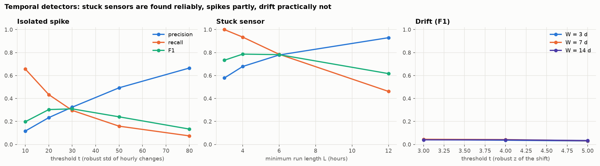
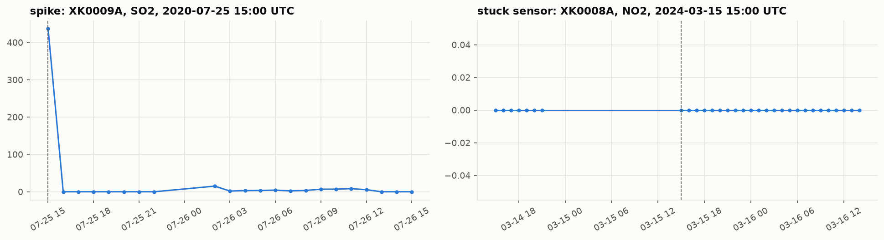

## 3. Collective anomalies in the hourly series

A **collective anomaly** is a sequence of related values that is anomalous together, while the single values may look
normal (lecture: the flat segment in an ECG). It needs sequential data, so this section uses the **hourly series** of
every station and pollutant (93 series, 3,697,899 measured hours that passed the cleaning of phase I)
instead of the station-days. Three typical faults of an air-quality analyzer are searched, each with a detector that
fits its shape:

| Fault | Shape in the series | Detector (score) | Parameter |
|---|---|---|---|
| isolated spike | one value jumps up and falls straight back | min(v − previous, v − next) / robust std of the hourly changes | threshold t |
| stuck sensor | the same value repeated hour after hour (a flat line) | length of the run of identical values | minimum length L |
| drift | the station slowly moves away from the others | shift of the last W days against the previous 60 days, relative to the other stations, as a robust z-score | window W, threshold t |

The spike score takes the *smaller* of the two jumps, so the start of a real episode (a rise that is not followed by a
fall) gets a low score; dividing by the robust spread of the hourly changes (1.4826 · MAD) makes quiet and busy series
comparable. For the stuck sensor, runs of 0 are ignored for CO, O3, SO2, NO, which
can really stay below the detection limit in clean air (the same rule as phase I). For the drift the other stations
are the reference: the regional weather moves all stations together and cancels out.

### 3.1 Evaluation with injected faults
Every detector is evaluated with injected faults of its own type (3 seeds): spikes in
0.1% of the hours (value × 3–6), 200
frozen runs of 3–24 hours, and 30 drifts in which a series
grows to 2× its value over 30 days. For the faults that last several points,
precision is counted on points and recall on events (one alarm is enough to find a frozen or drifting sensor).

Isolated spike:

| param | precision | recall | f1 | f1_std |
|---|---|---|---|---|
| t = 10 | 0.116 | 0.656 | 0.198 | 0.001 |
| t = 20 | 0.233 | 0.434 | 0.304 | 0.003 |
| t = 30 | 0.324 | 0.296 | 0.31 | 0.005 |
| t = 50 | 0.493 | 0.159 | 0.24 | 0.009 |
| t = 80 | 0.665 | 0.074 | 0.134 | 0.005 |

Stuck sensor:

| param | precision | recall | f1 | f1_std |
|---|---|---|---|---|
| L = 3 h | 0.579 | 1.0 | 0.733 | 0.005 |
| L = 4 h | 0.679 | 0.935 | 0.786 | 0.002 |
| L = 6 h | 0.779 | 0.785 | 0.782 | 0.007 |
| L = 12 h | 0.93 | 0.462 | 0.617 | 0.022 |

Drift:

| param | precision | recall | f1 | f1_std |
|---|---|---|---|---|
| W = 3 d, t = 3 | 0.021 | 0.467 | 0.041 | 0.017 |
| W = 3 d, t = 4 | 0.02 | 0.256 | 0.037 | 0.02 |
| W = 3 d, t = 5 | 0.017 | 0.144 | 0.03 | 0.011 |
| W = 7 d, t = 3 | 0.024 | 0.444 | 0.045 | 0.018 |
| W = 7 d, t = 4 | 0.023 | 0.256 | 0.042 | 0.022 |
| W = 7 d, t = 5 | 0.019 | 0.111 | 0.032 | 0.012 |
| W = 14 d, t = 3 | 0.021 | 0.378 | 0.04 | 0.017 |
| W = 14 d, t = 4 | 0.022 | 0.222 | 0.04 | 0.021 |
| W = 14 d, t = 5 | 0.022 | 0.089 | 0.034 | 0.001 |

- **Stuck sensor** is found reliably: with L = 3 h every run is found but short natural repeats
  also count; longer L misses the short faults. **Choice: L = 4 h** (F1 = 0.786).
- **Spike:** a low threshold finds most spikes but also many short natural peaks (a passing truck, a plume from a
  chimney); a high threshold is precise but misses the smaller spikes. **Choice: t = 30** (F1 =
  0.310); the injected spikes are only 0.1% of the hours, so even a few hundred natural
  peaks lower the precision.
- **Drift is not detectable** with this data: the best setting (W = 7 d, t = 3) finds 44% of the
  drifts, but 98% of its alarms are false. A slow change up to ×2 in a month
  is within the natural day-to-day differences between stations. In practice drift is found with a reference
  instrument at the same place or with regular calibration checks; the detector is therefore **not used** for flags,
  and drift remains a limitation of the analysis.

### 3.2 Check against the rules of phase I (real labels)
Phase I removed 473 hours as spikes and 3171 hours as
stuck with fixed rules. Running the statistical detectors on the raw values of these hours shows whether both
approaches agree on real faults:

| fault | phase1_hours | found_again | share_found | flags_on_kept_hours |
|---|---|---|---|---|
| spike | 473 | 258 | 0.545 | 2248 |
| stuck sensor | 3171 | 3171 | 1.0 | 222 |

The stuck detector finds **100%** of the stuck hours of phase I again, the spike
detector 55% of the spikes: phase I used one threshold per pollutant (P99.9 of the
changes), the detector one per series, so small spikes in very variable series are judged differently. The agreement
on real faults supports both the rules of phase I and the detectors.

### 3.3 Temporal anomalies in the real (cleaned) data
After the cleaning of phase I the detectors still find **2,303 spike hours** and **1,093 stuck
hours** (`data/gold/anomalies_temporal.parquet`):

| pollutant | spike_hours | stuck_hours | hours | spikes_per_1000h |
|---|---|---|---|---|
| CO | 394 | 93 | 477842 | 0.825 |
| NO | 900 | 4 | 397815 | 2.262 |
| NO2 | 109 | 861 | 433861 | 0.251 |
| NOx | 39 | 99 | 404440 | 0.096 |
| PM10 | 90 | 5 | 531247 | 0.169 |
| PM2_5 | 8 | 5 | 531393 | 0.015 |
| SO2 | 763 | 26 | 470896 | 1.62 |

The strongest spikes:

| station_id | pollutant | ts_utc | v | spike_score |
|---|---|---|---|---|
| XK0009A | SO2 | 2020-07-25 15:00:00+00:00 | 437.7 | 637.7 |
| XK0010A | NO | 2021-11-02 10:00:00+00:00 | 133.1 | 345.4 |
| XK0008A | SO2 | 2021-03-12 10:00:00+00:00 | 198.7 | 323.0 |
| XK0012A | NO | 2020-02-04 20:00:00+00:00 | 132.6 | 270.0 |
| XK0012A | CO | 2020-04-28 13:00:00+00:00 | 14.5 | 261.1 |
| XK0007A | NO2 | 2022-03-25 15:00:00+00:00 | 83.9 | 226.7 |
| XK0011A | SO2 | 2024-08-08 10:00:00+00:00 | 193.4 | 215.5 |
| XK0010A | SO2 | 2020-07-01 10:00:00+00:00 | 115.5 | 178.0 |
| XK0008A | SO2 | 2019-07-08 09:00:00+00:00 | 97.4 | 175.0 |
| XK0012A | NO | 2023-12-19 16:00:00+00:00 | 105.7 | 172.7 |

Spikes are most frequent for NO, SO2 and CO, the pollutants of local sources: a plume from a chimney or the power plant
(SO2) or traffic near the analyzer (NO, CO) can raise a single hour; such hours may be real short events or faults and
need a look at the neighbouring stations. Of the stuck hours, 962 are runs of 0, mostly NO2 at
Brezovica (XK0007A), a remote mountain station. 870 of these zeros exist only because phase I
set small negative readings to 0 (`zero_negative`): the analyzer was measuring noise around zero, i.e. NO2 at the
detection limit, which after the conversion looks like a frozen line. They are therefore low-concentration periods
rather than frozen sensors, and the phase-I rule "0 is not plausible for NO2" is too strict for such a clean station.
The non-zero runs (e.g. CO at Palaj, XK0010A, in 2024) are more likely real frozen values. All of them are flagged,
none is removed.
