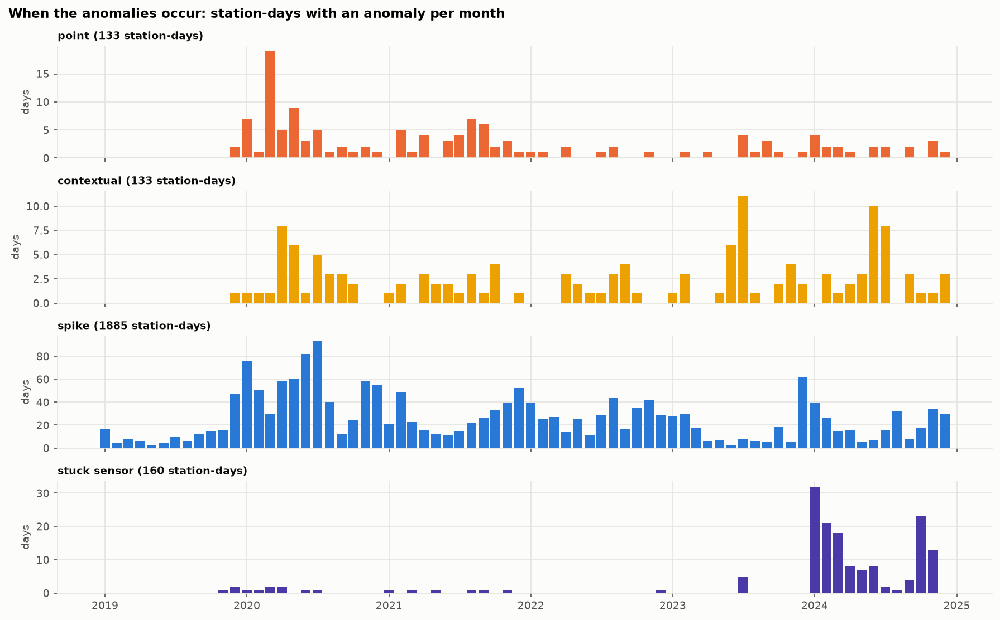
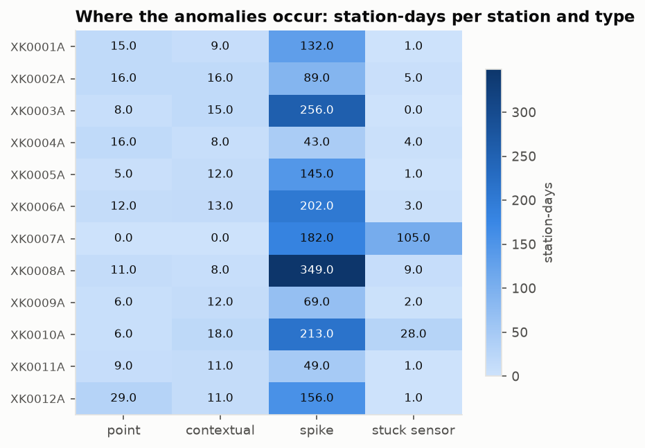

## 4. Summary: catalogue of all anomalies

Every anomaly type was detected with the representation and the method that fit it, and every choice was checked with
injected anomalies of that type. The overview of the chosen methods (`tables/o4_methods_overview.csv`):

| type | representation | method | precision | recall | f1 |
|---|---|---|---|---|---|
| point | station-day (6 daily means) | LOF + Mahalanobis + KNN + K-Means + SVM, rule: LOF only | 0.512 | 0.516 | 0.514 |
| contextual | station-day minus the station × month profile | LOF on residuals, context station × month, k = 10 | 0.204 | 0.206 | 0.205 |
| spike | hourly series | isolated spike, t = 30 | 0.324 | 0.296 | 0.31 |
| stuck sensor | hourly series | constant non-zero run, L = 4 h | 0.679 | 0.935 | 0.786 |
| drift | daily series vs other stations | shift of the recent days, W = 7 d, t = 3 | 0.024 | 0.444 | 0.045 |

The F1 values are not comparable between the types (different data and different injected faults), but they show how
reliably each type can be detected: stuck sensors very well, point anomalies well, spikes and contextual anomalies
partly, drift not.

### 4.1 One catalogue
All results are combined into one catalogue (`data/gold/anomaly_catalogue.parquet`): **2,256 station-days**
have at least one anomaly, 52 of them more than one type.

| type | station_days |
|---|---|
| point | 133 |
| contextual | 133 |
| spike | 1885 |
| stuck sensor | 160 |

| types | station_days |
|---|---|
| spike | 1852 |
| stuck sensor | 153 |
| contextual | 107 |
| point | 92 |
| point + spike | 19 |
| point + contextual | 16 |
| contextual + spike | 7 |
| spike + stuck sensor | 4 |
| point + stuck sensor | 3 |
| point + contextual + spike | 3 |

The types overlap little: each representation finds its own anomalies, which is why all of them are needed to find
"any" anomaly. Spikes are the most frequent (1,885 station-days) because a single hour is enough.

### 4.2 Where and when

| year | point | contextual | spike | stuck sensor |
|---|---|---|---|---|
| 2019 | 2 | 1 | 147 | 3 |
| 2020 | 56 | 31 | 639 | 8 |
| 2021 | 36 | 20 | 320 | 6 |
| 2022 | 8 | 15 | 337 | 1 |
| 2023 | 12 | 31 | 196 | 5 |
| 2024 | 19 | 35 | 246 | 137 |

Point anomalies are most frequent in 2020 (56 station-days, among them the dust
episode of March 2020 and the SO2 episode in Mitrovica in May 2020, section 1.11). The stuck-sensor alarms
are concentrated at Brezovica (XK0007A, NO2 at zero) and Palaj (XK0010A), which shows that a few instruments cause
most of the technical faults.

### 4.3 Decisions of the anomaly detection
| Decision | Reason |
|---|---|
| Three types of anomalies (point, contextual, collective) with their own representation | the lecture's structure of anomalies; one representation cannot show all types |
| Every choice evaluated with injected anomalies of its type (3 seeds) | the real data has no labels; injection gives precision, recall and F1 |
| Point anomalies: LOF, threshold 99th percentile; Mahalanobis as an optional addition | best F1 of all methods and combination rules; Mahalanobis adds the zero readings |
| Majority voting is not used | the weaker methods outvote LOF (lower F1) |
| Contextual anomalies: LOF on residuals of the station × month profile | without context the F1 is ≈ 0 |
| Temporal anomalies: isolated-spike and stuck-sensor detectors; drift not flagged | drift cannot be separated from natural differences without a reference instrument |
| Static thresholds (\|z\| > 3, χ², Grubbs) are not used | the data is not Gaussian; the χ² threshold marks several times the expected share |
| Anomalies are flagged, not removed | many are real events (dust, smog, local emissions); removal needs the reason for every anomaly |
