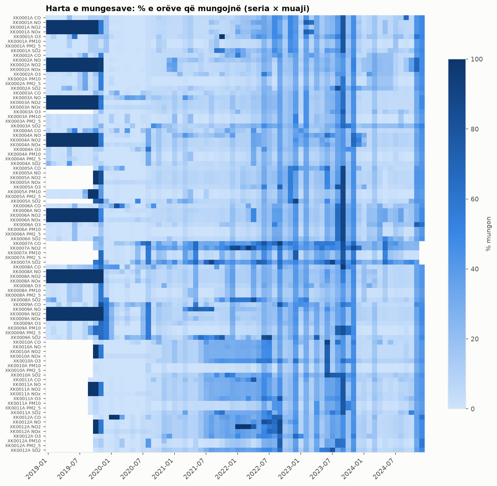
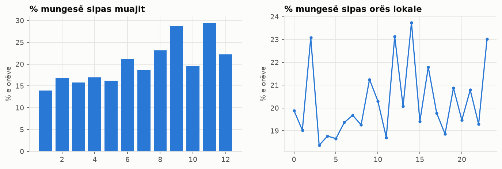
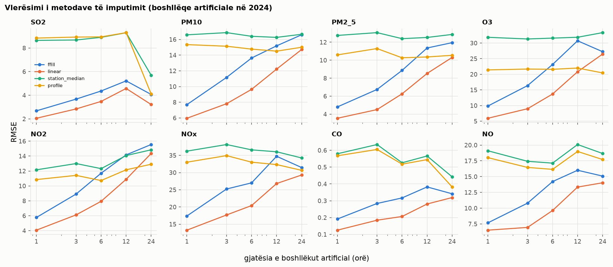
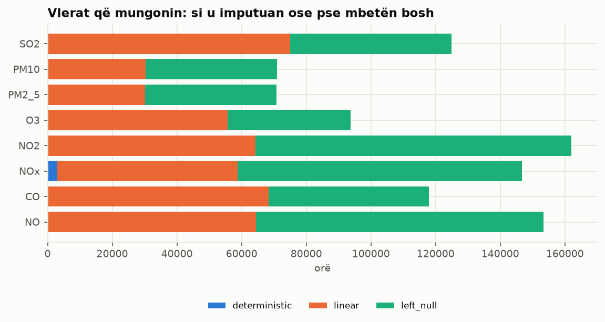

## 4. Vlerat e zbrazëta: identifikimi dhe strategjia e trajtimit

### 4.1 Identifikimi
Krijohet rrjeti i plotë orar: çdo stacion × çdo ndotës × çdo orë mbi periudhën e stacionit (4,823,304 orë).
Kështu bëhen të dukshme orët që **mungojnë fare** (pa rresht), të cilat në të dhënat raw nuk shihen.
Çdo orë merr një `status`:

| pollutant | missing_row | not_measured | null_calibration | null_inconsistent | null_invalid | null_negative | null_spike | null_stuck | ok | outside_period |
|---|---|---|---|---|---|---|---|---|---|---|
| SO2 | 49929 | 0 | 0 | 0 | 73420 | 1081 | 109 | 409 | 470896 | 7069 |
| PM10 | 48154 | 0 | 0 | 75 | 21112 | 0 | 90 | 1509 | 531247 | 726 |
| PM2_5 | 48818 | 0 | 0 | 137 | 21061 | 0 | 37 | 741 | 531393 | 726 |
| O3 | 46886 | 44732 | 0 | 0 | 46595 | 137 | 136 | 0 | 450405 | 14022 |
| NO2 | 49118 | 0 | 50915 | 0 | 61764 | 135 | 0 | 51 | 433861 | 7069 |
| NOx | 41283 | 44732 | 0 | 52954 | 51433 | 514 | 46 | 442 | 404440 | 7069 |
| CO | 51334 | 0 | 0 | 0 | 65881 | 738 | 30 | 19 | 477842 | 7069 |
| NO | 41173 | 44732 | 47897 | 0 | 63695 | 507 | 25 | 0 | 397815 | 7069 |

**Mungesat strukturore** (vlera "nuk duhej të ekzistonte"): `not_measured` (134,196; p.sh.
XK0007A s'mat NO, NOx, O3) dhe `outside_period` (50,819; seria s'kishte nisur ose kishte
mbaruar). Nuk numërohen si mungesë dhe **nuk imputohen kurrë**.
**Mungesat reale:** 940,390 nga 4,638,289 orë të pritura (20.3%), prej tyre
376,695 pa rresht fare dhe pjesa tjetër null me arsye nga p2.

% e mungesës reale sipas stacionit dhe ndotësit:

| station_id | SO2 | PM10 | PM2_5 | O3 | NO2 | NOx | CO | NO |
|---|---|---|---|---|---|---|---|---|
| XK0001A | 17.7 | 10.8 | 10.8 | 19.8 | 28.3 | 30.4 | 15.2 | 30.2 |
| XK0002A | 15.6 | 9.5 | 9.5 | 14.2 | 28.5 | 28.8 | 16.0 | 30.8 |
| XK0003A | 19.6 | 9.9 | 9.9 | 14.0 | 26.3 | 27.0 | 12.2 | 30.4 |
| XK0004A | 12.1 | 9.1 | 9.2 | 13.1 | 29.0 | 29.8 | 16.8 | 32.7 |
| XK0005A | 19.6 | 12.8 | 12.7 | 16.9 | 16.9 | 17.7 | 17.5 | 16.9 |
| XK0006A | 15.4 | 10.2 | 10.2 | 15.5 | 30.2 | 31.0 | 17.2 | 30.7 |
| XK0007A | 43.1 | 18.9 | 18.9 |  | 41.0 |  | 39.4 |  |
| XK0008A | 20.3 | 11.0 | 11.0 | 15.0 | 29.0 | 29.7 | 19.6 | 30.0 |
| XK0009A | 24.6 | 14.7 | 14.7 | 14.7 | 29.8 | 30.9 | 20.9 | 35.8 |
| XK0010A | 23.3 | 8.4 | 8.3 | 23.8 | 18.8 | 19.4 | 20.2 | 19.3 |
| XK0011A | 22.0 | 12.9 | 12.9 | 21.4 | 21.3 | 21.8 | 21.2 | 21.3 |
| XK0012A | 22.0 | 14.3 | 14.2 | 22.9 | 26.0 | 23.2 | 24.9 | 23.9 |

### 4.2 Analiza e mungesave
Gjatësia e boshllëqeve (një boshllëk = orë të njëpasnjëshme pa vlerë):

| gjatesia | boshlleqe | ore | pct_boshlleqe | pct_ore |
|---|---|---|---|---|
| 1 orë | 206042 | 206042 | 79.3 | 21.9 |
| 2–3 orë | 30367 | 71024 | 11.7 | 7.6 |
| 4–24 orë | 19827 | 169511 | 7.6 | 18.0 |
| 1–7 ditë | 3102 | 177789 | 1.2 | 18.9 |
| > 7 ditë | 418 | 316024 | 0.2 | 33.6 |

79.3% e boshllëqeve janë 1 orë, por boshllëqet më të gjata se 1 ditë
(1.4% e boshllëqeve) mbajnë 52.5% të orëve që mungojnë.
Boshllëku më i gjatë për çdo ndotës:

| pollutant | station_id | fillimi | gap_len_h | dite |
|---|---|---|---|---|
| SO2 | XK0009A | 2019-11-13 | 837 | 34.9 |
| PM10 | XK0005A | 2019-08-22 | 1961 | 81.7 |
| PM2_5 | XK0005A | 2019-08-27 | 1842 | 76.8 |
| O3 | XK0001A | 2021-09-27 | 842 | 35.1 |
| NO2 | XK0009A | 2019-01-01 | 8440 | 351.7 |
| NOx | XK0009A | 2019-01-01 | 8440 | 351.7 |
| CO | XK0008A | 2023-09-03 | 948 | 39.5 |
| NO | XK0009A | 2019-01-01 | 8440 | 351.7 |

Te NO, NO2 dhe NOx boshllëqet më të gjata (deri 352 ditë) janë periudha e 2019 para ndërrimit të
analizuesit (D10, D33);
te ndotësit e tjerë boshllëku më i gjatë është
81.7 ditë
(ndërprerje e gjatë e stacionit).

% mungesë sipas vitit: 2019: 37.45%, 2020: 6.37%, 2021: 12.97%, 2022: 26.25%, 2023: 29.25%, 2024: 14.57%.

Korrelacioni i treguesve të mungesës (1 = mungojnë gjithmonë bashkë):

| ndotesi | SO2 | PM10 | PM2_5 | O3 | NO2 | NOx | CO | NO |
|---|---|---|---|---|---|---|---|---|
| SO2 | 1.0 | 0.61 | 0.61 | 0.66 | 0.46 | 0.43 | 0.64 | 0.42 |
| PM10 | 0.61 | 1.0 | 1.0 | 0.67 | 0.52 | 0.51 | 0.63 | 0.49 |
| PM2_5 | 0.61 | 1.0 | 1.0 | 0.66 | 0.52 | 0.51 | 0.63 | 0.5 |
| O3 | 0.66 | 0.67 | 0.66 | 1.0 | 0.5 | 0.49 | 0.68 | 0.48 |
| NO2 | 0.46 | 0.52 | 0.52 | 0.5 | 1.0 | 0.97 | 0.49 | 0.93 |
| NOx | 0.43 | 0.51 | 0.51 | 0.49 | 0.97 | 1.0 | 0.46 | 0.94 |
| CO | 0.64 | 0.63 | 0.63 | 0.68 | 0.49 | 0.46 | 1.0 | 0.45 |
| NO | 0.42 | 0.49 | 0.5 | 0.48 | 0.93 | 0.94 | 0.45 | 1.0 |

Testi chi-square dhe Cramér's V: 

| ndotesi | V_month | p_month | V_year | p_year | V_hour | p_hour |
|---|---|---|---|---|---|---|
| SO2 | 0.133 | 0e+00 | 0.235 | 0e+00 | 0.067 | 0e+00 |
| PM10 | 0.177 | 0e+00 | 0.238 | 0e+00 | 0.018 | 1e-28 |
| PM2_5 | 0.176 | 0e+00 | 0.239 | 0e+00 | 0.018 | 6e-29 |
| O3 | 0.149 | 0e+00 | 0.247 | 0e+00 | 0.049 | 3e-259 |
| NO2 | 0.092 | 0e+00 | 0.508 | 0e+00 | 0.055 | 0e+00 |
| NOx | 0.095 | 0e+00 | 0.539 | 0e+00 | 0.04 | 8e-175 |
| CO | 0.123 | 0e+00 | 0.21 | 0e+00 | 0.069 | 0e+00 |
| NO | 0.092 | 0e+00 | 0.521 | 0e+00 | 0.038 | 6e-154 |

Me ~600k orë për ndotës, chi-square del gjithmonë "domethënës" (p ≈ 0), prandaj vendimi bazohet te **Cramér's V**
(madhësia e efektit: < 0.1 e papërfillshme, 0.1–0.3 e dobët deri mesatare, > 0.3 e fortë).

**Testi i MCAR për boshllëqet 1-orëshe** (206,042 boshllëqe): (a) a varen nga ora e ditës?

| boshlleqe_1h | chi2_ora | p | cramers_v_ora |
|---|---|---|---|
| 206042 | 22472.3 | 0e+00 | 0.069 |

(b) a ndodhin në kushte të veçanta ndotjeje? Vlera e orës para boshllëkut kundrejt mesatares së serisë:

| pollutant | mesatarja_seria | mesatarja_ora_para_boshllekut | diferenca_ne_std |
|---|---|---|---|
| SO2 | 9.99 | 8.19 | -0.177 |
| PM10 | 23.42 | 19.92 | -0.142 |
| PM2_5 | 16.9 | 13.36 | -0.181 |
| O3 | 45.96 | 43.73 | -0.073 |
| NO2 | 15.04 | 13.54 | -0.105 |
| NOx | 29.53 | 27.32 | -0.056 |
| CO | 0.76 | 0.71 | -0.065 |
| NO | 9.3 | 8.69 | -0.03 |

**Mekanizmi (MCAR / MAR / MNAR), sipas evidencës (D18):**
- **MAR (mekanizmi kryesor).** Mungesa varet nga **viti**: V = 0.21–0.25 për SO2, PM, O3, CO
  (mungesa vjetore nga 6.44% në 2020 deri 28.95% në 2023: vite me ndërprerje të gjata), dhe
  V = 0.51–0.54 për NO, NO2, NOx (periudha 2019 para ndërrimit të analizuesit, D10/D33). Nga **muaji**
  varet dobët (V = 0.09–0.18), nga **ora** pothuajse aspak (V = 0.02–0.07). Ndotësit e të
  njëjtit stacion mungojnë bashkë (korrelacion 0.42–1.00): ndalime të gjithë stacionit (rryma, komunikimi,
  mirëmbajtja). Mungesa varet nga koha dhe stacioni, që janë të njohura → imputimi që përdor kohën (interpolimi,
  profili) është i përshtatshëm.
- **Boshllëqet 1-orëshe: afërsisht MCAR, jo plotësisht.** Ora e ditës s'ka rëndësi praktike
  (V = 0.069), por ora para boshllëkut ka ndotje pak më të ulët se mesatarja
  (0.03–0.18 std më e ulët): ndodhin pak më shpesh në kushte me ndotje të ulët. Efekti është i vogël dhe,
  për një orë të vetme, interpolimi mes dy fqinjëve të matur e kompenson.
- **MNAR:** shënimi Validity 2 ("nën pragun e detektimit") varet nga vetë vlera (vetëm vlerat shumë të vogla e marrin).
  Nëse këto vlera do të hiqeshin, mungesa do të ishte MNAR dhe mesatarja do të anohej lart; prandaj **u mbajtën** te p2.

### 4.3 Vlerësimi i metodave (evidenca për strategjinë)
Mbi segmente të plota të vitit 2024 fshihen artificialisht boshllëqe [1, 3, 6, 12, 24] orë
(200 për seri, seed 42); vlera e vërtetë dihet, ndaj gabimi matet. Profili dhe mediana
mësohen vetëm nga 2019–2023 (pa periudhën e dyshimtë të CO/SO2 para ndërrimit të analizuesve, D35), që vlerësimi
që bëhet në 2024 të jetë i ndershëm.

Metoda më e mirë për boshllëqet ≤ 3h: 

| pollutant | 1 | 3 |
|---|---|---|
| SO2 | linear | linear |
| PM10 | linear | linear |
| PM2_5 | linear | linear |
| O3 | linear | linear |
| NO2 | linear | linear |
| NOx | linear | linear |
| CO | linear | linear |
| NO | linear | linear |

Metoda e zgjedhur për boshllëqet 4–24h (RMSE mesatare më e ulët për 6, 12 dhe 24 orë):

| pollutant | method | RMSE |
|---|---|---|
| SO2 | linear | 3.758 |
| PM10 | linear | 12.194 |
| PM2_5 | linear | 8.366 |
| O3 | linear | 20.325 |
| NO2 | linear | 11.058 |
| NOx | linear | 25.508 |
| CO | linear | 0.269 |
| NO | linear | 12.333 |

Ku e kalon profili linearin (RMSE, ndryshimi në %):

| pollutant | L | linear | profile | profili_vs_linear_pct |
|---|---|---|---|---|
| O3 | 24 | 26.469 | 20.444 | -22.8 |
| NO2 | 24 | 14.35 | 12.906 | -10.1 |

Profili e kalon linearin vetëm në 24h dhe vetëm për
O3, NO2, sepse e ruan ciklin ditor. Strategjia mbetet linear për 4–24h (D16):
një prag i veçantë mbi një pikë të vetme vlerësimi do të ishte përshtatje e tepërt.

**Kontrolli i qëndrueshmërisë:** segmentet e plota zgjidhen kryesisht në periudha të qeta, ndërsa boshllëqet reale
ndodhin pranë prishjeve. Prandaj gabimi ndahet sipas kontekstit (RMSE, të gjithë ndotësit bashkë):

| konteksti | L | ffill | linear | profile | station_median |
|---|---|---|---|---|---|
| periudhë e qetë | 1 | 6.199 | 4.722 | 12.791 | 14.361 |
| periudhë e qetë | 3 | 10.224 | 6.748 | 13.846 | 15.77 |
| periudhë e qetë | 6 | 11.421 | 7.947 | 12.486 | 14.457 |
| periudhë e qetë | 12 | 13.23 | 10.437 | 12.595 | 14.449 |
| periudhë e qetë | 24 | 13.403 | 11.925 | 12.354 | 14.311 |
| pranë boshllëkut real (±24h) | 1 | 8.888 | 6.605 | 18.116 | 21.445 |
| pranë boshllëkut real (±24h) | 3 | 13.022 | 8.685 | 18.398 | 21.52 |
| pranë boshllëkut real (±24h) | 6 | 16.067 | 11.114 | 17.922 | 21.298 |
| pranë boshllëkut real (±24h) | 12 | 21.072 | 15.732 | 18.868 | 22.451 |
| pranë boshllëkut real (±24h) | 24 | 22.567 | 21.011 | 21.786 | 24.678 |

Pranë boshllëqeve reale gabimi i interpolimit linear është 1.3–1.8 herë më i madh
(vlerësimi në periudha të qeta është optimist), por **renditja e metodave s'ndryshon**: interpolimi linear mbetet më i miri në çdo gjatësi dhe në të dy kontekstet. Strategjia është e qëndrueshme (D30).

**Validimi i metodës deterministike** (orët ku NOx, NO2 dhe NO janë të matur): 

| ore | MAE | RMSE | mesatarja_NOx |
|---|---|---|---|
| 392190 | 0.071 | 0.39 | 30.192 |

Gabimi mesatar (0.07 µg/m³) është i papërfillshëm krahasuar me mesataren e NOx
(30.2 µg/m³), pra NOx = NO2 + 1.53·NO është e besueshme kur NO dhe NO2 janë të sakta.

### 4.4 Strategjia dhe imputimi
Rendi (vetëm mungesat reale; strukturoret kurrë):
1. **Deterministik:** NOx = NO2 + 1.53·NO në të njëjtën orë, kur NO2 dhe NO janë të matura dhe të vlefshme
   (relacion fizik, jo parashikim në kohë, ndaj vlen edhe në skaj të serisë, D15). Për periudhën para nëntorit 2019
   s'aplikohet, sepse aty NO dhe NO2 janë null (ndërrimi i analizuesit, D33).
2. **Boshllëk ≤ 3h brenda serisë:** interpolim linear (metoda më e mirë në vlerësim
   për të gjithë: 16/16 kombinime ndotës × gjatësi).
3. **Boshllëk 4–24h brenda serisë:** metoda fituese për ndotësin (tabela më sipër).
4. **Boshllëk > 24h ose në skaj të serisë:** mbetet null. Imputimi i ditëve të tëra do të shpikte të
   dhëna dhe do ta ulte variancën artificialisht.

| pollutant | deterministic | left_null | linear | none |
|---|---|---|---|---|
| SO2 | 0 | 49990 | 74958 | 477965 |
| PM10 | 0 | 40695 | 30245 | 531973 |
| PM2_5 | 0 | 40702 | 30092 | 532119 |
| O3 | 0 | 38165 | 55589 | 509159 |
| NO2 | 0 | 97753 | 64230 | 440930 |
| NOx | 3074 | 87999 | 55599 | 456241 |
| CO | 0 | 49609 | 68393 | 484911 |
| NO | 0 | 88886 | 64411 | 449616 |

Pse mbeten null: 

| arsyeja | len |
|---|---|
| boshllëk > 24h | 316977 |
| periudha 2019 para ndërrimit të analizuesit (D10, D33) | 149333 |
| në skaj të serisë (pa vlerë në njërën anë) | 27489 |

### 4.5 Kontrollet
0 vlera të imputuara negative ose mbi kufirin fizik; 0 mungesa strukturore të imputuara. Shpërndarja para/pas:

| ndotesi | n_para | n_pas | mesatarja_para | mesatarja_pas | std_para | std_pas | ndryshimi_std_pct | KS |
|---|---|---|---|---|---|---|---|---|
| SO2 | 470896 | 545854 | 9.99 | 9.604 | 10.2 | 10.001 | -1.955 | 0.022 |
| PM10 | 531247 | 561492 | 23.423 | 23.209 | 24.752 | 24.464 | -1.165 | 0.004 |
| PM2_5 | 531393 | 561485 | 16.904 | 16.733 | 19.576 | 19.315 | -1.329 | 0.004 |
| O3 | 450405 | 505994 | 45.96 | 45.642 | 30.443 | 30.395 | -0.155 | 0.004 |
| NO2 | 433861 | 498091 | 15.042 | 14.682 | 14.279 | 14.046 | -1.631 | 0.012 |
| NOx | 404440 | 463113 | 29.534 | 29.315 | 39.742 | 39.554 | -0.473 | 0.004 |
| CO | 477842 | 546235 | 0.759 | 0.747 | 0.824 | 0.821 | -0.422 | 0.013 |
| NO | 397815 | 462226 | 9.301 | 9.08 | 20.487 | 19.992 | -2.418 | 0.012 |

Ndryshimi më i madh i std-së është 2.4% dhe statistika KS më e madhe
0.022: imputimi s'e shtrembëron shpërndarjen.
**Rreshta të plotë** në format të gjerë (stacion × orë ku çdo ndotës që stacioni mat ka vlerë): 56.4%
→ 77.0%. Përkufizimi këtu përfshin edhe orët pa rresht në rrjetin e plotë orar, prandaj ndryshon nga
64.2% i analizës eksploruese.
Koha e p3: 35.9 s. Output: `data/gold/hourly_long/`.
