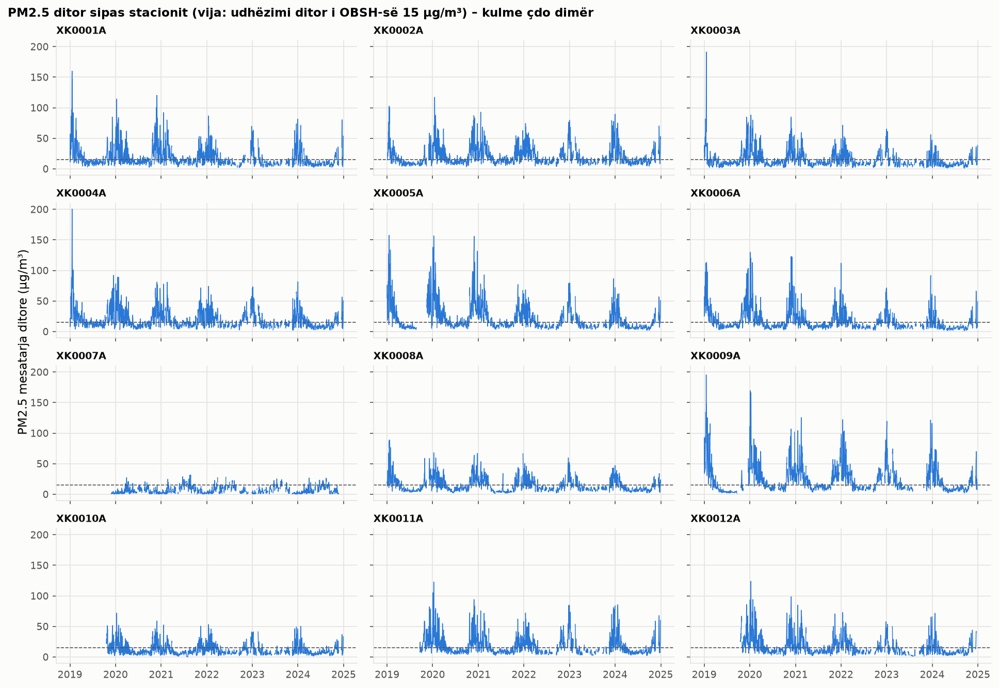

## 5. Agregimi dhe mostrimi

### 5.1 Agregimi
**Ditor** (sipas datës lokale, sepse dita e njerëzve dhe e trafikut ndjek orën lokale): mesatarja, maksimumi dhe numri
i orëve të vlefshme. **Rregulli i plotësisë (D19):** mesatarja ditore llogaritet vetëm kur ka ≥ 18
orë të vlefshme (75%); përndryshe null, sepse një "mesatare" nga pak orë (p.sh. vetëm natën) do të ishte e anuar.
**Mujor:** mesatarja e ditëve të vlefshme, vetëm kur ≥ 75% e ditëve janë të vlefshme.
**Vjetor:** mesatarja dhe mbulimi (orë të vlefshme / orë të vitit).

Agregimi bëhet dy herë: nga **matjet** (zyrtare) dhe nga vlerat **me imputim**. Ditët e vlefshme të fituara falë imputimit:

| pollutant | matje | me_imputim | dite_te_fituara | pct |
|---|---|---|---|---|
| SO2 | 18535 | 22449 | 3914 | 21.1 |
| PM10 | 21556 | 23175 | 1619 | 7.5 |
| PM2_5 | 21562 | 23176 | 1614 | 7.5 |
| O3 | 17955 | 20861 | 2906 | 16.2 |
| NO2 | 17349 | 20535 | 3186 | 18.4 |
| NOx | 16327 | 19121 | 2794 | 17.1 |
| CO | 18737 | 22487 | 3750 | 20.0 |
| NO | 15783 | 19075 | 3292 | 20.9 |

Zvogëlimi i madhësisë:

| niveli | rreshta | zvogelimi_x |
|---|---|---|
| orar | 4638289 | 1.0 |
| ditor | 193292 | 24.0 |
| mujor | 6373 | 728.0 |
| vjetor | 558 | 8312.0 |

**Mbulimi vjetor:** 402 nga 558 stacion-ndotës-vite janë nën 90%
(D26): për to `mean_official` = null dhe ruhet vetëm `mean` si informative, sepse një mesatare vjetore me më pak se
90% të orëve s'e përfaqëson vitin (p.sh. mungon gjithë një sezon). Tabela e plotë: `tables/p4_mbulimi_vjetor.csv`.

| station_id | pollutant | 2019 | 2020 | 2021 | 2022 | 2023 | 2024 |
|---|---|---|---|---|---|---|---|
| XK0001A | SO2 | 0.958 | 0.973 | 0.797 | 0.683 | 0.689 | 0.833 |
| XK0001A | PM10 | 0.956 | 0.983 | 0.955 | 0.808 | 0.756 | 0.892 |
| XK0001A | PM2_5 | 0.957 | 0.983 | 0.955 | 0.808 | 0.757 | 0.892 |
| XK0001A | O3 | 0.875 | 0.967 | 0.845 | 0.671 | 0.652 | 0.801 |
| XK0001A | NO2 | 0.107 | 0.981 | 0.942 | 0.708 | 0.716 | 0.847 |
| XK0001A | NOx | 0.107 | 0.977 | 0.927 | 0.678 | 0.641 | 0.844 |
| XK0001A | CO | 0.941 | 0.977 | 0.94 | 0.712 | 0.71 | 0.805 |
| XK0001A | NO | 0.107 | 0.978 | 0.921 | 0.697 | 0.635 | 0.846 |
| XK0002A | SO2 | 0.854 | 0.98 | 0.932 | 0.834 | 0.655 | 0.799 |
| XK0002A | PM10 | 0.902 | 0.994 | 0.994 | 0.883 | 0.796 | 0.85 |
| XK0002A | PM2_5 | 0.902 | 0.994 | 0.994 | 0.883 | 0.796 | 0.85 |
| XK0002A | O3 | 0.886 | 0.983 | 0.9 | 0.802 | 0.769 | 0.799 |

*… 81 rreshta të tjerë te CSV.*

**Sezoni i ngrohjes (tetor–prill) kundrejt pjesës tjetër** (mesatarja e ditëve të vlefshme):

| pollutant | sezoni_ngrohjes | pjesa_tjeter | raporti | mediana_stacioneve |
|---|---|---|---|---|
| SO2 | 10.145 | 10.57 | 0.96 | 0.945 |
| PM10 | 29.34 | 15.16 | 1.94 | 1.885 |
| PM2_5 | 22.569 | 8.886 | 2.54 | 2.565 |
| O3 | 38.44 | 58.71 | 0.65 | 0.64 |
| NO2 | 17.786 | 11.788 | 1.51 | 1.525 |
| NOx | 36.691 | 19.413 | 1.89 | 1.94 |
| CO | 0.924 | 0.531 | 1.74 | 1.715 |
| NO | 12.425 | 4.881 | 2.55 | 2.58 |

Grimcat (PM2.5, PM10), CO dhe NO janë shumë më të larta në sezonin e ngrohjes (djegia e druve, qymyrit dhe inversioni
termik në dimër); O3 është më i lartë jashtë tij (formohet nga drita e diellit). SO2 është pothuajse i njëjtë
gjatë gjithë vitit, sepse burimi i tij kryesor është industria dhe termocentralet, jo ngrohja e shtëpive.
Mediana e raportit të llogaritur brenda çdo stacioni (`mediana_stacioneve`) përputhet me raportin e përbashkët, pra
përfundimi s'vjen nga përbërja e ndryshme e stacioneve mes sezoneve (`tables/p4_sezoni_ngrohjes_stacionet.csv`).

**Përjashtim i vërtetë, jo gabim:** te XK0007A grimcat janë **më të ulëta** në sezonin e
ngrohjes (raporti PM10 0.39, PM2_5 0.41). XK0007A (Brezovica) është stacion
sfondi rural-remote në 1,803 m: në dimër ndodhet mbi shtresën e inversionit termik që e mban ndotjen nga ngrohja poshtë
në lugina, dhe toka është e mbuluar me borë; në verë arrin ndotja rajonale dhe pluhuri. Modeli përsëritet çdo vit, ndaj
vlerat mbahen të pandryshuara (D34).

### 5.2 Mostrimi
Popullata: 602,913 stacion-orë (formati i gjerë, pas imputimit). Krahasohen dy metoda me
10%: **e rastësishme e thjeshtë** dhe **e stratifikuar** sipas stacion × sezon
(e njëjta përqindje nga çdo shtresë).

Shpërndarja e mostrës kundrejt popullatës (testi Kolmogorov–Smirnov: KS i vogël dhe p i madh = e njëjta shpërndarje):

| metoda | ndotesi | mesatarja_pop | mesatarja_mostra | std_pop | std_mostra | p95_pop | p95_mostra | KS | KS_p |
|---|---|---|---|---|---|---|---|---|---|
| rastësor | PM2_5 | 16.733 | 16.74 | 19.315 | 19.199 | 53.896 | 54.094 | 0.003 | 0.89 |
| rastësor | PM10 | 23.209 | 23.155 | 24.464 | 24.162 | 69.584 | 69.539 | 0.003 | 0.895 |
| rastësor | NO2 | 14.682 | 14.676 | 14.046 | 13.972 | 42.665 | 42.475 | 0.002 | 0.979 |
| rastësor | O3 | 45.642 | 45.746 | 30.395 | 30.451 | 99.76 | 100.348 | 0.003 | 0.788 |
| i_stratifikuar | PM2_5 | 16.733 | 16.743 | 19.315 | 19.399 | 53.896 | 53.646 | 0.002 | 0.936 |
| i_stratifikuar | PM10 | 23.209 | 23.215 | 24.464 | 24.622 | 69.584 | 69.049 | 0.003 | 0.606 |
| i_stratifikuar | NO2 | 14.682 | 14.658 | 14.046 | 14.056 | 42.665 | 42.791 | 0.002 | 0.95 |
| i_stratifikuar | O3 | 45.642 | 45.554 | 30.395 | 30.409 | 99.76 | 100.046 | 0.004 | 0.545 |

Përfaqësimi i shtresave (devijimi maksimal i përqindjes së një stacioni/sezoni nga popullata, në pikë përqindjeje):

| metoda | n | devijimi_max_stacion_pp | devijimi_max_sezon_pp |
|---|---|---|---|
| rastësor | 60291 | 0.154 | 0.328 |
| i_stratifikuar | 60291 | 0.002 | 0.004 |

**Vendimi (D20):** ruhet mostra **e stratifikuar** (`data/gold/sample_10pct.parquet`). Të dyja metodat i ruajnë
shpërndarjet (KS p më i vogël: 0.54 > 0.05), por mostra e stratifikuar i garanton saktë proporcionet e stacioneve dhe sezoneve
(devijim ≈ 0), ndërsa e rastësishmja mund t'i shmanget rastësisht. Kjo ka rëndësi sepse ndotja ndryshon shumë sipas
stacionit dhe sezonit. Koha e p4: 7.8 s.
