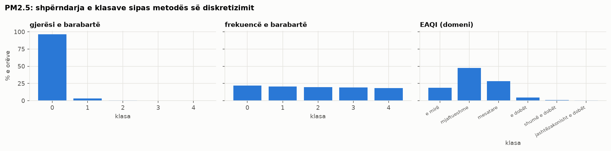
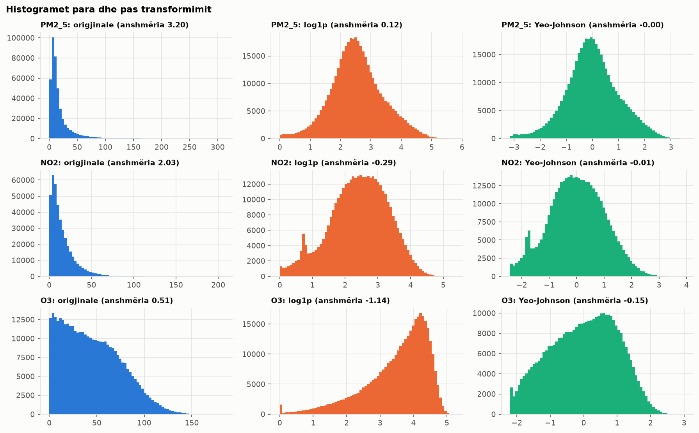
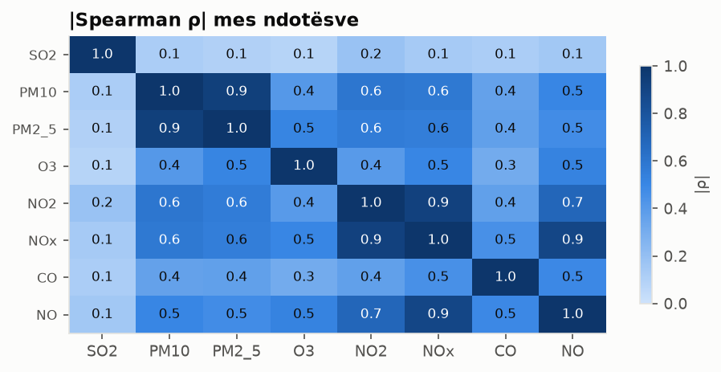

## 6. Zgjedhja dhe krijimi i vetive, diskretizimi, binarizimi, transformimi, reduktimi

### 6.1 Formati i gjerë
Nga tabela e gjatë (p3) ndërtohet tabela e gjerë: një rresht = stacion × orë (602,913 rreshta), një kolonë për çdo
ndotës (vlera pas imputimit) dhe `
_obs` (vlera e matur, që vetitë e vonuara të mos përdorin vlera të imputuara).

### 6.2 Zgjedhja e nënbashkësisë së vetive
**Kolonat e burimit që hiqen** (evidenca te p1, "kolonat pa informacion"):

| kolona | arsyeja |
|---|---|
| DataCapture | 100% bosh |
| AggType | konstante (gjithmonë 'hour'), variancë zero |
| Verification | konstante (gjithmonë 1), variancë zero |
| End | e tepërt: End = Start + 1h (0 përjashtime) |
| ResultTime | administrative: koha e publikimit, s'lidhet me ndotjen |
| FkObservationLog | identifikues administrativ |
| Unit | e tepërt pas harmonizimit (të gjitha në njësi kanonike) |
| Samplingpoint | e zbërthyer në station_id dhe pollutant |
| Validity | e përthithur te clean_action/status (p2–p3) |

**Filtrat mbi vetitë numerike**, me objektiv PM2.5 **e matur** e orës pasardhëse (2019–2023, deri në
30,000 rreshta për veti):
- *filtri i variancës:* hiqet çdo veti me variancë 0 (konstante);
- *mutual information:* sa informacion jep vetia për objektivin, edhe për lidhje jolineare;
- *korrelacioni Spearman* me objektivin.

Dy masa kundër rezultateve të rreme (D27): (1) ndotësit e orës aktuale merren nga vlerat **e matura** (`
_obs`),
sepse interpolimi linear i p3 e përdor vlerën e orës pasardhëse, pra një vlerë e imputuar do ta "shihte" objektivin;
(2) çdo veti vlerësohet mbi rreshtat ku ajo dhe objektivi kanë vlerë, që XK0007A (pa NO, NOx, O3) të mos përjashtohet.

| veti | kalon_variancen | mutual_information | spearman_me_targetin |
|---|---|---|---|
| PM2_5_obs | True | 1.27 | 0.941 |
| PM10_obs | True | 0.888 | 0.875 |
| PM2_5_lag_1h | True | 0.875 | 0.881 |
| PM10_lag_1h | True | 0.674 | 0.823 |
| PM2_5_roll_mean_24h | True | 0.508 | 0.762 |
| PM10_roll_mean_24h | True | 0.414 | 0.719 |
| PM2_5_lag_24h | True | 0.331 | 0.654 |
| PM10_lag_24h | True | 0.261 | 0.59 |
| pm_coarse | True | 0.254 | 0.47 |
| NO2_obs | True | 0.217 | 0.541 |
| NOx_obs | True | 0.21 | 0.519 |
| month | True | 0.184 | -0.072 |
| NO2_lag_1h | True | 0.179 | 0.5 |
| NO2_roll_mean_24h | True | 0.171 | 0.474 |
| O3_obs | True | 0.158 | -0.488 |
| month_cos | True | 0.152 | 0.4 |
| NO_obs | True | 0.146 | 0.439 |
| is_heating_season | True | 0.137 | 0.388 |
| CO_obs | True | 0.123 | 0.349 |
| NO2_lag_24h | True | 0.101 | 0.384 |

*… 9 rreshta të tjerë te CSV.*

Më informative janë PM2.5 e matur e orës aktuale dhe e orës paraprake, PM10, dhe mesataret e 24h të kaluara
(persistenca e ndotjes); pastaj `pm_coarse`, NOx/NO2 dhe muaji (sezonaliteti). Dita e javës dhe fundjava s'japin
pothuajse asnjë informacion për orën pasardhëse (MI ≈ 0). Vetitë me variancë 0: asnjë.
**Filtri i korrelacionit** (|ρ| > 0.9, mbi vlerat e matura) gjen çiftet e tepërta:

| a | b | spearman |
|---|---|---|
| PM10 | PM2_5 | 0.929 |
| NO2 | NOx | 0.922 |

Vendimi për to merret te reduktimi i dimensionit (6.7).

### 6.3 Krijimi i vetive

| veti | formula | arsyeja |
|---|---|---|
| hour, dow, month, year | nga ora lokale | ndotja ndjek ritmin ditor (trafiku), javor dhe sezonal |
| is_weekend | dita e javës ≥ 6 | më pak trafik në fundjavë |
| season, is_heating_season | muaji → stina; tetor–prill | ngrohja me dru/qymyr: PM2.5 2.5× më i lartë |
| hour_sin, hour_cos, month_sin, month_cos | sin/cos(2π·x/periudha) | ora 23 dhe 0 janë fqinje; numri 23 vs 0 s'e tregon këtë |
| 
_is_imputed | vlera e orës u imputua te p3 | transparenca: modelet mund t'i trajtojnë ndryshe |
| gas_period_2019 | ora bie para ndërrimit të analizuesve të gazeve (nëntor 2019) | CO/SO2 të dyshimta (D33): analizat mund ta përjashtojnë këtë periudhë |
| pm25_pm10_ratio | PM2.5 / PM10 të matura (kur PM10 > 0, PM2.5 ≤ PM10) | lart = djegie (grimca të imta); poshtë = pluhur |
| pm_coarse | PM10 − PM2.5 të matura | grimcat e trasha (pluhur, rrugë); më pak e koreluar me PM2.5 se PM10 |
| 
_lag_1h, 
_lag_24h | vlera e matur 1h / 24h më parë, brenda stacionit | ndotja ka persistencë |
| 
_roll_mean_24h | mesatarja e 24h të kaluara (pa orën aktuale) | niveli i fundit i ndotjes |
| station_type, altitude_m | nga metadata (p2) | lloji i burimit (trafik/industri/sfond) dhe lartësia |

Vetitë e vonuara llogariten brenda të njëjtit stacion, mbi rrjetin e plotë orar (shift 1 = saktë 1 orë më parë),
nga vlerat e matura dhe pa orën aktuale (`closed="left"`): asnjë veti s'përdor të ardhmen (D21).

### 6.4 Diskretizimi i PM2.5
Kufijtë e gjerësisë dhe të frekuencës së barabartë mësohen nga 2019–2023; EAQI përdor pragjet zyrtare të EEA
(https://airindex.eea.europa.eu/AQI/index.html, revizioni 2024).

| metoda | kufijte |
|---|---|
| gjeresi_e_barabarte | 64.19, 128.39, 192.58, 256.78 |
| frekuence_e_barabarte | 5.54, 9.12, 13.79, 24.09 |
| eaqi | 5.0, 15.0, 50.0, 90.0, 140.0 |

- **Gjerësi e barabartë:** shpërndarja shumë e anuar fut pothuajse gjithçka në klasën e parë; e papërdorshme.
- **Frekuencë e barabartë:** klasa të balancuara (rreth 20% secila), por kufijtë s'kanë kuptim shëndetësor.
- **EAQI:** klasa të pabalancuara, por **të interpretueshme** dhe të krahasueshme me Evropën → zgjidhet për analizë (D22).

| pm25_bin_eaqi | count | klasa | pct |
|---|---|---|---|
| 0 | 104537 | e mirë | 18.6 |
| 1 | 265719 | mjaftueshme | 47.3 |
| 2 | 158589 | mesatare | 28.2 |
| 3 | 25096 | e dobët | 4.5 |
| 4 | 6162 | shumë e dobët | 1.1 |
| 5 | 1382 | jashtëzakonisht e dobët | 0.2 |

### 6.5 Binarizimi dhe kodimi
- `pm10_exceed_eu` = 1 kur mesatarja ditore e PM10 > 50 µg/m³ (kufiri ditor i BE-së);
  `pm25_exceed_who` = 1 kur PM2.5 ditor > 15 µg/m³ (udhëzimi i OBSH-së 2021).
  Llogariten nga mesataret ditore **të matura** dhe vetëm për ditët e vlefshme (≥ 18 orë, p4), sepse numri i
  tejkalimeve krahasohet me kufijtë ligjorë, të cilët vlerësohen mbi matje, jo mbi vlera të imputuara (D28).

| station_id | year | dite_PM10_>50 | dite_PM2.5_>15 |
|---|---|---|---|
| XK0001A | 2019 | 51 | 146 |
| XK0001A | 2020 | 59 | 178 |
| XK0001A | 2021 | 35 | 167 |
| XK0001A | 2022 | 25 | 105 |
| XK0001A | 2023 | 20 | 65 |
| XK0001A | 2024 | 11 | 65 |
| XK0002A | 2019 | 28 | 110 |
| XK0002A | 2020 | 77 | 195 |
| XK0002A | 2021 | 63 | 200 |
| XK0002A | 2022 | 56 | 173 |
| XK0002A | 2023 | 31 | 132 |
| XK0002A | 2024 | 28 | 148 |

*… 60 rreshta të tjerë te CSV.*

- **One-hot** për stacionin, sezonin dhe llojin e stacionit (19 kolona 0/1): kategoritë nominale s'kanë
  renditje, ndaj s'mund të kodohen si 1, 2, 3.

### 6.6 Transformimi
Ndotësit janë të anuar djathtas (shumë orë me pak ndotje, pak orë me shumë): anshmëria > 1 te SO2, PM10, PM2_5, NO2, NOx, CO, NO;
O3 është afërsisht simetrik (0.51).

| ndotesi | anshmeria_origjinale | anshmeria_log1p | anshmeria_yeo_johnson | kurtoza_origjinale | kurtoza_yeo_johnson |
|---|---|---|---|---|---|
| SO2 | 3.834 | -0.106 | -0.001 | 32.155 | -0.09 |
| PM10 | 3.038 | -0.198 | 0.007 | 14.135 | 0.365 |
| PM2_5 | 3.2 | 0.121 | -0.003 | 15.067 | 0.229 |
| O3 | 0.514 | -1.143 | -0.15 | -0.461 | -0.794 |
| NO2 | 2.029 | -0.285 | -0.014 | 6.231 | -0.37 |
| NOx | 5.893 | 0.138 | 0.004 | 75.791 | -0.218 |
| CO | 2.827 | 1.185 | 0.158 | 11.817 | -0.884 |
| NO | 9.635 | 0.75 | 0.119 | 187.112 | -0.943 |

- **log1p** e ul anshmërinë shumë, por e prish O3-in (që ishte pothuajse simetrik → anshmëri negative).
- **Yeo-Johnson** e çon anshmërinë afër 0 për të gjithë ndotësit dhe pranon zero → zgjidhet (D23). Box-Cox s'përdoret
  sepse kërkon vlera > 0, ndërsa zerot janë reale.
- **Shkallëzimi:** `StandardScaler` (mesatarja 0, std 1) për vlera afërsisht normale, si pas Yeo-Johnson;
  `RobustScaler` (mediana dhe IQR) kur mbeten outliers, sepse s'ndikohet prej tyre. Këtu përdoret standardizimi pas
  Yeo-Johnson; RobustScaler është alternativa nëse vlerat ekstreme mbahen pa transformim.

### 6.7 Reduktimi i dimensionit

**NOx hiqet (D24):** NOx = NO + NO2 kimikisht; mbi matjet, NO2 + 1.53·NO shpjegon NOx me R² = 0.9999: pas nëntorit 2019 NOx **llogaritet** nga NO dhe NO2 nga vetë rrjeti.
Është i tepërt dhe do ta dyfishonte peshën e NO/NO2 në PCA. PM10 dhe PM2.5 (ρ = 0.929)
mbahen të dyja, sepse `pm_coarse` = PM10 − PM2.5 tregon që PM10 mbart edhe informacion tjetër (pluhurin).

**PCA** mbi 7 ndotës (Yeo-Johnson + standardizim, mësuar nga 342,175 orë të plota të 2019–2023; vlerat pas
imputimit, që të mos humbasin orët me një boshllëk të vetëm). Transformuesi dhe PCA s'mësojnë nga periudha e 2019 para
ndërrimit të analizuesve (`gas_period_2019`), ku CO dhe SO2 janë të dyshimta (D35). PCA kërkon rreshta të plotë, ndaj **XK0007A s'përfshihet**
(s'mat NO dhe O3). Kontrolli me 5 ndotësit që i masin të 12 stacionet (D29):

| varianti | stacione | ore_train | PC1 | PC2 | komponente_per_90pct |
|---|---|---|---|---|---|
| 7 ndotës (pa NOx) | 11 | 342175 | 0.516 | 0.139 | 5 |
| 5 ndotës të përbashkët (SO2, PM10, PM2.5, NO2, CO) | 12 | 374215 | 0.547 | 0.19 | 4 |

Struktura mbetet e njëjtë: PC1 (ndotja nga djegia) shpjegon 52% me 11 stacione dhe
55% me 12; me më pak ndotës mjaftojnë më pak komponentë për 90%. Përfshirja e XK0007A s'e ndryshon
interpretimin.

| komponenti | varianca | kumulative |
|---|---|---|
| PC1 | 0.516 | 0.516 |
| PC2 | 0.139 | 0.656 |
| PC3 | 0.115 | 0.771 |
| PC4 | 0.096 | 0.866 |
| PC5 | 0.09 | 0.956 |
| PC6 | 0.036 | 0.993 |
| PC7 | 0.007 | 1.0 |

Ngarkesat:

| ndotesi | PC1 | PC2 | PC3 |
|---|---|---|---|
| SO2 | 0.105 | 0.981 | 0.151 |
| PM10 | 0.448 | -0.109 | 0.531 |
| PM2_5 | 0.455 | -0.135 | 0.492 |
| O3 | -0.352 | 0.025 | 0.282 |
| NO2 | 0.402 | -0.042 | -0.132 |
| CO | 0.344 | 0.071 | -0.392 |
| NO | 0.422 | 0.02 | -0.449 |

**Interpretimi:**
- **PC1 (52%)** = ndotja e përgjithshme nga djegia: PM2.5, PM10, NO, NO2 dhe CO me ngarkesa pozitive, O3 me
  shenjë të kundërt (O3 bie aty ku NO e konsumon). Mesatarja e PC1 në sezonin e ngrohjes është
  0.47, jashtë tij -0.94: dimri = më shumë ndotje nga djegia.
- **PC2 (14%)** dominohet nga SO2: burim më vete (industria/termocentralet), pa sezonalitet (p4).
- **5 komponentë** mjaftojnë për 90% të variancës, nga 7 ndotës.

Output: `data/gold/features_hourly.parquet` (602,913 rreshta × 76 kolona). Koha e p5: 120.3 s.
